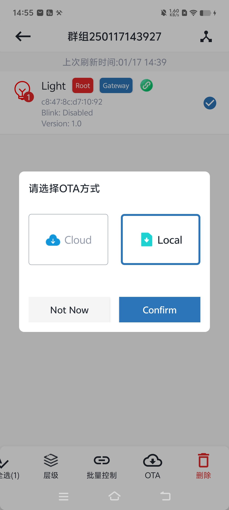
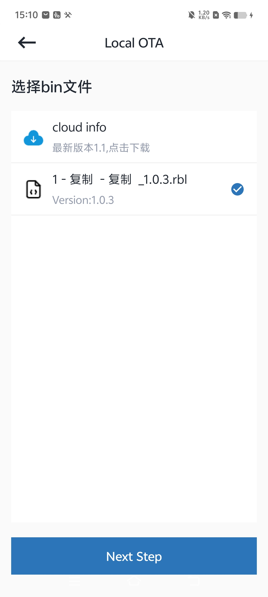
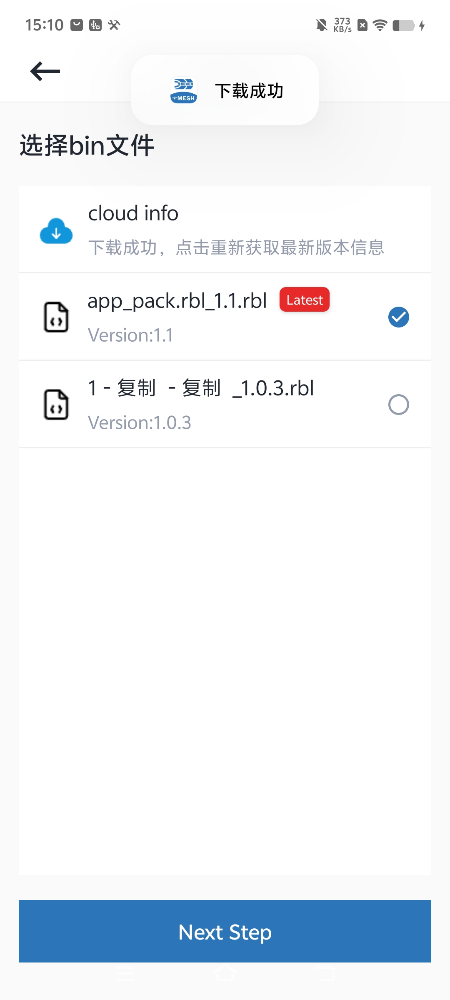
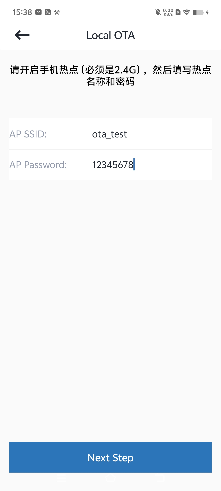
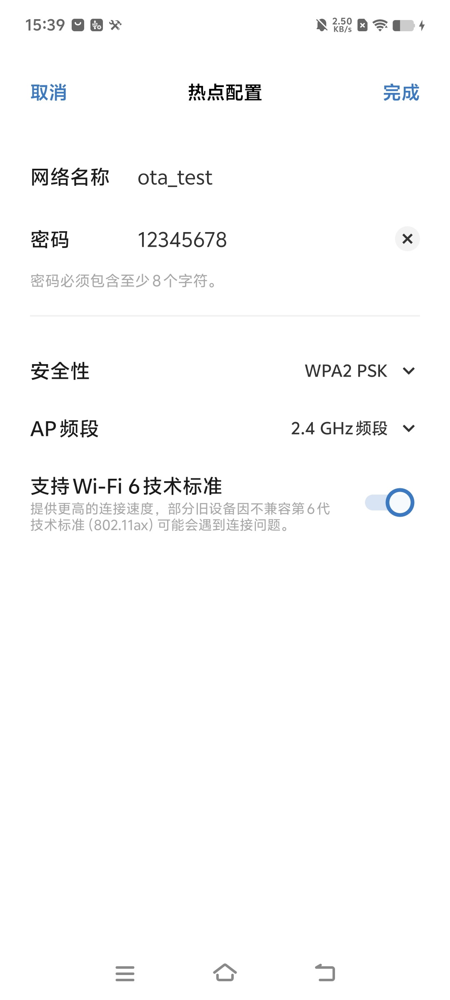
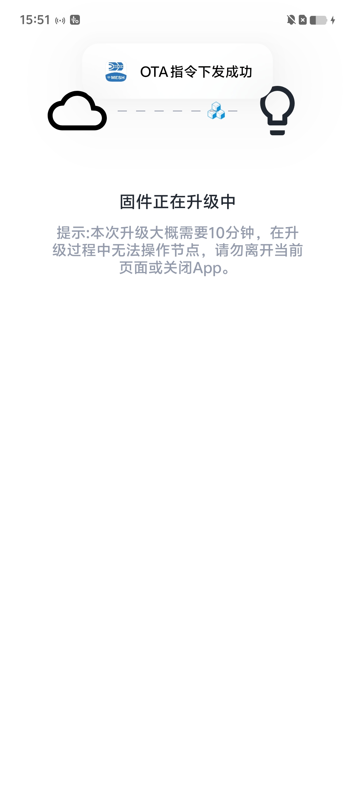
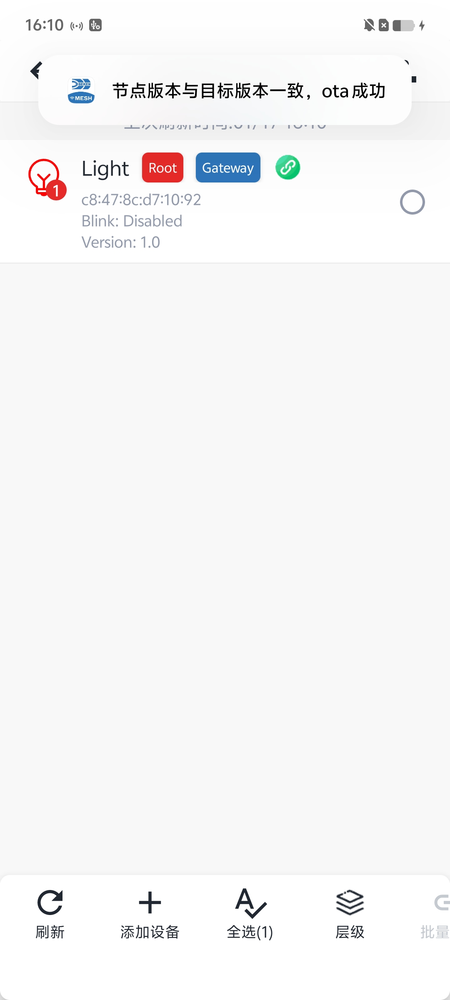

# 7.1. local ota

Local ota从手机上获取对应的ota文件。

选择ota方式

点击按钮，可将服务器上最新的版本文件，下载到手机上。选择要使用的ota文件。

使用当前手机，开启手机热点（必须是2.4G），然后填写热点名称和密码。

开始ota。

ota结束，会检测目标版本与节点版本是否一致，并提示结果。

## 模块导航

- [1. 简介](../summary.md)
- [2. 下载安装](../download.md)
- [3. 硬件准备](../device_prepare.md)
- [4. 新建群组](../new_group.md)
- [5. 群组控制](../group_control.md)
- [6. 群组拓扑](../group_topology.md)
- [7. ota](../ota.md)
- [7.2. cloud ota](cloud_ota.md)
