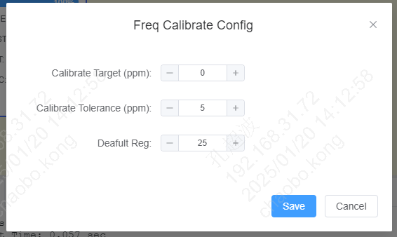
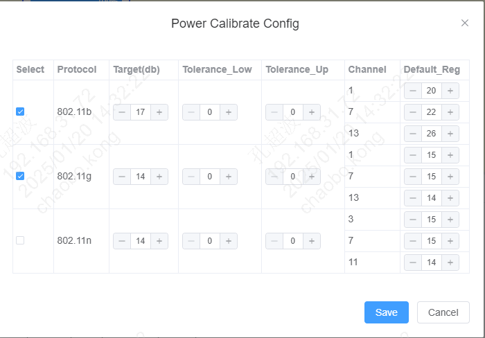
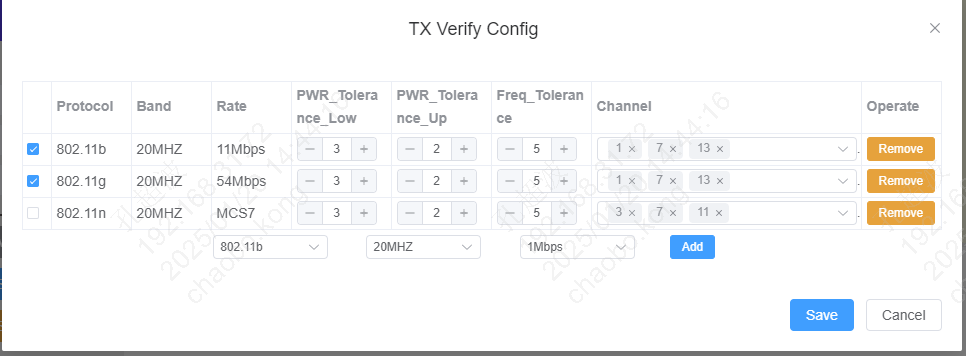

<a id="id1"></a>

# 4\. 测试配置

BekenRFTest 为用户提供了灵活的配置项，通过不同的配置可以满足多样化的测试需求。

<a id="site-config"></a>

## 4.1. Site Config

菜单栏中 “Config” \=\=\> “Site Config” 可以打开对应的配置对话框。可以配置每个SITE对应的Test/DUT串口号、每个信道对应的线损值。

[](../../_assets/c2f5871b366a2431fdf1-site_cfg.png)

<a id="runner-config"></a>

## 4.2. Runner Config

菜单栏中 “Config” \=\=\> “Runner Config” 可以打开对应的配置对话框。

**Auto Start After Detect Dut**: “YES” 表示开始执行测试后，连接DUT会自动开始执行测试(支持Win10及以上操作系统)

**Continue After Case fail**: “YES” 表示测试过程中CASE fail后继续执行后面的CASE

**DUT CHIP**: 选择DUT 芯片类型

**DUT BaudRate**: 选择DUT 串口波特率

**MAC Addr**: MAC地址，测试过程中会给DUT写MAC地址。该配置项用于配置MAC地址的起始地址

**MAC Step**: MAC地址变更步长

**LOG LEVEL**: 选择log等级

[](../../_assets/4f3b963b5ba113b4fc34-runner_cfg.png)

备注

测试过程中会给DUT写入MAC地址。每次执行测试，MAC地址值会根据MAC Step值变更一次，确保写入到每个模组/开发板的MAC地址不重复。

<a id="freq-calibrate-config"></a>

## 4.3. Freq Calibrate Config

菜单栏中 “Config” \=\=\> “Freq Calibrate Config” 可以打开对应的配置对话框。该配置页主要是配置频偏校准测试的相关参数。

**Calibrate Target (ppm)**: 频偏校准目标值，单位ppm，1ppm≈2.4kHz

**Calibrate Tolerance (ppm)**: 频偏校准容限值，校准时频偏处于 (target \- Tolerance) 到 (target \+ Tolerance) 之间，即结束校准

**Default Reg**: 默认晶体值，建议保持默认值

[](../../_assets/7841eb25065cd697f437-freq_cal_config.png)

备注

频偏校准的过程是在不断调整晶体值的过程，默认晶体值越接近最终调整后的值，校准耗时越短。该工具针对不同的芯片平台，已经设置了一个相对合理的默认值。
实际测试过程中，如果发现频偏校准时间过长，可以参考log信息找到最终校准的值(FREQ\_CALIBRATION CASE中 CAL列对应的值)，来修改”Default Reg” 参数。

<a id="power-calibrate-config"></a>

## 4.4. Power Calibrate Config

菜单栏中 “Config” \=\=\> “Power Calibrate Config” 可以打开对应的配置对话框。该配置页主要是配置功率校准测试的相关参数。

**Target(db)**: 功率校准目标值

**Tolerance\_Low/Tolerance\_Up**: 功率校准容限值。校准时，功率值处于 (Target \- Tolerance\_Low) 到 (Target \+ Tolerance\_Up) 之间，即结束校准

**Default Reg**: 对应校准信道的默认晶体值，建议保持默认值

[](../../_assets/84ca762a6b97b31c53ad-power_cal_config.png)

备注

Default Reg的设置建议可类比”Freq Calibrate Config”。

<a id="tx-verify-config"></a>

## 4.5. TX Verify Config

菜单栏中 “Config” \=\=\> “TX Verify Config” 可以打开对应的配置对话框。该配置页主要是配置频偏/功率 TX验证测试相关参数。

**PWR\_Tolerance\_Low/PWR\_Tolerance\_Up**: 功率容限值。测试功率值处于 (Target \- Tolerance\_Low) 到 (Target \+ Tolerance\_Up) 之间，即认为测试PASS。其中Target值参考下放备注信息

**Freq\_Tolerance**: 频偏容限值。测试时频偏处于(Target \- Freq\_Tolerance) 到 (Target \+ Freq\_Tolerance) 之间，即认为测试PASS,其中Target值为“Freq Calibrate Config”配置中的\*\*Calibrate Target (ppm)\*\*参数

**Channel**: 选择在哪些信道上做验证

[](../../_assets/42826bac6eb30ac4a733-tx_verify_config.png)

备注

功率验证中，Target取值会基于“Power Calibrate Config”配置中的“Target(db)”，对不同的Rate值做计算。计算公式为(“Target(db)” \+ “offset” \* 0.25), 不同Protocol 的 offset值见下表。

<a id="id2"></a>

802.11b


|  |  |  |  |  |
| --- | --- | --- | --- | --- |
| **Rate** | 11M | 5.5M | 2M | 1M |
| **offset** | 0 | 0 | 0 | 0 |

<a id="id3"></a>

802.11g


|  |  |  |  |  |  |  |  |  |
| --- | --- | --- | --- | --- | --- | --- | --- | --- |
| **Rate** | 54M | 48M | 36M | 24M | 18M | 12M | 9M | 6M |
| **offset** | 0 | 2 | 2 | 2 | 3 | 3 | 4 | 4 |

<a id="id4"></a>

802.11n


|  |  |  |  |  |  |  |  |  |
| --- | --- | --- | --- | --- | --- | --- | --- | --- |
| **Rate** | MCS7 | MCS6 | MCS5 | MCS4 | MCS3 | MCS2 | MCS1 | MCS0 |
| **offset(20MHZ)** | 0 | 2 | 2 | 2 | 3 | 3 | 4 | 4 |
| **offset(40MHZ)** | 0 | 0 | 0 | 0 | 0 | 0 | 0 | 0 |

<a id="case"></a>

## 4.6. 测试CASE配置

通过修改case\_config目录下的CASE\_LIST.yaml文件可以增减测试CASE。

以BK7258的配置项为例，将会依次执行CASE:

- SET\_DEST\_POWER
- FREQ\_CALIBRATION\_LIMIT
- POWER\_CALIBRATION\_LIMIT
- SAVE\_CALIBRATION\_DATA
- TX\_VERIFY\_CASE
- ENABLE\_CALIBRATION\_FLAG
- WRITE\_MAC

建议保持默认配置执行测试。

```
# 测试CASE配置表
-
  CHIP: [BK7236, BK7258, BK7259, BK7236N]                    # 当前配置对应的芯片列表
  CASE:
    - SET_DEST_POWER                        # 设置目标功率
    - FREQ_CALIBRATION_LIMIT                # 频偏校准
    - POWER_CALIBRATION_LIMIT               # 功率校准
    - SAVE_CALIBRATION_DATA                 # 保存校准数据到flash
    - TX_VERIFY_CASE                        # TX 验证(包括频偏验证和功率验证)
    - ENABLE_CALIBRATION_FLAG               # 使能校准标志位
    - WRITE_MAC                             # 写MAC地址
-
  CHIP: [BK7235, BK7256, BK7231N, BK7238, BK7252N]  # 当前配置对应的芯片列表
  CASE:
    - FREQ_CALIBRATION_LIMIT               # 频偏校准
    - POWER_CALIBRATION_LIMIT              # 功率校准
    - SAVE_CALIBRATION_DATA                # 保存校准数据到flash
    - TX_VERIFY_CASE                       # TX 验证(包括频偏验证和功率验证)
    - ENABLE_CALIBRATION_FLAG              # 使能校准标志位
    - WRITE_MAC                            # 写MAC地址
```
