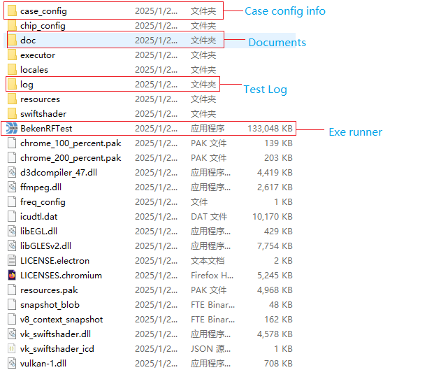

# 2\. 下载安装

Beken 射频综测系统包括: 综测仪小板 和 BekenRFTest 软件工具。其中综测仪小板可以通过淘宝进行购买，软件工具可以在Beken官网下载。

## 2.1. 综测仪购买

综测仪小板购买: [https://item.taobao.com/item.htm?id\=811643852565](https://item.taobao.com/item.htm)

## 2.2. 软件下载

<https://dl.bekencorp.com/tools/BEKEN_RF_CAL/v3>

## 2.3. 解压执行

下载后解压，解压后的文件如下图所示

- **case\_config**: 测试case内容自定义配置文件，可以新增/删除测试CASE(详细说明见测试配置页)
- **doc**: 该系统的使用文档目录
- **log**: 存放测试过程产生的log
- **BekenRFTest.exe**: 工具可执行文件，双击即可运行该工具

BekenRFTest工具文件列表

## 模块导航

- [1. 简介](summary.md)
- [3. 快速开始](fast_start.md)
- [4. 测试配置](config.md)
- [5. Q&A](q_and_a.md)
- [6. Relase Notes](release_notes.md)
