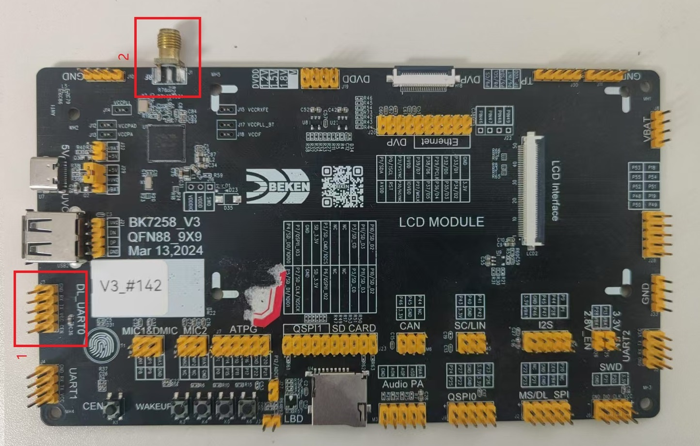
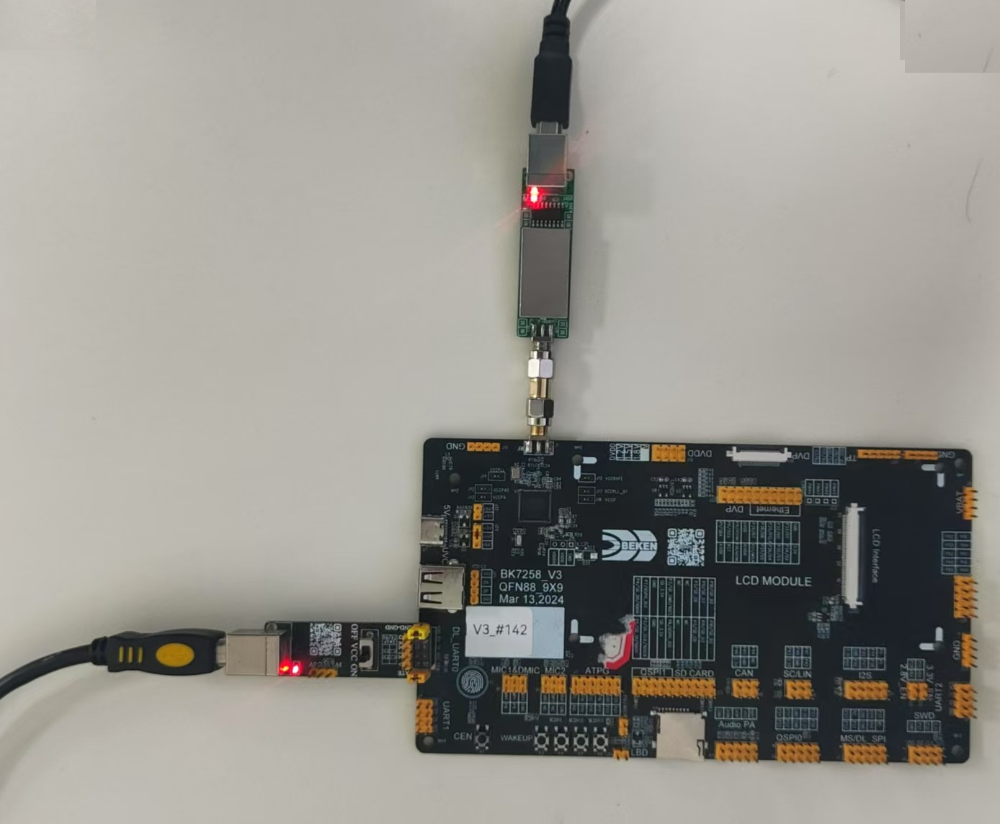
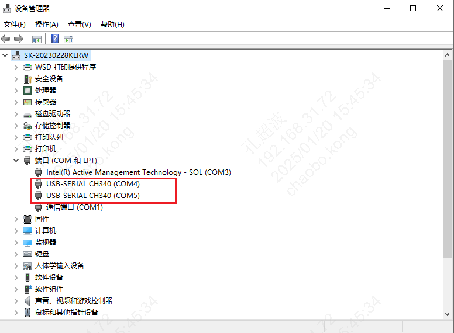
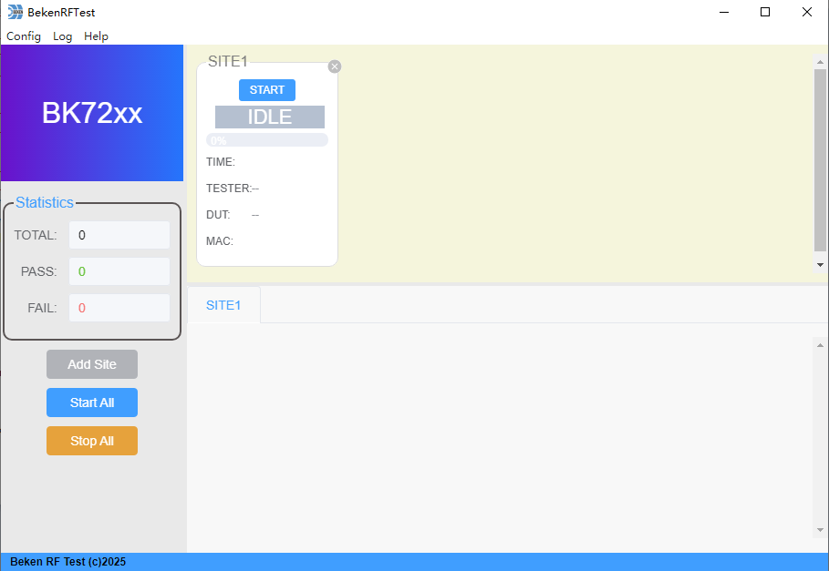
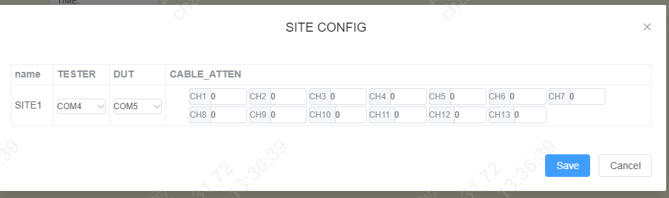
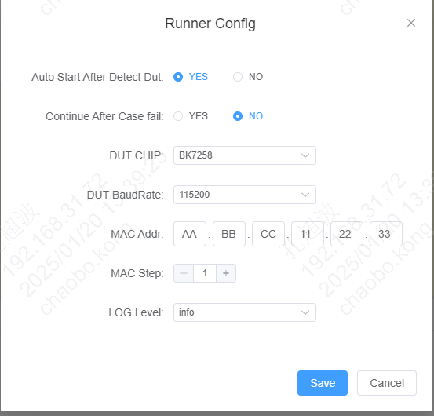
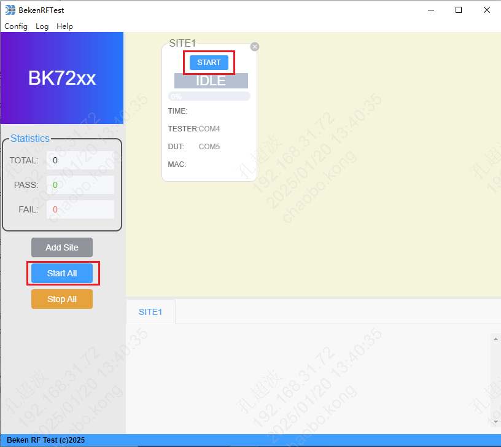
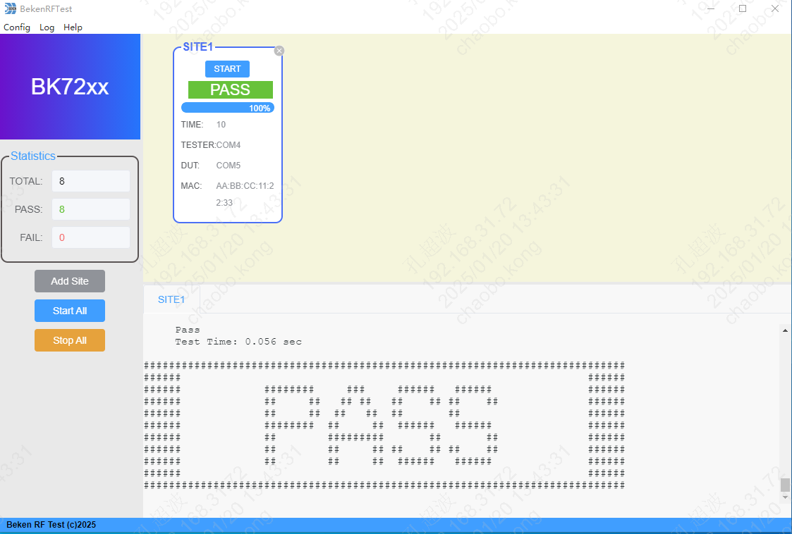

<a id="id1"></a>

# 3\. 快速开始

<a id="id2"></a>

## 3.1. 准备硬件

<a id="id3"></a>

### 3.1.1. 串口板

串⼝板主要⽤于 USB 转串⼝。串口板如下图所示，图中标注位置的功能如下:

**位置1**: 需要短接，短接后被测板开机会进入到射频测试模式

**位置2**: 给被测模组供电的开关

**位置3**: 和电脑端USB相连接口

**位置4**: UART连接接口，需要和被测模组的DL UART相连

**位置5**: 和电脑端USB相连接口,功能同位置3

<a id="id8"></a>
[](../../_assets/9c2bdf7c0e62e4d495ef-serial_board.jpg)


串口板

<a id="tester"></a>

### 3.1.2. 综测仪(TESTER)

综测仪用于校准被测模组的射频性能。以下简称TESTER。如下图所示，图中标注位置的功能如下:

**位置1**: 和电脑端USB相连接口

**位置2**: 和被测模组SMA头相接接口

<a id="id9"></a>
[](../../_assets/687844642e47ee7958e7-tester_board.jpg)


综测仪

<a id="dut"></a>

### 3.1.3. 被测模组或开发板(DUT)

被测模组或开发板为测试对象，以下简称DUT。如下图所示，图中标注位置的功能如下:

**位置1**: UART接口，用于和串口板\*\*位置4\*\*相连

**位置2**: 射频口，用于和综测仪的\*\*位置2\*\*相连

<a id="id10"></a>
[](../../_assets/017869daf9b00a734edb-dut.jpg)


DUT

<a id="id4"></a>

## 3.2. 硬件连接

硬件连接示意图如下所示。

<a id="id11"></a>

```
        flowchart LR
    PC["计算机"] -->|"串口线"| DUT["Beken模组/开发板"]
    PC -->|"USB线"| TESTER["综测仪"]
    DUT -->|"射频线"| TESTER
```

硬件连接示意图

<a id="testerdut"></a>

### 3.2.1. 将串口板、TESTER、DUT相连接

连接后如下图所示。

[](../../_assets/db8d3082c9917f18a09d-connect.jpg)

<a id="testerusb"></a>

### 3.2.2. 将TESTER和串口板分别连接到电脑的USB口

连接后在设备管理器上可以看到对应的端口，如下图所示

[](../../_assets/43f9fce9c1a8c2dd532c-serial_port.png)

<a id="id5"></a>

## 3.3. 软件配置

<a id="site"></a>

### 3.3.1. 添加测试站点(SITE)

点击”Add Site” 按钮后，在工具窗口的右边会新加一个SITE，如下图所示。

[](../../_assets/ec0799ab29a71fd1ca73-add_site.png)

<a id="id6"></a>

### 3.3.2. 配置SITE信息

菜单栏点击 “Config” \=\> “Site Config” 后，在弹出的SITE配置窗口中配置SITE。

其中包括:

**TESTER**: 综测仪小板串口号选择

**DUT**: 被测模组/开发板串口号选择

**ATTEN**: 对应信道的线损设置，默认为0

[](../../_assets/c2f5871b366a2431fdf1-site_cfg.png)

<a id="mac"></a>

### 3.3.3. 选择芯片、设置MAC

菜单栏点击 “Config” \=\> “Runner Config” 后，在弹出窗口中配置。

**DUT CHIP**: 选择DUT 芯片类型

**MAC Addr**: 填Wi-Fi MAC地址

[](../../_assets/4f3b963b5ba113b4fc34-runner_cfg.png)

<a id="id7"></a>

## 3.4. 执行测试

点击”START” 或 “START ALL” 开始执行测试

[](../../_assets/41b1a5193d07f8051b13-start_test.png)

执行结束后，界面会显示测试结果及测试过程中产生的log信息。

[](../../_assets/f1ac34851a9ce2d2b94e-finish_test.png)
