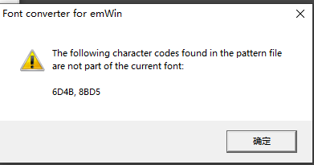

<a id="common-error"></a>

<a id="id1"></a>

# 6\. 常见错误

<a id="id2"></a>

## 6.1. 字体选择错误

文字控件中，请确保选择的Font字体内包含 **Content** 内容中的全部字符，否则导出时将会报错，如下图：

[](../../_assets/625c5c6b08724f66e251-export_font_error.png)

<a id="rom"></a>

## 6.2. 编译时ROM内存溢出

编译时如果遇到以下错误，可能是图片导入过多或界面上图片设计尺寸过大导致ROM内存溢出。

```
/opt/gcc-arm-none-eabi-10.3-2021.10/bin/../lib/gcc/arm-none-eabi/10.3.1/../../../../arm-none-eabi/bin/ld: missing --end-group; added as last command line option
/opt/gcc-arm-none-eabi-10.3-2021.10/bin/../lib/gcc/arm-none-eabi/10.3.1/../../../../arm-none-eabi/bin/ld: app.elf section `.data' will not fit in region `FLASH'
/opt/gcc-arm-none-eabi-10.3-2021.10/bin/../lib/gcc/arm-none-eabi/10.3.1/../../../../arm-none-eabi/bin/ld: ROM overflow!!!
/opt/gcc-arm-none-eabi-10.3-2021.10/bin/../lib/gcc/arm-none-eabi/10.3.1/../../../../arm-none-eabi/bin/ld: region `FLASH' overflowed by 3256 bytes
```

## 模块导航

- [1. 简介](summary.md)
- [2. 下载安装](download.md)
- [3. 快速上手](start.md)
- [4. 界面介绍](introduction.md)
- [5. 控件](widget.md)
- [7. ReleaseNotes](releasenotes.md)
