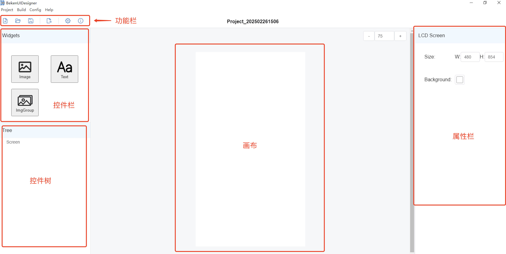
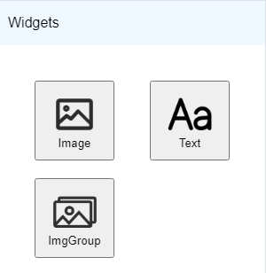
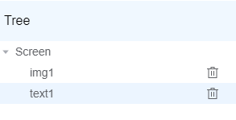
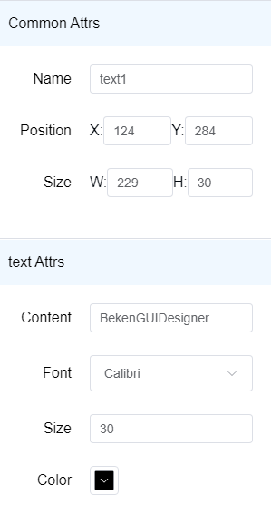
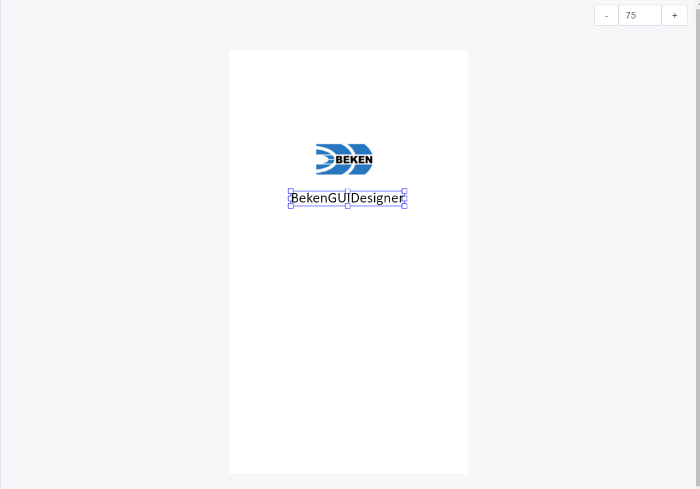

# 4\. 界面介绍

## 4.1. 软件界面

BekenUIDesigner软件界面整体分为：功能栏、控件树、层级树、画布区、属性栏几个部分，如下图所示：

BekenUIDesigner界面

## 4.2. 功能栏

- **新建工程**

  点击功能栏中的  图标，选择工程存放的路径（必须为空目录，目录名称请不要包含特殊字符及空格），点击确定即可。
- **打开工程**

  点击功能栏中的  图标，选择名称为 **project.bkproj** 的工程文件，点击确定即可打开一个工程。
- **保存**

  点击功能栏中的  图标，保存当前设计进度。
- **导出**

  点击功能栏中的  图标，根据界面设计导出目标文件。
- **配置**

  点击功能栏中的  图标，打开全局配置页面。

## 4.3. 控件栏

点击控件栏中的图片控件或者文本控件，即可在画布中添加一个新控件，如下图：

## 4.4. 控件树

控件树中显示当前画布中已经添加的控件，点击控件树中的控件可以进行选中，点击删除图标可删除对应控件，如下图：

## 4.5. 属性栏

属性栏中显示当前选中控件的属性，可以通过调整属性来控制控件的显示位置及样式，如下图：

## 4.6. 画布

画布中显示当前创建的所有控件，可以通过点击某个控件进行选中，拖动控件周围的选中框来进行缩放，拖动控件来进行位置移动，如下图：

