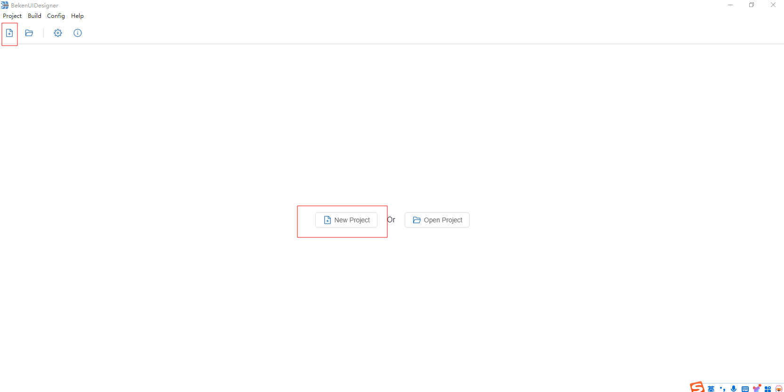
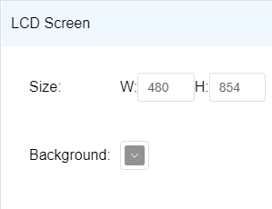
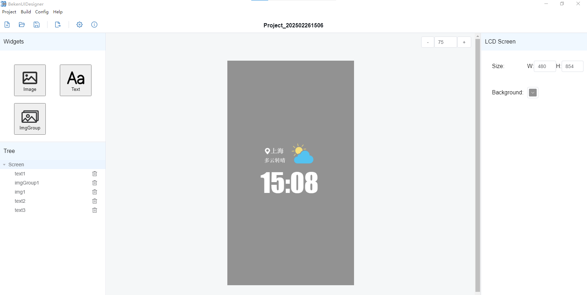
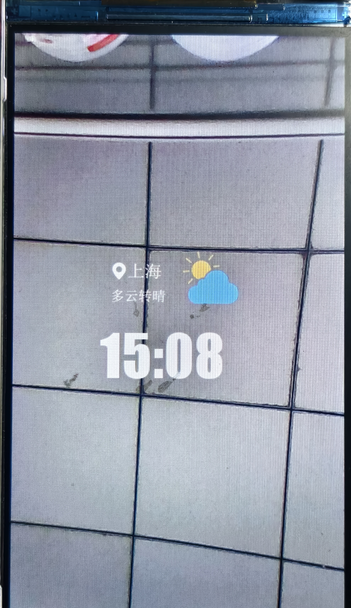

<a id="id1"></a>

# 3\. 快速上手

本文档以BK7258开发板为例，通过一个简单的示例项目向您展示：

- 新建工程
- 界面设计
- 代码导出与使用
- 固件编译与烧录

<a id="id2"></a>

## 3.1. 准备工作

硬件：

- BK7258开发板（ [开发板简介](../../bk_idk/BK7258/get-started/bk7258.md#bk7258) ，[购买链接](https://item.taobao.com/item.htm) ）；
- 串口烧录工具；

<a id="id5"></a>

## 3.2. 新建工程

点击工具栏中的新建按钮，选择好工程保存路径后（必须为空目录，目录名称请不要包含特殊字符及空格），点击确定即可，如下图:

[](../../_assets/9151736cff06bcfaa5a9-new_proj.png)

<a id="id6"></a>

## 3.3. 界面设计

- **画布设置**

  开始界面设计之前，请根据目标LCD屏尺寸设置好画布的尺寸，调整画布背景颜色，如下图：

[](../../_assets/338722d3557dce0d6e0d-prop_screen.png)

- **添加控件**

  点击控件栏中的控件，添加到画布中，根据需求修改控件位置、尺寸、属性，完成界面的整体设计，如下图：

[](../../_assets/91bf13b4b2be294e1a9c-design2.png)

<a id="id7"></a>

## 3.4. 代码导出与使用

界面设计完成后，点击导出，软件将开始导出流程。当导出结束，会自动打开导出文件目录。导出目录中包含如下四个文件:

> - **blend.h**: 头文件
> - **bk\_font.c**: 字体融合文件
> - **bk\_img.c**: 图片融合文件
> - **blend\_dsc.c** : 界面描述文件，如果想修改界面具体显示内容，可编辑该文件。

将上述文件复制到AVDK项目中 `projects\media\doorbell\main\src\assets` 路径下即可。

备注

关于融合文件的详细使用介绍及融合API请访问：[OSD视频叠加](https://docs.bekencorp.com/arminodoc/bk_avdk/bk7258/zh_CN/v2.0.2/gui/osd/osd_blend.html)

<a id="id8"></a>

## 3.5. 固件编译与烧录

- 编译工程

导出文件放到项目中后，即可以通过下面命令进行编译:

```
make bk7258
```

- 烧录

Armino支持在Windows/Linux平台进行固件烧录，烧录方法参考烧录工具中的指导文档。以Windows平台为例，Armino目前支持UART烧录。

具体 [烧录流程](../../bk_idk/BK7258/get-started.md) 请参考 [IDK](../../bk_idk/BK7258.md)

<a id="id10"></a>

## 3.6. 预览

烧录完成以后，使用BekenIot App对开发板进行配网，并开启摄像头及LCD显示，BekenIot App使用请参考: [BekenIot App文档](https://docs.bekencorp.com/arminodoc/bk_app/app/en/v2.0.1/)

然后输入以下用于快速预览融合效果的串口命令，即可LCD屏上显示的摄像头图像与文字图片的融合效果:

```
blend open
```

LCD显示的融合效果如下图：

[](../../_assets/fc6b22a4715ef3741fd5-lcd_display.jpg)
