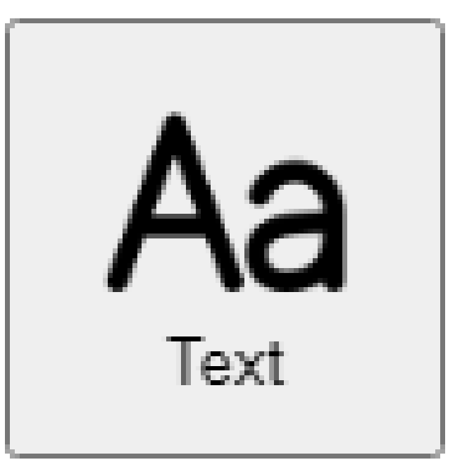
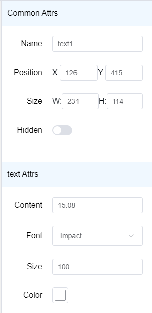
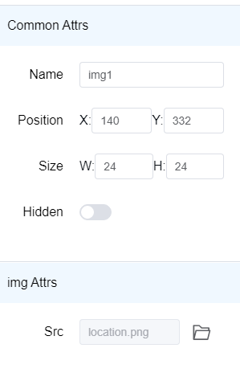
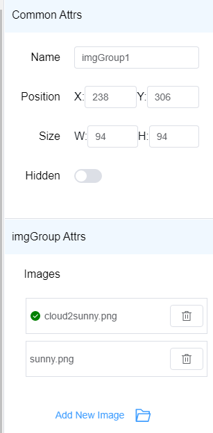

# 5\. 控件

## 5.1. 文字控件

点击 **控件栏** 中的 **Text** 图标，在画布中添加一个文本控件，如下图:

文字控件的属性如下：

备注

文字控件的 **Content** 属性最多允许输入30个字符长度的内容（中文占3个字符，英文占1个字符，**”** 号占2个字符）。

警告

请确保文字控件中所选的Font字体包含 **Content** 中的全部字符，否则导出时将会报错，参考 [常见错误](error.md#common-error)

## 5.2. 图片控件

点击 **控件栏** 中的 **Image** 图标，在画布中添加一个图片控件，如下图:

图片控件的属性如下：

## 5.3. 图片组合控件

点击 **控件栏** 中的 **ImgGruop** 图标，在画布中添加一个图片组合控件,如下图:

图片组合控件的属性如下：

图片组合控件可以在同一个控件内添加多个图片，导出时默认显示图片组合中 **选中状态** 下的图片。

警告

图片相关控件使用时，请注意：

1. 请确保导入的图片名称中只包含 \_ 、 字母和数字 ，否则编译时将会报错。
2. 导入图片太多或者界面上图片尺寸设计太大时，编译时可能会报错：ROM overflow，参考 [常见错误](error.md#common-error)
