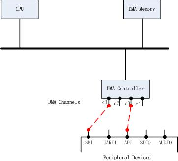
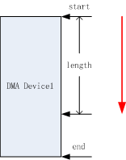
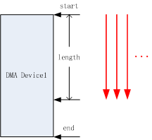
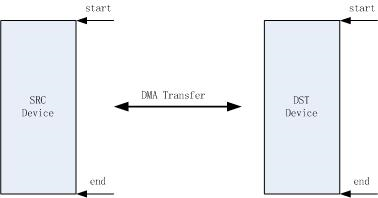

# DMA 使用指南[](#dma "永久链接至标题")

[[English]](../../../../en/v2.2.1/developer-guide/peripheral/bk_dma.html "../../../../en/v2.2.1/developer-guide/peripheral/bk_dma.html")

## 概述[](#id1 "永久链接至标题")

DMA 传输将数据从一个地址空间复制到另一个地址空间，提供在外设和存储器之间或者存储器与存储器之间的高速数据传输。
一个典型的 DMA 实现通常如下图所示。

DMA Overview[](#id10 "永久链接至图片")

备注

实际 DMA 架构实现可能与上图不同，上图主要为方便理解的一个抽象概述图。

CPU，DMA 控制器，DMA 内存通过总线相连。一个 DMA 控制器可支持多个通道，不同的通道可并发传输。外设与内存之间进行数据传输前，需要先选择一个通道，配置好相应的参数。

BK7236N 支持两个 DMA 控制器，第个控制器支持 8 个 DMA 通道，虽然 8 个通道能同时工作，但由于总线只有一条，因此在特定时刻实际只有一个通道能在总线上传输数据。当多个
不同的 DMA 通道在同一时刻均有数据传输时，由 DMA 对通道进行调度。DMA 通道有两种调度方式：

> - 轮询调度，所有通道同一优先级，先请求先调度
> - 基于优先级调度，优先级高的先调度，可通过:cpp:func:bk_dma_init 设置调度方式与优先级。

## DMA 配置[](#id2 "永久链接至标题")

为了进行 DMA 传输，通常需要进行下述配置:

> - 配置源与目的设备
> - 设置源与目的设备的数据宽度
> - 设置数据量
> - 传输次数（单次传输或者循环传输)

## DMA 传输次数设置[](#id3 "永久链接至标题")

DMA 传输次数可通过传输模式来设置， DMA 有两种传输模式：

> - SINGLE 模式
> - REPEAT 模式

### 单次模式[](#id4 "永久链接至标题")

单次模式如下图所示，从 start 传输到 start + len 结束， 通常 len 设置成 end - start， 即整个块的长度。

DMA Single Mode[](#id11 "永久链接至图片")

### 循环模式[](#id5 "永久链接至标题")

循环模式如下图所示，DMA 从 start 传输到 end 后会再次从 start 传输到 end, 一直重复直到 DMA 被 stop。
当 SRC or DST 设备为单地址时，在 Repeat 模式下每次均传输 Start 所指向的地址，直到 DMA 被 stop。

DMA Repeat Mode[](#id12 "永久链接至图片")

## DMA 传输场景[](#id6 "永久链接至标题")

DMA 地址配置基本原则：

> - 如果要传输的地址为单地址，即进行 DMA 传输时设备地址可用的地址长度等于数据宽度时，
>   则只需配置 start 地址，end 地址配置成 0。如 UART 设备， 位宽为 8bits, DMA 传输时每次都只使用这 8bits 传输，
>   因此只需配置 start 地址为 UART FIFO 地址，end 设置成 0.
> - 如果要传输的地址为块地址，即地址长度超过数据宽度，则 Start配置成块地址的起始地址， end 配置成块地址的结束地址

具体应用可分成下述三种场景：

> - 单地址到单地址传输
> - 单地址到块地址传输
> - 块地址到块地址传输

### 单地址到单地址传输[](#id7 "永久链接至标题")

DMA case1[](#id13 "永久链接至图片")

如上图所示, SRC/DST 设备均只需要配置 start 地址， end 为 0.

### 单地址到块地址传输[](#id8 "永久链接至标题")

DMA case2[](#id14 "永久链接至图片")

如上图所示, SRC 设备均只需要配置 start 地址， end 为 0， end 设备配置 start/end 地址。

### 块地址到块地址传输[](#id9 "永久链接至标题")

DMA case3[](#id15 "永久链接至图片")

如上图所示, SRC 设备均只需要配置 start 地址， end 为 0， end 设备配置 start/end 地址。
