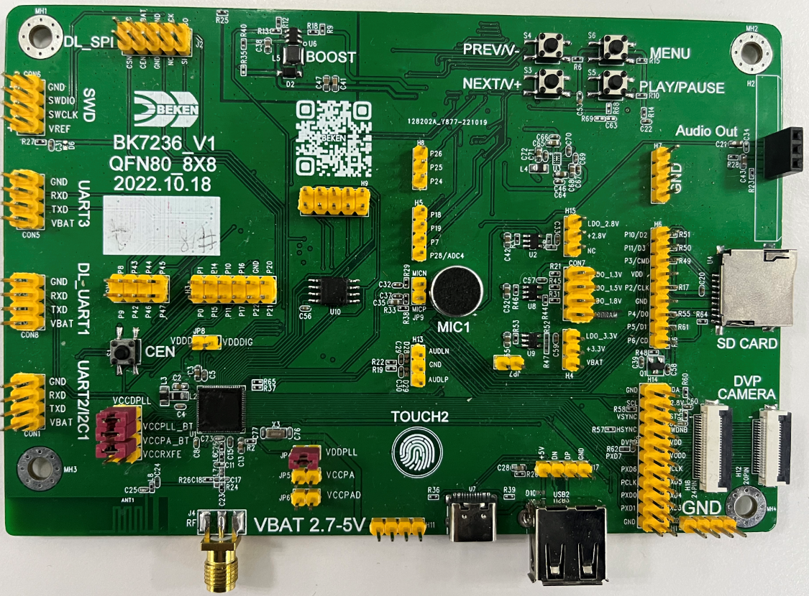

# BK7236N[](#bk7236n "永久链接至标题")

[[English]](../../../en/v2.2.1/get-started/bk7236.html "../../../en/v2.2.1/get-started/bk7236.html")

## 开发板简介[](#id2 "永久链接至标题")

> - 为单核 CM33 架构；
> - 支持 FreeRTOS V10.4；

BK7236N Demo Board[](#id3 "永久链接至图片")

BK7236N Demo Board Back Side[](#id4 "永久链接至图片")
