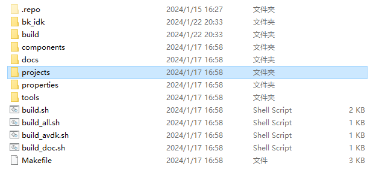

# AB分区位置无关的工程介绍[](#ab "永久链接至标题")

[[English]](../../../../../en/v2.2.1/developer-guide/bootloader_ota/ab_position_independent_ota/bk_ab_position_independent_project_introduction.html "../../../../../en/v2.2.1/developer-guide/bootloader_ota/ab_position_independent_ota/bk_ab_position_independent_project_introduction.html")

avdk根目录下的projects/customization/config_ab 为所提供的拥有AB位置无关升级的功能的工程。

重要

- 若使用AB位置无关升级的功能，必须使用customization/config_ab这个工程；

- 在此工程中路径下：projects/customization/config_ab/config/bk7239n/config添加想要的的配置即可；

　以avdk工程为例：customization/config_ab这个工程为avdk的project目录下的工程，此工程已经适配好多媒体功能，如下图1所示； 而非bk_idk的roject/customization/config_ab工程。

图1 customization/config_ab工程目录[](#id1 "永久链接至图片")
