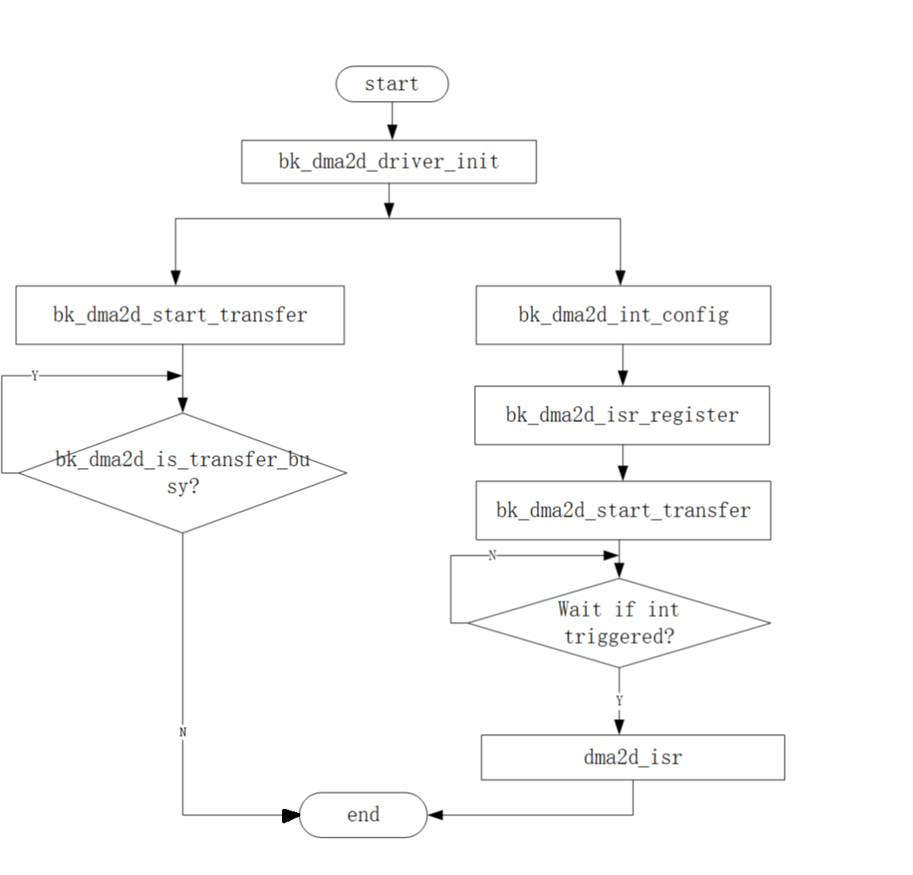

# DMA2D APIs[](#dma2d-apis "永久链接至标题")

[[English]](../../../../en/v1.5/api-reference/multi_media/bk_dma2d.html "../../../../en/v1.5/api-reference/multi_media/bk_dma2d.html")


## DMA2D Interface[](#dma2d-interface "永久链接至标题")


## DMA2D Features[](#dma2d-features "永久链接至标题")

> - fill specific color
>   :   Fill part or all of the target image with a specific color
> - mem to mem copy
>   :   Copy part or all of the source image to part or all of the target image
> - mem to mem with pixel conversion
>   :   Copy part or all of the source image to part or all of the target image through pixel format conversion
> - mem to mem with pixel conversionwith and blending
>   :   Part or all of the two source images with different pixel formats are mixed,
>       and the result is copied to the part or the entire target :image with different color formats


## DMA2D API Categories[](#dma2d-api-categories "永久链接至标题")

| DMA2D API | Description |
| --- | --- |
| [`bk_dma2d_driver_init()`](#_CPPv420bk_dma2d_driver_initv "bk_dma2d_driver_init") | initializes the DMA2D |
| [`bk_dma2d_init()`](#_CPPv413bk_dma2d_initP14dma2d_config_t "bk_dma2d_init") | config the DMA2D |
| [`bk_dma2d_driver_deinit()`](#_CPPv422bk_dma2d_driver_deinitv "bk_dma2d_driver_deinit") | Deinitializes the DMA2D peripheral |
| [`bk_dma2d_layer_config()`](#_CPPv421bk_dma2d_layer_configP14dma2d_config_t8uint32_t "bk_dma2d_layer_config") | Configure the background or foreground Layer |
| [`bk_dma2d_start_transfer()`](#_CPPv423bk_dma2d_start_transferP14dma2d_config_t8uint32_t8uint32_t8uint32_t8uint32_t "bk_dma2d_start_transfer") | Start the DMA2D Transfer |
| [`bk_dma2d_start_blending()`](#_CPPv423bk_dma2d_start_blendingP14dma2d_config_t8uint32_t8uint32_t8uint32_t8uint32_t8uint32_t "bk_dma2d_start_blending") | Start the multi-source DMA2D Transfer |
| [`bk_dma2d_is_transfer_busy()`](#_CPPv425bk_dma2d_is_transfer_busyv "bk_dma2d_is_transfer_busy") | check dma2d is transfer busy or not |
| [`bk_dma2d_int_enable()`](#_CPPv419bk_dma2d_int_enable16dma2d_int_type_tb "bk_dma2d_int_enable") | clear dma2d int status |
| [`bk_dma2d_int_status_clear()`](#_CPPv425bk_dma2d_int_status_clear18dma2d_int_status_t "bk_dma2d_int_status_clear") | Lcd transfer pixel config |

| DMA2D Register ISR API | Description |
| --- | --- |
| [`bk_dma2d_isr_register()`](#_CPPv421bk_dma2d_isr_register11dma2d_isr_t "bk_dma2d_isr_register") | register dma2d cpu int isr |
| `bk_dma2d_register_int_callback_isr()` | register dma2d int type isr |


## DMA2D Work Config[](#dma2d-work-config "永久链接至标题")

1、fill specific color



Figure 1. dma2d_fill_color[](#id2 "永久链接至图片")

2、mem to mem copy


Figure 2. dma2d_mem_to_mem[](#id3 "永久链接至图片")

3、mem to mem with pixel conversion

> The Figure API is the same as dma2d_mem_to_mem
> please reference the API Reference for the different config

4、mem to mem with pixel conversion and blending


Figure 3. dma2d_mem_to_mem_with_pixel_conversion_and_blending[](#id4 "永久链接至图片")


## API Reference[](#api-reference "永久链接至标题")


### Header File[](#header-file "永久链接至标题")


- [dma2d.h](http://192.168.0.46/gerrit/plugins/gitiles/iot/wcn/projects/+/refs/heads/armino_main/components/dma2d.h "http://192.168.0.46/gerrit/plugins/gitiles/iot/wcn/projects/+/refs/heads/armino_main/components/dma2d.h")


### Functions[](#functions "永久链接至标题")

[bk_err_t](../system/os.html#_CPPv48bk_err_t "bk_err_t") bk_dma2d_driver_init(void)[](#_CPPv420bk_dma2d_driver_initv "永久链接至目标")
:   initializes the DMA2D system and peripheral registers

    ```

         - open dma2d sys interrupt enable
    ```


    **Attention**
    :   you can reference cli_dma2d.c for all API usage

    参数
    :   **dma2d_config** – pointer to a [dma2d_config_t](#structdma2d__config__t "#structdma2d__config__t") structure that contains the configuration information for the DMA2D.

    返回
    :   - BK_OK: succeed

        - others: other errors.

[bk_err_t](../system/os.html#_CPPv48bk_err_t "bk_err_t") bk_dma2d_init([dma2d_config_t](#_CPPv414dma2d_config_t "dma2d_config_t") *dma2d)[](#_CPPv413bk_dma2d_initP14dma2d_config_t "永久链接至目标")
:   config dma2d work mode/ data format/ offset etc.

    Usage example:

    ```
           dma2d_config_t dma2d_config = {0};
           dma2d_config.init.mode = DMA2D_R2M;                     Mode Register to Memory
           dma2d_config.init.color_mode = DMA2D_OUTPUT_RGB565;       DMA2D Output color mode is ARGB4444 (16 bpp)
           dma2d_config.init.output_offset = 0;            No offset in output
           dma2d_config.init.red_blue_swap = DMA2D_RB_REGULAR;       No R&B swap for the output image
           dma2d_config.init.alpha_inverted = DMA2D_REGULAR_ALPHA;   No alpha inversion for the output image
           bk_dma2d_init(&dma2d_config);
    ```


    **Attention**
    :   you can reference cli_dma2d.c for all API usage

    参数
    :   **dma2d_config** – pointer to a [dma2d_config_t](#structdma2d__config__t "#structdma2d__config__t") structure that contains the configuration information for the DMA2D.

    返回
    :   - BK_OK: succeed

        - others: other errors.

[bk_err_t](../system/os.html#_CPPv48bk_err_t "bk_err_t") bk_dma2d_driver_deinit(void)[](#_CPPv422bk_dma2d_driver_deinitv "永久链接至目标")
:   Deinitializes the DMA2D peripheral registers to their default reset values.

    ```

        - reset the dma2d driver init reg
    ```

    返回
    :   - BK_OK: succeed

        - others: other errors.

[bk_err_t](../system/os.html#_CPPv48bk_err_t "bk_err_t") bk_dma2d_layer_config([dma2d_config_t](#_CPPv414dma2d_config_t "dma2d_config_t") *dma2d, uint32_t layer_idx)[](#_CPPv421bk_dma2d_layer_configP14dma2d_config_t8uint32_t "永久链接至目标")
:   Configure the DMA2D background or foreground Layer include layer offset, color mode, alpha value etc.

    Usage example:

    ```
           dma2d_config.layer_cfg[DMA2D_FOREGROUND_LAYER].alpha_mode = DMA2D_REPLACE_ALPHA;
           dma2d_config.layer_cfg[DMA2D_FOREGROUND_LAYER].input_alpha = alpha_value;
           dma2d_config.layer_cfg[DMA2D_FOREGROUND_LAYER].input_color_mode = DMA2D_INPUT_RGB565;
           dma2d_config.layer_cfg[DMA2D_FOREGROUND_LAYER].input_offset = fg_offline;
           dma2d_config.layer_cfg[DMA2D_FOREGROUND_LAYER].red_blue_swap  = DMA2D_RB_REGULAR;
           dma2d_config.layer_cfg[DMA2D_FOREGROUND_LAYER].alpha_inverted = DMA2D_REGULAR_ALPHA;

           Background layer Configuration
           dma2d_config.layer_cfg[DMA2D_BACKGROUND_LAYER].alpha_mode  = DMA2D_REPLACE_ALPHA;
           dma2d_config.layer_cfg[DMA2D_BACKGROUND_LAYER].input_alpha   = 0x80;
           dma2d_config.layer_cfg[DMA2D_BACKGROUND_LAYER].input_color_mode = DMA2D_INPUT_RGB565;
           dma2d_config.layer_cfg[DMA2D_BACKGROUND_LAYER].input_offset   = bg_offline;
           dma2d_config.layer_cfg[DMA2D_BACKGROUND_LAYER].red_blue_swap   = DMA2D_RB_REGULAR;
           dma2d_config.layer_cfg[DMA2D_BACKGROUND_LAYER].alpha_inverted  = DMA2D_REGULAR_ALPHA;

           bk_dma2d_layer_config(&dma2d_config, DMA2D_FOREGROUND_LAYER);
           bk_dma2d_layer_config(&dma2d_config, DMA2D_BACKGROUND_LAYER);
    ```

    参数
    :   **dma2d** – Pointer to a [dma2d_config_t](#structdma2d__config__t "#structdma2d__config__t") structure that contains the configuration information for the DMA2D.


        - LayerIdx DMA2D Layer index. This parameter can be one of the following values: DMA2D_BACKGROUND_LAYER(0) / DMA2D_FOREGROUND_LAYER(1)

    返回
    :   - BK_OK: succeed

        - others: other errors.

[bk_err_t](../system/os.html#_CPPv48bk_err_t "bk_err_t") bk_dma2d_start_transfer([dma2d_config_t](#_CPPv414dma2d_config_t "dma2d_config_t") *dma2d, uint32_t pdata, uint32_t dst_addr, uint32_t width, uint32_t height)[](#_CPPv423bk_dma2d_start_transferP14dma2d_config_t8uint32_t8uint32_t8uint32_t8uint32_t "永久链接至目标")
:   Start the DMA2D Transfer when you use (bk_dma2d_driver_init) and (bk_dma2d_layer_config) API, then use this API start dma2d work.


    - dst_addr: The destination memory Buffer address.

    - Width: The width of data to be transferred from source to destination (expressed in number of pixels per line).

    - Height: The height of data to be transferred from source to destination (expressed in number of lines).

    Usage example:

    ```
           dma2d_config_t dma2d_config = {0};
           dma2d_config.init.mode   = DMA2D_R2M;                     Mode Register to Memory
           dma2d_config.init.color_mode = DMA2D_OUTPUT_RGB565;       DMA2D Output color mode is ARGB4444 (16 bpp)
           dma2d_config.init.output_offset = 0;          No offset in output
           dma2d_config.init.red_blue_swap = DMA2D_RB_REGULAR;       No R&B swap for the output image
           dma2d_config.init.alpha_inverted = DMA2D_REGULAR_ALPHA;   No alpha inversion for the output image

           bk_dma2d_driver_init(&dma2d_config);
           bk_dma2d_start_transfer(&dma2d_config, color, (uint32_t)dst_addr, width, high);
    ```

    参数
    :   **dma2d, :** – Pointer to a [dma2d_config_t](#structdma2d__config__t "#structdma2d__config__t") structure that contains the configuration information for the DMA2D.


        - pdata: have two means:

          - 1: if the Memory-to-Memory or Memory-to-Memory with pixel format select, should Configure the source memory Buffer address

          - 2: if Register-to-Memory mode is selected, should configure the color value

    返回
    :   - BK_OK: succeed

        - others: other errors.

[bk_err_t](../system/os.html#_CPPv48bk_err_t "bk_err_t") bk_dma2d_start_blending([dma2d_config_t](#_CPPv414dma2d_config_t "dma2d_config_t") *dma2d, uint32_t fg_addr, uint32_t bg_addr, uint32_t dst_addr, uint32_t width, uint32_t height)[](#_CPPv423bk_dma2d_start_blendingP14dma2d_config_t8uint32_t8uint32_t8uint32_t8uint32_t8uint32_t "永久链接至目标")
:   Start the multi-source DMA2D Transfer. start foreground layer and background layer blending.

    Usage example:

    ```
           1: bk_dma2d_driver_init(&dma2d_config);
           2: bk_dma2d_layer_config(&dma2d_config, DMA2D_FOREGROUND_LAYER);
           3: bk_dma2d_layer_config(&dma2d_config, DMA2D_BACKGROUND_LAYER);
           4:bk_dma2d_blending_start(&dma2d_config, (uint32_t)pFgaddr, (uint32_t)pBgaddr, (uint32_t)pDst, xsize ,ysize);
    ```


    **Attention**
    :   you can reference cli_dma2d.c for API usage

    参数
    :   **-** – dma2d: Pointer to a [dma2d_config_t](#structdma2d__config__t "#structdma2d__config__t") structure that contains the configuration information for the DMA2D.


        - fg_addr: The source memory Buffer address for the foreground layer.

        - bg_addr: The source memory Buffer address for the background layer.

        - dst_addr: The destination memory Buffer address.

        - Width: The width of data to be transferred from source to destination (expressed in number of pixels per line).

        - Height: The height of data to be transferred from source to destination (expressed in number of lines).

    返回
    :   - BK_OK: succeed

        - others: other errors.

bool bk_dma2d_is_transfer_busy(void)[](#_CPPv425bk_dma2d_is_transfer_busyv "永久链接至目标")
:   this API is check dma2d is transfer busy or not

    Usage example:

    ```
           1: bk_dma2d_driver_init(&dma2d_config);
           2: bk_dma2d_start_transfer(&dma2d_config, color, (uint32_t)dst_addr, width, high);
           3: while (bk_dma2d_get_transfer_status()) {}
    ```

    返回
    :   return 0: transfer stop or transfer done;


        - return 1 dma2d is work or transfer not done

[bk_err_t](../system/os.html#_CPPv48bk_err_t "bk_err_t") bk_dma2d_int_enable([dma2d_int_type_t](#_CPPv416dma2d_int_type_t "dma2d_int_type_t") int_type, bool enable)[](#_CPPv419bk_dma2d_int_enable16dma2d_int_type_tb "永久链接至目标")
:   dma2d int enable.

    Usage example:

    ```
           bk_dma2d_int_config(DMA2D_TRANS_ERROR | DMA2D_TRANS_COMPLETE ,1);
           always use with:  bk_dma2d_isr_register(dma2d_isr);
                             bk_dma2d_int_status_get();
                             bk_dma2d_int_status_clear(DMA2D_TRANS_ERROR_STATUS);
                             bk_dma2d_int_status_clear(DMA2D_TRANS_COMPLETE_STATUS);
    ```

    参数
    :   - **int_type** – select from dma2d_int_type_t, include int type:

          - DMA2D_CFG_ERROR

          - DMA2D_CLUT_TRANS_COMPLETE

          - DMA2D_CLUT_TRANS_ERROR

          - DMA2D_WARTERMARK_INT

          - DMA2D_TRANS_COMPLETE

          - DMA2D_TRANS_ERROR

        - **enable, :** – 1:enable int, 0 disable int

    返回
    :   - BK_OK: succeed

        - others: other errors.

uint32_t bk_dma2d_int_status_get(void)[](#_CPPv423bk_dma2d_int_status_getv "永久链接至目标")
:   bk_dma2d_int_status_get.

    Usage example:

    ```
             uint32_t int_status;
             int_status = bk_dma2d_int_status_get();
             if (int_status & DMA2D_CFG_ERROR) {
                bk_dma2d_int_status_clear(DMA2D_CFG_ERROR_STATUS);
                bk_dma2d_int_config(DMA2D_CFG_ERROR, 0);
             }
    ```

    返回
    :   return uint32_t value of all int status,


        - can used by value & dma2d_int_status_t check which int triggered. typedef enum { DMA2D_TRANS_ERROR_STATUS = 0x1, DMA2D_TRANS_COMPLETE_STATUS, DMA2D_WARTERMARK_INT_STATUS, DMA2D_CLUT_TRANS_ERROR_STATUS, DMA2D_CLUT_TRANS_COMPLETE_STATUS, DMA2D_CFG_ERROR_STATUS }dma2d_int_status_t;

    返回
    :   - BK_OK: succeed

        - others: other errors.

[bk_err_t](../system/os.html#_CPPv48bk_err_t "bk_err_t") bk_dma2d_int_status_clear([dma2d_int_status_t](#_CPPv418dma2d_int_status_t "dma2d_int_status_t") int_status)[](#_CPPv425bk_dma2d_int_status_clear18dma2d_int_status_t "永久链接至目标")
:   clear dma2d int status

    参数
    :   **int_status** – select from dma2d_int_status_t include: DMA2D_TRANS_ERROR_STATUS DMA2D_TRANS_COMPLETE_STATUS DMA2D_WARTERMARK_INT_STATUS DMA2D_CLUT_TRANS_ERROR_STATUS DMA2D_CLUT_TRANS_COMPLETE_STATUS DMA2D_CFG_ERROR_STATUS

    返回
    :   - BK_OK: succeed

        - others: other errors.

[bk_err_t](../system/os.html#_CPPv48bk_err_t "bk_err_t") bk_dma2d_isr_register([dma2d_isr_t](#_CPPv411dma2d_isr_t "dma2d_isr_t") dma2d_isr)[](#_CPPv421bk_dma2d_isr_register11dma2d_isr_t "永久链接至目标")
:   register dma2d cpu int isr

    参数
    :   **dma2d_isr** – the function you registr isr

    Return values
    :   **bk_err_t** – status

[bk_err_t](../system/os.html#_CPPv48bk_err_t "bk_err_t") bk_dma2d_blend([dma2d_blend_t](#_CPPv413dma2d_blend_t "dma2d_blend_t") *dma2d_blend)[](#_CPPv414bk_dma2d_blendP13dma2d_blend_t "永久链接至目标")
:   config dma2d blend

    参数
    :   **-** – dma2d_blend struct to config blend params

    返回
    :   - BK_OK: succeed

        - others: other errors.

void bk_dma2d_memcpy_or_pixel_convert([dma2d_memcpy_pfc_t](#_CPPv418dma2d_memcpy_pfc_t "dma2d_memcpy_pfc_t") *pixel_convert)[](#_CPPv432bk_dma2d_memcpy_or_pixel_convertP18dma2d_memcpy_pfc_t "永久链接至目标")
:   config dma2d pixel revert

    参数
    :   **-** – dma2d_pixel_convert_t struct to config pixel convert params

    返回
    :   - BK_OK: succeed

        - others: other errors.

[bk_err_t](../system/os.html#_CPPv48bk_err_t "bk_err_t") dma2d_fill([dma2d_fill_t](#_CPPv412dma2d_fill_t "dma2d_fill_t") *fill)[](#_CPPv410dma2d_fillP12dma2d_fill_t "永久链接至目标")
:   config dma2d fill color

    参数
    :   **-** – [dma2d_fill_t](#structdma2d__fill__t "#structdma2d__fill__t") struct to config dma2d fill params

    返回
    :   - BK_OK: succeed

        - others: other errors.

[bk_err_t](../system/os.html#_CPPv48bk_err_t "bk_err_t") dma2d_start_transfer(void)[](#_CPPv420dma2d_start_transferv "永久链接至目标")
:   start dma2d transfer

    返回
    :   - BK_OK: succeed

        - others: other errors.


## API Typedefs[](#api-typedefs "永久链接至标题")


### Header File[](#id1 "永久链接至标题")


- [dma2d_types.h](http://192.168.0.46/gerrit/plugins/gitiles/iot/wcn/projects/+/refs/heads/armino_main/components/dma2d_types.h "http://192.168.0.46/gerrit/plugins/gitiles/iot/wcn/projects/+/refs/heads/armino_main/components/dma2d_types.h")


### Structures[](#structures "永久链接至标题")

struct dma2d_init_t[](#_CPPv412dma2d_init_t "永久链接至目标")
:   DMA2D Init structure definition.

    Public Members

    [dma2d_mode_t](#_CPPv412dma2d_mode_t "dma2d_mode_t") mode[](#_CPPv4N12dma2d_init_t4modeE "永久链接至目标")
    :   Configures the DMA2D transfer mode.his parameter can be one value of DMA2D_Mode.

    uint32_t color_mode[](#_CPPv4N12dma2d_init_t10color_modeE "永久链接至目标")
    :   ```
         Configures the color format of the output image.
        ```

        This parameter can be one value of DMA2D_Output_Color_Mode.

    uint32_t output_offset[](#_CPPv4N12dma2d_init_t13output_offsetE "永久链接至目标")
    :   Specifies the Offset value. This parameter must be a number between Min_Data = 0x0000 and Max_Data = 0x3FFF.

    uint32_t alpha_inverted[](#_CPPv4N12dma2d_init_t14alpha_invertedE "永久链接至目标")
    :   Select regular or inverted alpha value for the output pixel format converter. This parameter can be one value of DMA2D_Alpha_Inverted.

    uint32_t line_offset_mode[](#_CPPv4N12dma2d_init_t16line_offset_modeE "永久链接至目标")
    :   Configures how is expressed the line offset for the foreground, background and output. This parameter can be one value of DMA2D_Line_Offset_Mode.

    uint32_t red_blue_swap[](#_CPPv4N12dma2d_init_t13red_blue_swapE "永久链接至目标")
    :   Select regular mode (RGB or ARGB) or swap mode (BGR or ABGR) for the output pixel format converter. This parameter can be one value of DMA2D_RB_Swap.

    [rgb888_dataout_reverse_t](#_CPPv424rgb888_dataout_reverse_t "rgb888_dataout_reverse_t") data_reverse[](#_CPPv4N12dma2d_init_t12data_reverseE "永久链接至目标")
    :   in output rgb888 formart, reverse data byte by byte..

    [dma2d_trans_ability_t](#_CPPv421dma2d_trans_ability_t "dma2d_trans_ability_t") trans_ability[](#_CPPv4N12dma2d_init_t13trans_abilityE "永久链接至目标")
    :   set defult MAX_TRANS_256BYTES

struct dma2d_layer_cfg_t[](#_CPPv417dma2d_layer_cfg_t "永久链接至目标")
:   DMA2D Layer structure definition

    Public Members

    uint32_t input_offset[](#_CPPv4N17dma2d_layer_cfg_t12input_offsetE "永久链接至目标")
    :   Configures the DMA2D foreground or background offset. This parameter must be a number between Min_Data = 0x0000 and Max_Data = 0x3FFF.

    uint32_t input_color_mode[](#_CPPv4N17dma2d_layer_cfg_t16input_color_modeE "永久链接至目标")
    :   Configures the DMA2D foreground or background color mode. This parameter can be one value of DMA2D_Input_Color_Mode.

    uint32_t alpha_mode[](#_CPPv4N17dma2d_layer_cfg_t10alpha_modeE "永久链接至目标")
    :   Configures the DMA2D foreground or background alpha mode.This parameter can be one value of DMA2D_Alpha_Mode.

    uint32_t input_color[](#_CPPv4N17dma2d_layer_cfg_t11input_colorE "永久链接至目标")
    :   Specifies color value in case of A8 or A4 color mode.

        备注

        In case of A8 or A4 color mode (ARGB), this parameter must be a number between Min_Data = 0x00000000 and Max_Data = 0xFFFFFF where


        - Inputcolor[16:23] is the red value RED[0:7]

        - Inputcolor[8:15] is the green value GREEN[0:7]

        - Inputcolor[0:7] is the blue value BLUE[0:7].

    uint32_t alpha_inverted[](#_CPPv4N17dma2d_layer_cfg_t14alpha_invertedE "永久链接至目标")
    :   Select regular or inverted alpha value.This parameter can be one value of DMA2D_Alpha_Inverted.

    uint32_t red_blue_swap[](#_CPPv4N17dma2d_layer_cfg_t13red_blue_swapE "永久链接至目标")
    :   Select regular mode (RGB or ARGB) or swap mode (BGR or ABGR). This parameter can be one value of DMA2D_RB_Swap.

struct dma2d_config_t[](#_CPPv414dma2d_config_t "永久链接至目标")
:   Public Members

    [dma2d_init_t](#_CPPv412dma2d_init_t "dma2d_init_t") init[](#_CPPv4N14dma2d_config_t4initE "永久链接至目标")
    :   dma2d init config, is the value of struct [dma2d_init_t](#structdma2d__init__t "#structdma2d__init__t")

    [dma2d_layer_cfg_t](#_CPPv417dma2d_layer_cfg_t "dma2d_layer_cfg_t") layer_cfg[MAX_DMA2D_LAYER][](#_CPPv4N14dma2d_config_t9layer_cfgE "永久链接至目标")
    :   dma2d layer config, is the value of struct [dma2d_layer_cfg_t](#structdma2d__layer__cfg__t "#structdma2d__layer__cfg__t") the param MAX_DMA2D_LAYER is select from DMA2D_BACKGROUND_LAYER and DMA2D_FOREGROUND_LAYER

struct dma2d_blend_t[](#_CPPv413dma2d_blend_t "永久链接至目标")
:   Public Members

    void *pfg_addr[](#_CPPv4N13dma2d_blend_t8pfg_addrE "永久链接至目标")
    :   The source memory Buffer address for the foreground layer..

    void *pbg_addr[](#_CPPv4N13dma2d_blend_t8pbg_addrE "永久链接至目标")
    :   he source memory Buffer address for the background layer…

    void *pdst_addr[](#_CPPv4N13dma2d_blend_t9pdst_addrE "永久链接至目标")
    :   The output memory Buffer address ..

    [input_color_mode_t](#_CPPv418input_color_mode_t "input_color_mode_t") fg_color_mode[](#_CPPv4N13dma2d_blend_t13fg_color_modeE "永久链接至目标")
    :   fg color mode..

    [input_color_mode_t](#_CPPv418input_color_mode_t "input_color_mode_t") bg_color_mode[](#_CPPv4N13dma2d_blend_t13bg_color_modeE "永久链接至目标")
    :   bg color mode..

    [out_color_mode_t](#_CPPv416out_color_mode_t "out_color_mode_t") dst_color_mode[](#_CPPv4N13dma2d_blend_t14dst_color_modeE "永久链接至目标")
    :   out color mode..

    uint32_t fg_offline[](#_CPPv4N13dma2d_blend_t10fg_offlineE "永久链接至目标")
    :   for partical copy this is to calculate start addr based on fg frame addr, uint by pixel

    uint32_t bg_offline[](#_CPPv4N13dma2d_blend_t10bg_offlineE "永久链接至目标")
    :   for partical copy this is to calculate start addr based on bg frame addr, uint by pixel

    uint32_t dest_offline[](#_CPPv4N13dma2d_blend_t12dest_offlineE "永久链接至目标")
    :   for partical copy this is to calculate output addr based on dst frame addr, uint by pixel

    uint32 xsize[](#_CPPv4N13dma2d_blend_t5xsizeE "永久链接至目标")
    :   dma2d blend x size..

    uint32 ysize[](#_CPPv4N13dma2d_blend_t5ysizeE "永久链接至目标")
    :   dma2d blend y size..

    uint8_t fg_alpha_value[](#_CPPv4N13dma2d_blend_t14fg_alpha_valueE "永久链接至目标")
    :   config fg alpha..

    uint8_t bg_alpha_value[](#_CPPv4N13dma2d_blend_t14bg_alpha_valueE "永久链接至目标")
    :   config bg alpha.

    uint8_t red_bule_swap[](#_CPPv4N13dma2d_blend_t13red_bule_swapE "永久链接至目标")
    :   DMA2D_RB_SWAP or DMA2D_RB_REGULAR

struct dma2d_memcpy_pfc_t[](#_CPPv418dma2d_memcpy_pfc_t "永久链接至目标")
:   Public Members

    void *input_addr[](#_CPPv4N18dma2d_memcpy_pfc_t10input_addrE "永久链接至目标")
    :   The image memcpy or pixel convert src addr

    void *output_addr[](#_CPPv4N18dma2d_memcpy_pfc_t11output_addrE "永久链接至目标")
    :   The mage memcpy or pixel convert dst addr

    uint16_t src_frame_width[](#_CPPv4N18dma2d_memcpy_pfc_t15src_frame_widthE "永久链接至目标")
    :   memcpy or pfc src image width

    uint16_t src_frame_height[](#_CPPv4N18dma2d_memcpy_pfc_t16src_frame_heightE "永久链接至目标")
    :   imemcpy or pfc src image height

    uint16_t src_frame_xpos[](#_CPPv4N18dma2d_memcpy_pfc_t14src_frame_xposE "永久链接至目标")
    :   src img start copy/pfc x pos

    uint16_t src_frame_ypos[](#_CPPv4N18dma2d_memcpy_pfc_t14src_frame_yposE "永久链接至目标")
    :   src img start copy/pfc y pos

    uint16_t dst_frame_width[](#_CPPv4N18dma2d_memcpy_pfc_t15dst_frame_widthE "永久链接至目标")
    :   memcpy to dst image, the dst image width

    uint16_t dst_frame_height[](#_CPPv4N18dma2d_memcpy_pfc_t16dst_frame_heightE "永久链接至目标")
    :   memcpy to dst image, the dst image height

    uint16_t dst_frame_xpos[](#_CPPv4N18dma2d_memcpy_pfc_t14dst_frame_xposE "永久链接至目标")
    :   dma2d fill x pos based on frame_xsize

    uint16_t dst_frame_ypos[](#_CPPv4N18dma2d_memcpy_pfc_t14dst_frame_yposE "永久链接至目标")
    :   dma2d fill y pos based on frame_ysize

    uint16_t dma2d_width[](#_CPPv4N18dma2d_memcpy_pfc_t11dma2d_widthE "永久链接至目标")
    :   dma2d memcpy or pfc width

    uint16_t dma2d_height[](#_CPPv4N18dma2d_memcpy_pfc_t12dma2d_heightE "永久链接至目标")
    :   dma2d memcpy or pfc height

    [input_color_mode_t](#_CPPv418input_color_mode_t "input_color_mode_t") input_color_mode[](#_CPPv4N18dma2d_memcpy_pfc_t16input_color_modeE "永久链接至目标")
    :   The pixel convert src color mode

    [out_color_mode_t](#_CPPv416out_color_mode_t "out_color_mode_t") output_color_mode[](#_CPPv4N18dma2d_memcpy_pfc_t17output_color_modeE "永久链接至目标")
    :   The pixel convert dst color mode

    uint8_t input_alpha[](#_CPPv4N18dma2d_memcpy_pfc_t11input_alphaE "永久链接至目标")
    :   src data alpha, depend on alpha_mode

    uint8_t output_alpha[](#_CPPv4N18dma2d_memcpy_pfc_t12output_alphaE "永久链接至目标")
    :   dst data alpha,depend on alpha_mode

    uint8_t input_red_blue_swap[](#_CPPv4N18dma2d_memcpy_pfc_t19input_red_blue_swapE "永久链接至目标")
    :   src img red blue swap, select DMA2D_RB_SWAP or DMA2D_RB_REGULAR

    uint8_t output_red_blue_swap[](#_CPPv4N18dma2d_memcpy_pfc_t20output_red_blue_swapE "永久链接至目标")
    :   src img red blue swap, select DMA2D_RB_SWAP or DMA2D_RB_REGULAR

struct dma2d_fill_t[](#_CPPv412dma2d_fill_t "永久链接至目标")
:   Public Members

    void *frameaddr[](#_CPPv4N12dma2d_fill_t9frameaddrE "永久链接至目标")
    :   dma2d fill frame baseaddr , normally LCD start frame addr

    uint16_t frame_xsize[](#_CPPv4N12dma2d_fill_t11frame_xsizeE "永久链接至目标")
    :   img/lcd x size

    uint16_t frame_ysize[](#_CPPv4N12dma2d_fill_t11frame_ysizeE "永久链接至目标")
    :   img/lcd y size

    uint16_t xpos[](#_CPPv4N12dma2d_fill_t4xposE "永久链接至目标")
    :   dma2d fill x pos based on frame_xsize

    uint16_t ypos[](#_CPPv4N12dma2d_fill_t4yposE "永久链接至目标")
    :   dma2d fill y pos based on frame_ysize

    uint16_t width[](#_CPPv4N12dma2d_fill_t5widthE "永久链接至目标")
    :   dma2d fill width

    uint16_t high[](#_CPPv4N12dma2d_fill_t4highE "永久链接至目标")
    :   dma2d fill height

    uint32_t color[](#_CPPv4N12dma2d_fill_t5colorE "永久链接至目标")
    :   dma2d fill color


### Macros[](#macros "永久链接至标题")

BK_ERR_DMA2D_NOT_INIT[](#c.BK_ERR_DMA2D_NOT_INIT "永久链接至目标")
:   dma2d macos define

    LCD driver not init

USE_HAL_DMA2D_REGISTER_CALLBACKS[](#c.USE_HAL_DMA2D_REGISTER_CALLBACKS "永久链接至目标")
:   if use int type isr register, set this value 1. always use with API bk_dma2d_register_int_callback_isr

DMA2D_OCOLR_WHITE[](#c.DMA2D_OCOLR_WHITE "永久链接至目标")
:   define Mode_RGB565 white Value

DMA2D_OCOLR_BLACK[](#c.DMA2D_OCOLR_BLACK "永久链接至目标")
:   define Mode_RGB565 black Value

DMA2D_OCOLR_BLUE_1[](#c.DMA2D_OCOLR_BLUE_1 "永久链接至目标")
:   define Mode_ARGB8888/RGB888 Blue Value

DMA2D_OCOLR_GREEN_1[](#c.DMA2D_OCOLR_GREEN_1 "永久链接至目标")
:   define Mode_ARGB8888/RGB888 Green Value

DMA2D_OCOLR_RED_1[](#c.DMA2D_OCOLR_RED_1 "永久链接至目标")
:   define Mode_ARGB8888/RGB888 Red Value

DMA2D_OCOLR_YELLOW_1[](#c.DMA2D_OCOLR_YELLOW_1 "永久链接至目标")
:   define Mode_ARGB8888/RGB888 yellow Value

DMA2D_OCOLR_ALPHA_1[](#c.DMA2D_OCOLR_ALPHA_1 "永久链接至目标")
:   define Mode_ARGB8888/RGB888Alpha Channel Value

DMA2D_OCOLR_BLUE_2[](#c.DMA2D_OCOLR_BLUE_2 "永久链接至目标")
:   define Mode_RGB565 Blue Value

DMA2D_OCOLR_GREEN_2[](#c.DMA2D_OCOLR_GREEN_2 "永久链接至目标")
:   define Mode_RGB565 Green Value

DMA2D_OCOLR_RED_2[](#c.DMA2D_OCOLR_RED_2 "永久链接至目标")
:   define Mode_RGB565Red Value

DMA2D_OCOLR_BLUE_3[](#c.DMA2D_OCOLR_BLUE_3 "永久链接至目标")
:   define Mode_ARGB1555 Blue Value

DMA2D_OCOLR_GREEN_3[](#c.DMA2D_OCOLR_GREEN_3 "永久链接至目标")
:   define Mode_ARGB1555Green Value

DMA2D_OCOLR_RED_3[](#c.DMA2D_OCOLR_RED_3 "永久链接至目标")
:   define Mode_ARGB1555 Red Value

DMA2D_OCOLR_ALPHA_3[](#c.DMA2D_OCOLR_ALPHA_3 "永久链接至目标")
:   define Mode_ARGB1555 Alpha Channel Value

DMA2D_OCOLR_BLUE_4[](#c.DMA2D_OCOLR_BLUE_4 "永久链接至目标")
:   define Mode_ARGB4444 Blue Value

DMA2D_OCOLR_GREEN_4[](#c.DMA2D_OCOLR_GREEN_4 "永久链接至目标")
:   define Mode_ARGB4444 Green Value

DMA2D_OCOLR_RED_4[](#c.DMA2D_OCOLR_RED_4 "永久链接至目标")
:   define Mode_ARGB4444 Red Value

DMA2D_OCOLR_ALPHA_4[](#c.DMA2D_OCOLR_ALPHA_4 "永久链接至目标")
:   define Mode_ARGB4444 Alpha Channel Value

DMA2D_BACKGROUND_LAYER[](#c.DMA2D_BACKGROUND_LAYER "永久链接至目标")
:   DMA2D Background Layer (layer 0)

DMA2D_FOREGROUND_LAYER[](#c.DMA2D_FOREGROUND_LAYER "永久链接至目标")
:   DMA2D Foreground Layer (layer 1)

MAX_DMA2D_LAYER[](#c.MAX_DMA2D_LAYER "永久链接至目标")
:   DMA2D maximum number of layers

DMA2D_REGULAR_ALPHA[](#c.DMA2D_REGULAR_ALPHA "永久链接至目标")
:   No modification of the alpha channel value

DMA2D_INVERTED_ALPHA[](#c.DMA2D_INVERTED_ALPHA "永久链接至目标")
:   Invert the alpha channel value

DMA2D_RB_REGULAR[](#c.DMA2D_RB_REGULAR "永久链接至目标")
:   Select regular mode (RGB or ARGB)

DMA2D_RB_SWAP[](#c.DMA2D_RB_SWAP "永久链接至目标")
:   Select swap mode (BGR or ABGR)

DMA2D_ISR_NUM[](#c.DMA2D_ISR_NUM "永久链接至目标")


### Type Definitions[](#type-definitions "永久链接至标题")

typedef void (*dma2d_isr_t)(void)[](#_CPPv411dma2d_isr_t "永久链接至目标")


### Enumerations[](#enumerations "永久链接至标题")

enum dm2d_isr_id_t[](#_CPPv413dm2d_isr_id_t "永久链接至目标")
:   if USE_HAL_DMA2D_REGISTER_CALLBACKS = 1, define int isr register id


    *Values:*

    enumerator DMA2D_CFG_ERROR_ISR[](#_CPPv4N13dm2d_isr_id_t19DMA2D_CFG_ERROR_ISRE "永久链接至目标")

    enumerator DMA2D_CLUT_TRANS_COMPLETE_ISR[](#_CPPv4N13dm2d_isr_id_t29DMA2D_CLUT_TRANS_COMPLETE_ISRE "永久链接至目标")

    enumerator DMA2D_CLUT_TRANS_ERROR_ISR[](#_CPPv4N13dm2d_isr_id_t26DMA2D_CLUT_TRANS_ERROR_ISRE "永久链接至目标")

    enumerator DMA2D_WARTERMARK_INT_ISR[](#_CPPv4N13dm2d_isr_id_t24DMA2D_WARTERMARK_INT_ISRE "永久链接至目标")

    enumerator DMA2D_TRANS_COMPLETE_ISR[](#_CPPv4N13dm2d_isr_id_t24DMA2D_TRANS_COMPLETE_ISRE "永久链接至目标")

    enumerator DMA2D_TRANS_ERROR_ISR[](#_CPPv4N13dm2d_isr_id_t21DMA2D_TRANS_ERROR_ISRE "永久链接至目标")

enum dma2d_mode_t[](#_CPPv412dma2d_mode_t "永久链接至目标")
:   DMA2D enum defines.

    DMA2D_Mode


    *Values:*

    enumerator DMA2D_M2M[](#_CPPv4N12dma2d_mode_t9DMA2D_M2ME "永久链接至目标")
    :   DMA2D memory to memory transfer mode

    enumerator DMA2D_M2M_PFC[](#_CPPv4N12dma2d_mode_t13DMA2D_M2M_PFCE "永久链接至目标")
    :   DMA2D memory to memory with pixel format conversion transfer mode

    enumerator DMA2D_M2M_BLEND[](#_CPPv4N12dma2d_mode_t15DMA2D_M2M_BLENDE "永久链接至目标")
    :   DMA2D memory to memory with blending transfer mode

    enumerator DMA2D_R2M[](#_CPPv4N12dma2d_mode_t9DMA2D_R2ME "永久链接至目标")
    :   DMA2D register to memory transfer mode

    enumerator DMA2D_M2M_BLEND_FG[](#_CPPv4N12dma2d_mode_t18DMA2D_M2M_BLEND_FGE "永久链接至目标")
    :   DMA2D memory to memory with blending transfer mode and fixed color FG

    enumerator DMA2D_M2M_BLEND_BG[](#_CPPv4N12dma2d_mode_t18DMA2D_M2M_BLEND_BGE "永久链接至目标")
    :   DMA2D memory to memory with blending transfer mode and fixed color BG

enum rgb888_dataout_reverse_t[](#_CPPv424rgb888_dataout_reverse_t "永久链接至目标")
:   *Values:*

    enumerator NO_REVERSE[](#_CPPv4N24rgb888_dataout_reverse_t10NO_REVERSEE "永久链接至目标")
    :   in output rgb888 formart, not reverse data byte by byte

    enumerator REVERSE[](#_CPPv4N24rgb888_dataout_reverse_t7REVERSEE "永久链接至目标")
    :   in output rgb888 formart, reverse data byte by byte

enum out_color_mode_t[](#_CPPv416out_color_mode_t "永久链接至目标")
:   DMA2D_Output_Color_Mode


    *Values:*

    enumerator DMA2D_OUTPUT_ARGB8888[](#_CPPv4N16out_color_mode_t21DMA2D_OUTPUT_ARGB8888E "永久链接至目标")
    :   ARGB8888 DMA2D color mode

    enumerator DMA2D_OUTPUT_RGB888[](#_CPPv4N16out_color_mode_t19DMA2D_OUTPUT_RGB888E "永久链接至目标")
    :   RGB888 DMA2D color mode

    enumerator DMA2D_OUTPUT_RGB565[](#_CPPv4N16out_color_mode_t19DMA2D_OUTPUT_RGB565E "永久链接至目标")
    :   RGB565 DMA2D color mode

    enumerator DMA2D_OUTPUT_ARGB1555[](#_CPPv4N16out_color_mode_t21DMA2D_OUTPUT_ARGB1555E "永久链接至目标")
    :   ARGB1555 DMA2D color mode

    enumerator DMA2D_OUTPUT_ARGB4444[](#_CPPv4N16out_color_mode_t21DMA2D_OUTPUT_ARGB4444E "永久链接至目标")
    :   ARGB4444 DMA2D color mode

enum input_color_mode_t[](#_CPPv418input_color_mode_t "永久链接至目标")
:   DMA2D_Input_Color_Mode


    *Values:*

    enumerator DMA2D_INPUT_ARGB8888[](#_CPPv4N18input_color_mode_t20DMA2D_INPUT_ARGB8888E "永久链接至目标")
    :   ARGB8888 DMA2D color mode

    enumerator DMA2D_INPUT_RGB888[](#_CPPv4N18input_color_mode_t18DMA2D_INPUT_RGB888E "永久链接至目标")
    :   RGB888 DMA2D color mode

    enumerator DMA2D_INPUT_RGB565[](#_CPPv4N18input_color_mode_t18DMA2D_INPUT_RGB565E "永久链接至目标")
    :   RGB565 DMA2D color mode

    enumerator DMA2D_INPUT_ARGB1555[](#_CPPv4N18input_color_mode_t20DMA2D_INPUT_ARGB1555E "永久链接至目标")
    :   ARGB1555 DMA2D color mode

    enumerator DMA2D_INPUT_ARGB4444[](#_CPPv4N18input_color_mode_t20DMA2D_INPUT_ARGB4444E "永久链接至目标")
    :   ARGB4444 DMA2D color mode

    enumerator DMA2D_INPUT_L8[](#_CPPv4N18input_color_mode_t14DMA2D_INPUT_L8E "永久链接至目标")

    enumerator DMA2D_INPUT_AL44[](#_CPPv4N18input_color_mode_t16DMA2D_INPUT_AL44E "永久链接至目标")

    enumerator DMA2D_INPUT_AL88[](#_CPPv4N18input_color_mode_t16DMA2D_INPUT_AL88E "永久链接至目标")

    enumerator DMA2D_INPUT_L4[](#_CPPv4N18input_color_mode_t14DMA2D_INPUT_L4E "永久链接至目标")

    enumerator DMA2D_INPUT_A8[](#_CPPv4N18input_color_mode_t14DMA2D_INPUT_A8E "永久链接至目标")

    enumerator DMA2D_INPUT_A4[](#_CPPv4N18input_color_mode_t14DMA2D_INPUT_A4E "永久链接至目标")

enum dma2d_int_type_t[](#_CPPv416dma2d_int_type_t "永久链接至目标")
:   dma2d int type


    *Values:*

    enumerator DMA2D_CFG_ERROR[](#_CPPv4N16dma2d_int_type_t15DMA2D_CFG_ERRORE "永久链接至目标")

    enumerator DMA2D_CLUT_TRANS_COMPLETE[](#_CPPv4N16dma2d_int_type_t25DMA2D_CLUT_TRANS_COMPLETEE "永久链接至目标")

    enumerator DMA2D_CLUT_TRANS_ERROR[](#_CPPv4N16dma2d_int_type_t22DMA2D_CLUT_TRANS_ERRORE "永久链接至目标")

    enumerator DMA2D_WARTERMARK_INT[](#_CPPv4N16dma2d_int_type_t20DMA2D_WARTERMARK_INTE "永久链接至目标")

    enumerator DMA2D_TRANS_COMPLETE[](#_CPPv4N16dma2d_int_type_t20DMA2D_TRANS_COMPLETEE "永久链接至目标")

    enumerator DMA2D_TRANS_ERROR[](#_CPPv4N16dma2d_int_type_t17DMA2D_TRANS_ERRORE "永久链接至目标")

    enumerator DMA2D_ALL_INI[](#_CPPv4N16dma2d_int_type_t13DMA2D_ALL_INIE "永久链接至目标")

enum dma2d_int_status_t[](#_CPPv418dma2d_int_status_t "永久链接至目标")
:   dma2d int status


    *Values:*

    enumerator DMA2D_TRANS_ERROR_STATUS[](#_CPPv4N18dma2d_int_status_t24DMA2D_TRANS_ERROR_STATUSE "永久链接至目标")

    enumerator DMA2D_TRANS_COMPLETE_STATUS[](#_CPPv4N18dma2d_int_status_t27DMA2D_TRANS_COMPLETE_STATUSE "永久链接至目标")

    enumerator DMA2D_WARTERMARK_INT_STATUS[](#_CPPv4N18dma2d_int_status_t27DMA2D_WARTERMARK_INT_STATUSE "永久链接至目标")

    enumerator DMA2D_CLUT_TRANS_ERROR_STATUS[](#_CPPv4N18dma2d_int_status_t29DMA2D_CLUT_TRANS_ERROR_STATUSE "永久链接至目标")

    enumerator DMA2D_CLUT_TRANS_COMPLETE_STATU[](#_CPPv4N18dma2d_int_status_t31DMA2D_CLUT_TRANS_COMPLETE_STATUE "永久链接至目标")

    enumerator DMA2D_CFG_ERROR_STATUS[](#_CPPv4N18dma2d_int_status_t22DMA2D_CFG_ERROR_STATUSE "永久链接至目标")

enum dma2d_trans_ability_t[](#_CPPv421dma2d_trans_ability_t "永久链接至目标")
:   *Values:*

    enumerator MAX_TRANS_256BYTES[](#_CPPv4N21dma2d_trans_ability_t18MAX_TRANS_256BYTESE "永久链接至目标")

    enumerator TRANS_192BYTES[](#_CPPv4N21dma2d_trans_ability_t14TRANS_192BYTESE "永久链接至目标")

    enumerator TRANS_128BYTES[](#_CPPv4N21dma2d_trans_ability_t14TRANS_128BYTESE "永久链接至目标")

    enumerator TRANS_64BYTES[](#_CPPv4N21dma2d_trans_ability_t13TRANS_64BYTESE "永久链接至目标")

enum blend_alpha_mode_t[](#_CPPv418blend_alpha_mode_t "永久链接至目标")
:   *Values:*

    enumerator DMA2D_NO_MODIF_ALPHA[](#_CPPv4N18blend_alpha_mode_t20DMA2D_NO_MODIF_ALPHAE "永久链接至目标")

    enumerator DMA2D_REPLACE_ALPHA[](#_CPPv4N18blend_alpha_mode_t19DMA2D_REPLACE_ALPHAE "永久链接至目标")

    enumerator DMA2D_COMBINE_ALPHA[](#_CPPv4N18blend_alpha_mode_t19DMA2D_COMBINE_ALPHAE "永久链接至目标")
