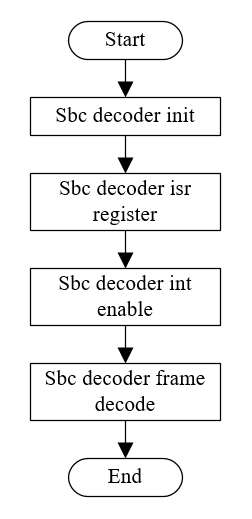

# SBC APIs[](#sbc-apis "永久链接至标题")

[[English]](../../../../en/v1.5/api-reference/multi_media/bk_sbc.html "../../../../en/v1.5/api-reference/multi_media/bk_sbc.html")

重要

The SBC Driver is just only APIs for SBC decoding function. And the SBC API v1.0 is the lastest and stable SBC decoder APIs. All new applications should use SBC API v1.0.

## SBC User Guide[](#sbc-user-guide "永久链接至标题")

The sbc and msbc are used as follow:

SBC User Guide Flow[](#id2 "永久链接至图片")

## SBC Interface[](#sbc-interface "永久链接至标题")

The BK SBC Driver supports following functions:

> - sbc function
> - msbc function

The SBC Driver support msbc decoder function. If the application need to use msbc decoder function, Just use the bk_sbc_decoder_support msbc() to enable msbc function.

## SBC API Categories[](#sbc-api-categories "永久链接至标题")

Most of SBC APIs can be categoried as:

> - Common or sbc APIs
>
>   The common APIs are prefixed with bk_sbc, the APIs may be common for sbc and msbc interfaces, e.g. bk_sbc_decoder_init() etc.
> - MSBC function APIs.
>
>   The APIs provide support for msbc function. e.g. bk_sbc_decoder_support msbc().

Common APIs:
:   - [`bk_sbc_decoder_init()`](#_CPPv419bk_sbc_decoder_initP19sbcdecodercontext_t "bk_sbc_decoder_init") - init the sbc module

    - [`bk_sbc_decoder_deinit()`](#_CPPv421bk_sbc_decoder_deinitv "bk_sbc_decoder_deinit") - deinit the sbc module

    - [`bk_sbc_decoder_bit_allocation()`](#_CPPv429bk_sbc_decoder_bit_allocationP18sbccommoncontext_t "bk_sbc_decoder_bit_allocation") - calculate the bit allocation

    - [`bk_sbc_decoder_frame_decode()`](#_CPPv427bk_sbc_decoder_frame_decodeP19sbcdecodercontext_tPK7uint8_t8uint32_t "bk_sbc_decoder_frame_decode") - decode one sbc frame

    - [`bk_sbc_decoder_interrupt_enable()`](#_CPPv431bk_sbc_decoder_interrupt_enableb "bk_sbc_decoder_interrupt_enable") - enable or disable the sbc interrupt

    - [`bk_sbc_decoder_support_msbc()`](#_CPPv427bk_sbc_decoder_support_msbcb "bk_sbc_decoder_support_msbc") - enable or disable msbc decoder function

    - [`bk_sbc_decoder_register_sbc_isr()`](#_CPPv431bk_sbc_decoder_register_sbc_isr17sbc_decoder_isr_tPv "bk_sbc_decoder_register_sbc_isr") - register sbc isr

## API Reference[](#api-reference "永久链接至标题")

### Header File[](#header-file "永久链接至标题")

- [sbc.h](http://192.168.0.46/gerrit/plugins/gitiles/iot/wcn/projects/+/refs/heads/armino_main/components/sbc.h "http://192.168.0.46/gerrit/plugins/gitiles/iot/wcn/projects/+/refs/heads/armino_main/components/sbc.h")

### Functions[](#functions "永久链接至标题")

[bk_err_t](../system/os.html#_CPPv48bk_err_t "bk_err_t") bk_sbc_decoder_frame_decode([sbcdecodercontext_t](#_CPPv419sbcdecodercontext_t "sbcdecodercontext_t") *sbc, const uint8_t *data, uint32_t length)[](#_CPPv427bk_sbc_decoder_frame_decodeP19sbcdecodercontext_tPK7uint8_t8uint32_t "永久链接至目标")
:   SBC decoder decode one frame.

    This API decode one frame by sbc decoder.

    Usage example:

    [sbcdecodercontext_t](#structsbcdecodercontext__t "#structsbcdecodercontext__t") sbc_decoder; bk_sbc_decoder_frame_decode(&sbc_decoder, sbc_data, 512);

    **Attention**
    :   1. the output PCM data please refer to the follows variables:

        - sbc->pcm_sample: means output PCM data address

        - sbc->pcm_length: means output PCM data length in sample

        - sbc->channel_number: means output PCM data channels

    参数
    :   **sbc, :** – sbc decoder context pointer;

        - data: buffer to be decoded;

        - length: the length of input buffer;

    返回
    :   - consumed: buffer length by decoder if no error ocurs, else error code (always small than 0) will be return.

[bk_err_t](../system/os.html#_CPPv48bk_err_t "bk_err_t") bk_sbc_decoder_bit_allocation([sbccommoncontext_t](#_CPPv418sbccommoncontext_t "sbccommoncontext_t") *sbc)[](#_CPPv429bk_sbc_decoder_bit_allocationP18sbccommoncontext_t "永久链接至目标")
:   SBC bit allocation calculate for both encoder and decoder.

    This API calculate sbc bit allocation.

    参数
    :   **sbc, :** – sbc decoder context pointer

    返回
    :   - BK_OK: succeed

        - others: other errors.

[bk_err_t](../system/os.html#_CPPv48bk_err_t "bk_err_t") bk_sbc_decoder_init([sbcdecodercontext_t](#_CPPv419sbcdecodercontext_t "sbcdecodercontext_t") *sbc)[](#_CPPv419bk_sbc_decoder_initP19sbcdecodercontext_t "永久链接至目标")
:   SBC decoder initialize.

    This API init the sbc decoder function.

    参数
    :   **sbc, :** – sbc decoder context pointer

    返回
    :   - BK_OK: succeed

        - others: other errors.

[bk_err_t](../system/os.html#_CPPv48bk_err_t "bk_err_t") bk_sbc_decoder_deinit(void)[](#_CPPv421bk_sbc_decoder_deinitv "永久链接至目标")
:   SBC decoder deinit.

    This API deinit the sbc decoder function.

    参数
    :   **None** –

    返回
    :   - BK_OK: succeed

        - others: other errors.

[bk_err_t](../system/os.html#_CPPv48bk_err_t "bk_err_t") bk_sbc_decoder_interrupt_enable(bool enable)[](#_CPPv431bk_sbc_decoder_interrupt_enableb "永久链接至目标")
:   enable/disable sbc interrupt

    This API enable or disable sbc interrupt:

    - reigster interrupt service handle

    - enable or disable sbc interrupt

    参数
    :   **enable, :** – enable —— 1, disable —— 0

    返回
    :   - BK_OK: succeed

        - others: other errors.

[bk_err_t](../system/os.html#_CPPv48bk_err_t "bk_err_t") bk_sbc_decoder_support_msbc(bool enable)[](#_CPPv427bk_sbc_decoder_support_msbcb "永久链接至目标")
:   enable/disable msbc decoder

    This API enable/disable msbc decoder.

    参数
    :   **enable, :** – enable —— 1, disable —— 0

    返回
    :   - BK_OK: succeed

        - others: other errors.

[bk_err_t](../system/os.html#_CPPv48bk_err_t "bk_err_t") bk_sbc_decoder_register_sbc_isr([sbc_decoder_isr_t](#_CPPv417sbc_decoder_isr_t "sbc_decoder_isr_t") isr, void *param)[](#_CPPv431bk_sbc_decoder_register_sbc_isr17sbc_decoder_isr_tPv "永久链接至目标")
:   Register sbc decoder isr.

    This API register sbc decoder isr.

    参数
    :   **isr, :** – sbc decoder isr callback;

        - param: sbc decoder isr callback parameter;

    返回
    :   - BK_OK: succeed

        - others: other errors.

## API Typedefs[](#api-typedefs "永久链接至标题")

### Header File[](#id1 "永久链接至标题")

- [sbc_types.h](http://192.168.0.46/gerrit/plugins/gitiles/iot/wcn/projects/+/refs/heads/armino_main/components/sbc_types.h "http://192.168.0.46/gerrit/plugins/gitiles/iot/wcn/projects/+/refs/heads/armino_main/components/sbc_types.h")

### Structures[](#structures "永久链接至标题")

struct sbccommoncontext_t[](#_CPPv418sbccommoncontext_t "永久链接至目标")
:   SBC decoder context.

    Public Members

    int8_t blocks[](#_CPPv4N18sbccommoncontext_t6blocksE "永久链接至目标")
    :   block number

    int8_t subbands[](#_CPPv4N18sbccommoncontext_t8subbandsE "永久链接至目标")
    :   subbands number

    uint8_t join[](#_CPPv4N18sbccommoncontext_t4joinE "永久链接至目标")
    :   bit number x set means joint stereo has been used in subband x

    uint8_t bitpool[](#_CPPv4N18sbccommoncontext_t7bitpoolE "永久链接至目标")
    :   indicate the size of the bit allocation pool that has been used for encoding the stream

    int8_t channel_mode[](#_CPPv4N18sbccommoncontext_t12channel_modeE "永久链接至目标")
    :   channel mode

    int8_t sample_rate_index[](#_CPPv4N18sbccommoncontext_t17sample_rate_indexE "永久链接至目标")
    :   sample rate index, 0:16000, 1:32000, 2:44100, 3:48000

    int8_t allocation_method[](#_CPPv4N18sbccommoncontext_t17allocation_methodE "永久链接至目标")
    :   allocation method

    int8_t reserved8[](#_CPPv4N18sbccommoncontext_t9reserved8E "永久链接至目标")
    :   dummy, reserved for byte align

    int8_t bits[2][8][](#_CPPv4N18sbccommoncontext_t4bitsE "永久链接至目标")
    :   calculate result by bit allocation

    int8_t scale_factor[2][8][](#_CPPv4N18sbccommoncontext_t12scale_factorE "永久链接至目标")
    :   only the lower 4 bits of every element are to be used

    int32_t mem[2][8][](#_CPPv4N18sbccommoncontext_t3memE "永久链接至目标")
    :   Memory used as bit need and levels

struct sbcdecodercontext_t[](#_CPPv419sbcdecodercontext_t "永久链接至目标")
:   SBC decoder context.

    Public Members

    int8_t channel_number[](#_CPPv4N19sbcdecodercontext_t14channel_numberE "永久链接至目标")
    :   channels number

    uint8_t pcm_length[](#_CPPv4N19sbcdecodercontext_t10pcm_lengthE "永久链接至目标")
    :   PCM length

    uint16_t sample_rate[](#_CPPv4N19sbcdecodercontext_t11sample_rateE "永久链接至目标")
    :   sample rate

    int32_t pcm_sample[2][128][](#_CPPv4N19sbcdecodercontext_t10pcm_sampleE "永久链接至目标")
    :   PCM frame buffer

    int32_t vfifo[2][170][](#_CPPv4N19sbcdecodercontext_t5vfifoE "永久链接至目标")
    :   FIFO V for subbands synthesis calculation.

struct sbc_config_t[](#_CPPv412sbc_config_t "永久链接至目标")
:   Public Members

    [sbc_channel_num_t](#_CPPv417sbc_channel_num_t "sbc_channel_num_t") channel_num[](#_CPPv4N12sbc_config_t11channel_numE "永久链接至目标")
    :   channels number

    [sbc_subband_number_t](#_CPPv420sbc_subband_number_t "sbc_subband_number_t") subbands[](#_CPPv4N12sbc_config_t8subbandsE "永久链接至目标")
    :   subband number

    [sbc_chn_comb_t](#_CPPv414sbc_chn_comb_t "sbc_chn_comb_t") chn_comb[](#_CPPv4N12sbc_config_t8chn_combE "永久链接至目标")
    :   pcm output struct

    [sbc_blocks_number_t](#_CPPv419sbc_blocks_number_t "sbc_blocks_number_t") blocks[](#_CPPv4N12sbc_config_t6blocksE "永久链接至目标")
    :   block number

### Macros[](#macros "永久链接至标题")

SBC_SYNCWORD[](#c.SBC_SYNCWORD "永久链接至目标")
:   SBC synchronize word

MSBC_SYNCWORD[](#c.MSBC_SYNCWORD "永久链接至目标")
:   MSBC synchronize word

SBC_CHANNEL_MODE_MONO[](#c.SBC_CHANNEL_MODE_MONO "永久链接至目标")
:   SBC channel mode : MONO

SBC_CHANNEL_MODE_DUAL[](#c.SBC_CHANNEL_MODE_DUAL "永久链接至目标")
:   SBC channel mode : Dual Channels

SBC_CHANNEL_MODE_STEREO[](#c.SBC_CHANNEL_MODE_STEREO "永久链接至目标")
:   SBC channel mode : Stereo

SBC_CHANNEL_MODE_JOINT_STEREO[](#c.SBC_CHANNEL_MODE_JOINT_STEREO "永久链接至目标")
:   SBC channel mode : Joint Stereo

SBC_DECODER_ERRORS[](#c.SBC_DECODER_ERRORS "永久链接至目标")

SBC_DECODER_ERROR_BUFFER_OVERFLOW[](#c.SBC_DECODER_ERROR_BUFFER_OVERFLOW "永久链接至目标")
:   buffer overflow

SBC_DECODER_ERROR_SYNC_INCORRECT[](#c.SBC_DECODER_ERROR_SYNC_INCORRECT "永久链接至目标")
:   synchronize incorrect

SBC_DECODER_ERROR_BITPOOL_OUT_BOUNDS[](#c.SBC_DECODER_ERROR_BITPOOL_OUT_BOUNDS "永久链接至目标")
:   bitpool out of bounds

SBC_DECODER_ERROR_STREAM_EMPTY[](#c.SBC_DECODER_ERROR_STREAM_EMPTY "永久链接至目标")
:   stream empty

SBC_DECODER_ERROR_OK[](#c.SBC_DECODER_ERROR_OK "永久链接至目标")
:   no error

### Type Definitions[](#type-definitions "永久链接至标题")

typedef void (*sbc_decoder_isr_t)(void *param)[](#_CPPv417sbc_decoder_isr_t "永久链接至目标")

### Enumerations[](#enumerations "永久链接至标题")

enum sbc_sample_rates_t[](#_CPPv418sbc_sample_rates_t "永久链接至目标")
:   *Values:*

    enumerator SBC_SAMPLE_RATE_16000[](#_CPPv4N18sbc_sample_rates_t21SBC_SAMPLE_RATE_16000E "永久链接至目标")
    :   SBC sampling frequency : 16.0KHz

    enumerator SBC_SAMPLE_RATE_32000[](#_CPPv4N18sbc_sample_rates_t21SBC_SAMPLE_RATE_32000E "永久链接至目标")
    :   SBC sampling frequency : 32.0KHz

    enumerator SBC_SAMPLE_RATE_44100[](#_CPPv4N18sbc_sample_rates_t21SBC_SAMPLE_RATE_44100E "永久链接至目标")
    :   SBC sampling frequency : 44.1KHz

    enumerator SBC_SAMPLE_RATE_48000[](#_CPPv4N18sbc_sample_rates_t21SBC_SAMPLE_RATE_48000E "永久链接至目标")
    :   SBC sampling frequency : 48.0KHz

    enumerator SBC_SAMPLE_RATE_MAX[](#_CPPv4N18sbc_sample_rates_t19SBC_SAMPLE_RATE_MAXE "永久链接至目标")

enum sbc_channel_num_t[](#_CPPv417sbc_channel_num_t "永久链接至目标")
:   *Values:*

    enumerator SBC_CHANNEL_NUM_ONE[](#_CPPv4N17sbc_channel_num_t19SBC_CHANNEL_NUM_ONEE "永久链接至目标")
    :   SBC channel number : 1 channel

    enumerator SBC_CHANNEL_NUM_TWO[](#_CPPv4N17sbc_channel_num_t19SBC_CHANNEL_NUM_TWOE "永久链接至目标")
    :   SBC channel number : 2 channels

    enumerator SBC_CHANNEL_MODE_INVALID[](#_CPPv4N17sbc_channel_num_t24SBC_CHANNEL_MODE_INVALIDE "永久链接至目标")

enum sbc_subband_number_t[](#_CPPv420sbc_subband_number_t "永久链接至目标")
:   *Values:*

    enumerator SBC_SUBBAND_NUMBER_4[](#_CPPv4N20sbc_subband_number_t20SBC_SUBBAND_NUMBER_4E "永久链接至目标")
    :   SBC subbands number 4

    enumerator SBC_SUBBAND_NUMBER_8[](#_CPPv4N20sbc_subband_number_t20SBC_SUBBAND_NUMBER_8E "永久链接至目标")
    :   SBC subbands number 8

    enumerator SBC_SUBBAND_MAX[](#_CPPv4N20sbc_subband_number_t15SBC_SUBBAND_MAXE "永久链接至目标")

enum sbc_chn_comb_t[](#_CPPv414sbc_chn_comb_t "永久链接至目标")
:   *Values:*

    enumerator SBC_DECODE_OUTPUT_SINGLE[](#_CPPv4N14sbc_chn_comb_t24SBC_DECODE_OUTPUT_SINGLEE "永久链接至目标")
    :   SBC decoder output struct:{16’d0, pcm}

    enumerator SBC_DECODE_OUTPUT_DOUBLE[](#_CPPv4N14sbc_chn_comb_t24SBC_DECODE_OUTPUT_DOUBLEE "永久链接至目标")
    :   SBC decoder output struct:{pcm_chn2, pcm_chn1}

    enumerator SBC_DECODE_OUTPUT_INVALID[](#_CPPv4N14sbc_chn_comb_t25SBC_DECODE_OUTPUT_INVALIDE "永久链接至目标")

enum sbc_blocks_number_t[](#_CPPv419sbc_blocks_number_t "永久链接至目标")
:   *Values:*

    enumerator SBC_BLOCK_NUMBER_4[](#_CPPv4N19sbc_blocks_number_t18SBC_BLOCK_NUMBER_4E "永久链接至目标")
    :   SBC blocks number 4

    enumerator SBC_BLOCK_NUMBER_8[](#_CPPv4N19sbc_blocks_number_t18SBC_BLOCK_NUMBER_8E "永久链接至目标")
    :   SBC blocks number 8

    enumerator SBC_BLOCK_NUMBER_12[](#_CPPv4N19sbc_blocks_number_t19SBC_BLOCK_NUMBER_12E "永久链接至目标")
    :   SBC blocks number 12

    enumerator SBC_BLOCK_NUMBER_16[](#_CPPv4N19sbc_blocks_number_t19SBC_BLOCK_NUMBER_16E "永久链接至目标")
    :   SBC blocks number 16

    enumerator SBC_BLOCK_NUMBER_MAX[](#_CPPv4N19sbc_blocks_number_t20SBC_BLOCK_NUMBER_MAXE "永久链接至目标")

enum sbc_allocation_method_t[](#_CPPv423sbc_allocation_method_t "永久链接至目标")
:   *Values:*

    enumerator SBC_ALLOCATION_METHOD_LOUDNESS[](#_CPPv4N23sbc_allocation_method_t30SBC_ALLOCATION_METHOD_LOUDNESSE "永久链接至目标")
    :   SBC allocation method : Loudness

    enumerator SBC_ALLOCATION_METHOD_SNR[](#_CPPv4N23sbc_allocation_method_t25SBC_ALLOCATION_METHOD_SNRE "永久链接至目标")
    :   SBC allocation method : SNR

    enumerator SBC_ALLOCATION_METHOD_INVALID[](#_CPPv4N23sbc_allocation_method_t29SBC_ALLOCATION_METHOD_INVALIDE "永久链接至目标")
