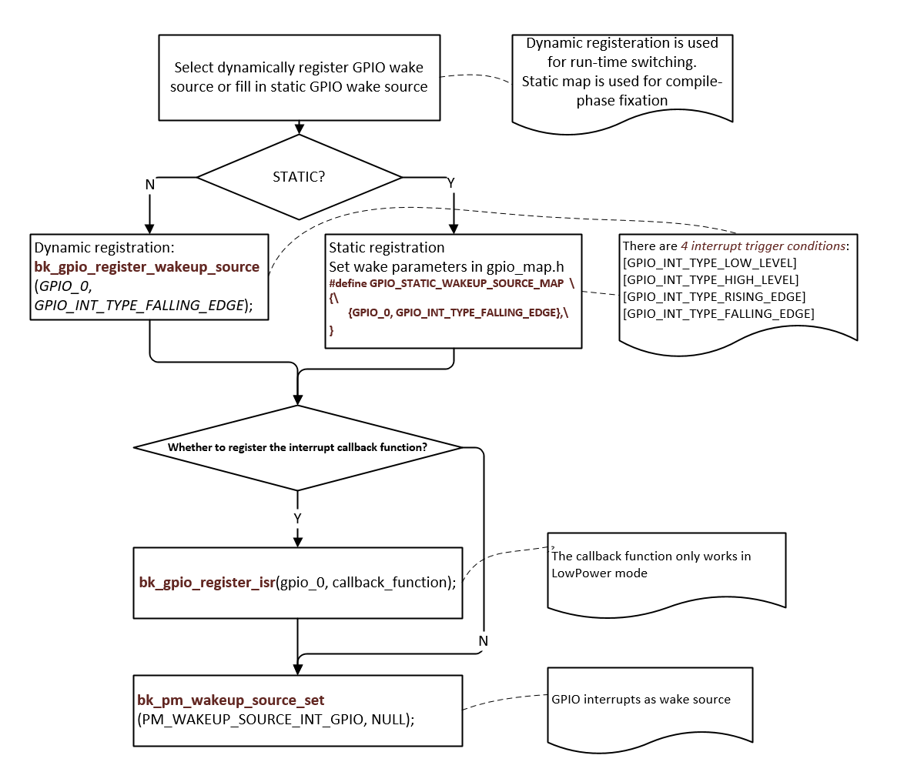

# GPIO[](#gpio "永久链接至标题")

[[English]](../../../../en/v1.5/api-reference/peripheral/bk_gpio.html "../../../../en/v1.5/api-reference/peripheral/bk_gpio.html")

Beken chip supports abundant GPIO pins, some GPIOs can’t be used by the application:

> - In most Beken chips, UART2 is enabled by default and GPIO 0 and GPIO 1 are used by UART2.
> - Some GPIOs may be used by specific peripheral device, the application can’t use the GPIOs used by that device if the device is enabled by software. E.g. in BK7271, the SPI-1 can use GPIO 2/3/4/5, the application can’t use GPIO 2/3/4/5 if SPI-1 is enabled by the software, the application can still use GPIO 2/3/4/5 if the SPI-1 is disabled by software.
> - Some GPIO groups may be used by specific peripheral device, the application can’t use that GPIO group if the device chooses that GPIO group and the device is enabled by software. E.g. SPI-3 can use GPIO 30/31/32/33 or GPIO GPIO 36/37/38/39, if the software enable the SPI-3 and configure it to use the first GPIO group (GPIO 30/31/32/33), the application can’t use GPIO 30/31/32/33, but the application can still use 2nd GPIO group (GPIO 36/37/38/39) if they are not used by other devices. The application can use both group if SPI-3 is NOT enabled and other devices also don’t use them.

If the GPIOs are already used by the periperal devices, the GPIO API, such as [`bk_gpio_set_config()`](#_CPPv418bk_gpio_set_config9gpio_id_tPK13gpio_config_t "bk_gpio_set_config") will return GPIO_ERR_INTERNAL_USED.

Generally speaking, the GPIO user can take following steps to use the GPIO:

> - Read the chip hardware datasheet to gain overview about how the peripheral use the GPIOs
> - Check the enabled peripheral device in your application and find out the GPIOs used by the devices
> - Always check the return value of GPIO API, make sure it’s not GPIO_ERR_INTERNAL_USED

备注

If peripheral is enabled after the application configure it’s GPIO, we have no way to detect the GPIO conflict between the application and peripheral usage, the application need to pay attention to it.

## GPIO MAP Config[](#gpio-map-config "永久链接至标题")

> gpio_map.h
>
> GPIO is configured according to the MAP(GPIO_DEFAULT_DEV_CONFIG) during driver initialization. Each row in the map contains nine elements.
> The 9 elements are as follows:
>
> > - gpio_id: Corresponding PIN number starting from 0
> > - second_func_en: Whether to enable the secondary function
> > - second_func_dev: Select the second function of the PIN
> > - io_mode: Select the IO operating mode, inputoutputhigh resistance
> > - pull_mode: Select IO level pull up or pull down
> > - int_en: Whether to turn on interrupt
> > - int_type: Select trigger interrupt condition, high/low/rise/fall
> > - low_power_io_ctrl: Low power whether to maintain the output level
> > - driver_capacity: Driver ability selection, a total of four levels

备注

gpio_map.h must be configured. GPIO configuration varies with product types.

Example:

Configure GPIO_0 to function [GPIO_DEV_I2C1_SCL] and GPIO_1 to function [GPIO_DEV_I2C1_SDA]:
:   | gpio_id | second_func_en | second_func_dev | io_mode | pull_mode | int_en | int_type | low_power_io_ctrl | driver_capacity |
    | --- | --- | --- | --- | --- | --- | --- | --- | --- |
    | GPIO_0 | GPIO_SECOND_FUNC_ENABLE | GPIO_DEV_I2C1_SCL | GPIO_IO_DISABLE | GPIO_PULL_DISABLE | GPIO_INT_DISABLE | GPIO_INT_TYPE_LOW_LEVEL | GPIO_LOW_POWER_DISCARD_IO_STATUS | GPIO_DRIVER_CAPACITY_3 |
    | GPIO_1 | GPIO_SECOND_FUNC_ENABLE | GPIO_DEV_I2C1_SDA | GPIO_IO_DISABLE | GPIO_PULL_DISABLE | GPIO_INT_DISABLE | GPIO_INT_TYPE_LOW_LEVEL | GPIO_LOW_POWER_DISCARD_IO_STATUS | GPIO_DRIVER_CAPACITY_3 |

    - PS:GPIO is turned off by default when the second function is used (io_mode is [GPIO_IO_DISABLE]). I2C needs more driving capability (driver_capacity is [GPIO_DRIVER_CAPACITY_3]).

GPIO_0 is set to high resistance(Default state):
:   | gpio_id | second_func_en | second_func_dev | io_mode | pull_mode | int_en | int_type | low_power_io_ctrl | driver_capacity |
    | --- | --- | --- | --- | --- | --- | --- | --- | --- |
    | GPIO_0 | GPIO_SECOND_FUNC_DISABLE | GPIO_DEV_INVALID | GPIO_IO_DISABLE | GPIO_PULL_DISABLE | GPIO_INT_DISABLE | GPIO_INT_TYPE_LOW_LEVEL | GPIO_LOW_POWER_DISCARD_IO_STATUS | GPIO_DRIVER_CAPACITY_0 |

    - PS:Disable all config

GPIO_0 is set to input key and falling edge to trigger the interrupt:
:   | gpio_id | second_func_en | second_func_dev | io_mode | pull_mode | int_en | int_type | low_power_io_ctrl | driver_capacity |
    | --- | --- | --- | --- | --- | --- | --- | --- | --- |
    | GPIO_0 | GPIO_SECOND_FUNC_DISABLE | GPIO_DEV_INVALID | GPIO_INPUT_ENABLE | GPIO_PULL_UP_EN | GPIO_INT_ENABLE | GPIO_INT_TYPE_FALLING_EDGE | GPIO_LOW_POWER_DISCARD_IO_STATUS | GPIO_DRIVER_CAPACITY_0 |

    - PS:Turn off the second function related. There are 4 interrupt trigger conditions:[GPIO_INT_TYPE_LOW_LEVEL],[GPIO_INT_TYPE_HIGH_LEVEL],[GPIO_INT_TYPE_RISING_EDGE],[GPIO_INT_TYPE_FALLING_EDGE].

GPIO_0 acts as a low power wake-up source:
:   | gpio_id | second_func_en | second_func_dev | io_mode | pull_mode | int_en | int_type | low_power_io_ctrl | driver_capacity |
    | --- | --- | --- | --- | --- | --- | --- | --- | --- |
    | GPIO_0 | GPIO_SECOND_FUNC_DISABLE | GPIO_DEV_INVALID | GPIO_INPUT_ENABLE | GPIO_PULL_UP_EN | GPIO_INT_ENABLE | GPIO_INT_TYPE_FALLING_EDGE | GPIO_LOW_POWER_DISCARD_IO_STATUS | GPIO_DRIVER_CAPACITY_0 |

    - PS:low_power_io_ctrl is [GPIO_LOW_POWER_KEEP_INPUT_STATUS], int_type is [GPIO_INT_TYPE_RISING_EDGE] or [GPIO_INT_TYPE_FALLING_EDGE];

## GPIO API Status[](#gpio-api-status "永久链接至标题")

| API | BK7256 | BK7256_cp1 |
| --- | --- | --- |
| [`bk_gpio_driver_init()`](#_CPPv419bk_gpio_driver_initv "bk_gpio_driver_init") | Y | Y |
| [`bk_gpio_driver_deinit()`](#_CPPv421bk_gpio_driver_deinitv "bk_gpio_driver_deinit") | Y | Y |
| [`bk_gpio_enable_output()`](#_CPPv421bk_gpio_enable_output9gpio_id_t "bk_gpio_enable_output") | Y | Y |
| [`bk_gpio_disable_output()`](#_CPPv422bk_gpio_disable_output9gpio_id_t "bk_gpio_disable_output") | Y | Y |
| [`bk_gpio_enable_input()`](#_CPPv420bk_gpio_enable_input9gpio_id_t "bk_gpio_enable_input") | Y | Y |
| [`bk_gpio_disable_input()`](#_CPPv421bk_gpio_disable_input9gpio_id_t "bk_gpio_disable_input") | Y | Y |
| [`bk_gpio_enable_pull()`](#_CPPv419bk_gpio_enable_pull9gpio_id_t "bk_gpio_enable_pull") | Y | Y |
| [`bk_gpio_disable_pull()`](#_CPPv420bk_gpio_disable_pull9gpio_id_t "bk_gpio_disable_pull") | Y | Y |
| [`bk_gpio_pull_up()`](#_CPPv415bk_gpio_pull_up9gpio_id_t "bk_gpio_pull_up") | Y | Y |
| [`bk_gpio_pull_down()`](#_CPPv417bk_gpio_pull_down9gpio_id_t "bk_gpio_pull_down") | Y | Y |
| [`bk_gpio_set_output_high()`](#_CPPv423bk_gpio_set_output_high9gpio_id_t "bk_gpio_set_output_high") | Y | Y |
| [`bk_gpio_set_output_low()`](#_CPPv422bk_gpio_set_output_low9gpio_id_t "bk_gpio_set_output_low") | Y | Y |
| [`bk_gpio_get_input()`](#_CPPv417bk_gpio_get_input9gpio_id_t "bk_gpio_get_input") | Y | Y |
| [`bk_gpio_set_config()`](#_CPPv418bk_gpio_set_config9gpio_id_tPK13gpio_config_t "bk_gpio_set_config") | Y | Y |
| [`bk_gpio_register_isr()`](#_CPPv420bk_gpio_register_isr9gpio_id_t10gpio_isr_t "bk_gpio_register_isr") | Y | Y |
| [`bk_gpio_enable_interrupt()`](#_CPPv424bk_gpio_enable_interrupt9gpio_id_t "bk_gpio_enable_interrupt") | Y | Y |
| [`bk_gpio_disable_interrupt()`](#_CPPv425bk_gpio_disable_interrupt9gpio_id_t "bk_gpio_disable_interrupt") | Y | Y |
| [`bk_gpio_set_interrupt_type()`](#_CPPv426bk_gpio_set_interrupt_type9gpio_id_t15gpio_int_type_t "bk_gpio_set_interrupt_type") | Y | Y |

## Application Example[](#application-example "永久链接至标题")

DEMO1:
:   GPIO_0 as wake-up source for DeepSleep or LowPower, pseudo code description and interpretation.

Figure 1. GPIO as wake-up source for DeepSleep or LowPower[](#id2 "永久链接至图片")

## GPIO API Reference[](#gpio-api-reference "永久链接至标题")

### Header File[](#header-file "永久链接至标题")

- [gpio.h](http://192.168.0.46/gerrit/plugins/gitiles/iot/wcn/projects/+/refs/heads/armino_main/components/gpio.h "http://192.168.0.46/gerrit/plugins/gitiles/iot/wcn/projects/+/refs/heads/armino_main/components/gpio.h")

### Functions[](#functions "永久链接至标题")

[bk_err_t](../system/os.html#_CPPv48bk_err_t "bk_err_t") bk_gpio_driver_init(void)[](#_CPPv419bk_gpio_driver_initv "永久链接至目标")
:   Init the GPIO driver.

    This API init the resoure common to all GPIO channels:

    - Init GPIO driver control memory

    This API should be called before any other GPIO APIs.

    返回
    :   - BK_OK: succeed

        - others: other errors.

[bk_err_t](../system/os.html#_CPPv48bk_err_t "bk_err_t") bk_gpio_driver_deinit(void)[](#_CPPv421bk_gpio_driver_deinitv "永久链接至目标")
:   Deinit the GPIO driver.

    This API free all resource related to GPIO and power down all GPIO channels.

    返回
    :   - BK_OK: succeed

        - others: other errors.

void bk_gpio_set_value(gpio_id_t id, uint32_t v)[](#_CPPv417bk_gpio_set_value9gpio_id_t8uint32_t "永久链接至目标")
:   Direct set GPIO config value.

    Please be care to use this API,unless you know the detail mean, because it will set the GPIO config value. Sometimes the special GPIO needs to re-used by one more owner, after the second owner re-used it, it should restore the config value. Before re-use a GPIO, the owner can call bk_gpio_get_value and bakup it, after re-used finish, it call bk_gpio_set_value to restore the prevous value.

uint32_t bk_gpio_get_value(gpio_id_t id)[](#_CPPv417bk_gpio_get_value9gpio_id_t "永久链接至目标")
:   get GPIO config value.

[bk_err_t](../system/os.html#_CPPv48bk_err_t "bk_err_t") bk_gpio_enable_output(gpio_id_t gpio_id)[](#_CPPv421bk_gpio_enable_output9gpio_id_t "永久链接至目标")
:   enable GPIO output mode

    返回
    :   - BK_OK: succeed

        - BK_ERR_GPIO_CHAN_ID: invalid GPIO channel

        - others: other errors.

[bk_err_t](../system/os.html#_CPPv48bk_err_t "bk_err_t") bk_gpio_disable_output(gpio_id_t gpio_id)[](#_CPPv422bk_gpio_disable_output9gpio_id_t "永久链接至目标")
:   disable GPIO output mode

    返回
    :   - BK_OK: succeed

        - BK_ERR_GPIO_CHAN_ID: invalid GPIO channel

        - others: other errors.

[bk_err_t](../system/os.html#_CPPv48bk_err_t "bk_err_t") bk_gpio_enable_input(gpio_id_t gpio_id)[](#_CPPv420bk_gpio_enable_input9gpio_id_t "永久链接至目标")
:   enable GPIO input mode

    返回
    :   - BK_OK: succeed

        - BK_ERR_GPIO_CHAN_ID: invalid GPIO channel

        - others: other errors.

[bk_err_t](../system/os.html#_CPPv48bk_err_t "bk_err_t") bk_gpio_disable_input(gpio_id_t gpio_id)[](#_CPPv421bk_gpio_disable_input9gpio_id_t "永久链接至目标")
:   disable GPIO input mode

    返回
    :   - BK_OK: succeed

        - BK_ERR_GPIO_CHAN_ID: invalid GPIO channel

        - others: other errors.

[bk_err_t](../system/os.html#_CPPv48bk_err_t "bk_err_t") bk_gpio_enable_pull(gpio_id_t gpio_id)[](#_CPPv419bk_gpio_enable_pull9gpio_id_t "永久链接至目标")
:   enable GPIO pull mode

    返回
    :   - BK_OK: succeed

        - BK_ERR_GPIO_CHAN_ID: invalid GPIO channel

        - others: other errors.

[bk_err_t](../system/os.html#_CPPv48bk_err_t "bk_err_t") bk_gpio_disable_pull(gpio_id_t gpio_id)[](#_CPPv420bk_gpio_disable_pull9gpio_id_t "永久链接至目标")
:   disable gpio pull mode

    返回
    :   - BK_OK: succeed

        - BK_ERR_GPIO_CHAN_ID: invalid GPIO channel

        - others: other errors.

[bk_err_t](../system/os.html#_CPPv48bk_err_t "bk_err_t") bk_gpio_pull_up(gpio_id_t gpio_id)[](#_CPPv415bk_gpio_pull_up9gpio_id_t "永久链接至目标")
:   set GPIO as pull up mode

    返回
    :   - BK_OK: succeed

        - BK_ERR_GPIO_CHAN_ID: invalid GPIO channel

        - others: other errors.

[bk_err_t](../system/os.html#_CPPv48bk_err_t "bk_err_t") bk_gpio_pull_down(gpio_id_t gpio_id)[](#_CPPv417bk_gpio_pull_down9gpio_id_t "永久链接至目标")
:   set GPIO as pull down mode

    返回
    :   - BK_OK: succeed

        - BK_ERR_GPIO_CHAN_ID: invalid GPIO channel

        - others: other errors.

[bk_err_t](../system/os.html#_CPPv48bk_err_t "bk_err_t") bk_gpio_set_config(gpio_id_t gpio_id, const gpio_config_t *config)[](#_CPPv418bk_gpio_set_config9gpio_id_tPK13gpio_config_t "永久链接至目标")
:   Config the GPIO mode.

    This API config GPIO’s mode

    - BK_OK: succeed

    - BK_ERR_GPIO_CHAN_ID: invalid GPIO channel

    - BK_ERR_GPIO_INVALID_MODE: invalid GPIO’s io_mode/pull_mode

    - BK_ERR_GPIO_INTERNAL_USED:GPIO was map to another device

    - others: other errors.

[bk_err_t](../system/os.html#_CPPv48bk_err_t "bk_err_t") bk_gpio_set_output_high(gpio_id_t gpio_id)[](#_CPPv423bk_gpio_set_output_high9gpio_id_t "永久链接至目标")
:   Set the GPIO output high,.

    返回
    :   - BK_OK: succeed

        - BK_ERR_GPIO_CHAN_ID: invalid GPIO channel

        - BK_ERR_GPIO_NOT_OUTPUT_MODE:GPIO not in output mode

        - others: other errors.

[bk_err_t](../system/os.html#_CPPv48bk_err_t "bk_err_t") bk_gpio_set_output_low(gpio_id_t gpio_id)[](#_CPPv422bk_gpio_set_output_low9gpio_id_t "永久链接至目标")
:   Set the GPIO output low,.

    返回
    :   - BK_OK: succeed

        - BK_ERR_GPIO_CHAN_ID: invalid GPIO channel

        - BK_ERR_GPIO_NOT_OUTPUT_MODE:GPIO not in output mode

        - others: other errors.

bool bk_gpio_get_input(gpio_id_t gpio_id)[](#_CPPv417bk_gpio_get_input9gpio_id_t "永久链接至目标")
:   Get the GPIO input value,.

    This API get GPIO’s input level: 0 :low_level 1:high_level.

    返回
    :   - input value

        - BK_ERR_GPIO_CHAN_ID: invalid GPIO channel

        - BK_ERR_GPIO_NOT_INPUT_MODE : GPIO is not input mode

        - others: other errors.

bool bk_gpio_set_capacity(gpio_id_t gpio_id, uint32 capacity)[](#_CPPv420bk_gpio_set_capacity9gpio_id_t6uint32 "永久链接至目标")
:   Set the GPIO driver capacity.

    This API Set GPIO’s output driver capacity which range is 0~3.

    返回
    :   - input value

        - BK_ERR_GPIO_CHAN_ID: invalid GPIO channel

        - BK_ERR_GPIO_NOT_INPUT_MODE : GPIO is not input mode

        - others: other errors.

[bk_err_t](../system/os.html#_CPPv48bk_err_t "bk_err_t") bk_gpio_set_interrupt_type(gpio_id_t gpio_id, gpio_int_type_t type)[](#_CPPv426bk_gpio_set_interrupt_type9gpio_id_t15gpio_int_type_t "永久链接至目标")
:   Config the GPIO intterrupt type mode when use gpio intterrupt mode,.

    This API config all GPIO channels’ intterrupt mode, the mode included in gpio_int_type_t.

    返回
    :   - BK_OK: succeed

        - BK_ERR_GPIO_CHAN_ID: invalid GPIO channel

        - BK_ERR_GPIO_INVALID_INT_TYPE: invalid GPIO int type

        - others: other errors.

[bk_err_t](../system/os.html#_CPPv48bk_err_t "bk_err_t") bk_gpio_enable_interrupt(gpio_id_t id)[](#_CPPv424bk_gpio_enable_interrupt9gpio_id_t "永久链接至目标")
:   Enable GPIO intterrupt.

    返回
    :   - BK_OK: succeed

        - BK_ERR_GPIO_CHAN_ID: invalid GPIO channel

        - BK_ERR_GPIO_NOT_INPUT_MODE : GPIO is not input mode

        - others: other errors.

[bk_err_t](../system/os.html#_CPPv48bk_err_t "bk_err_t") bk_gpio_disable_interrupt(gpio_id_t id)[](#_CPPv425bk_gpio_disable_interrupt9gpio_id_t "永久链接至目标")
:   Disable GPIO intterrupt.

    返回
    :   - BK_OK: succeed

        - BK_ERR_GPIO_CHAN_ID: invalid GPIO channel

        - others: other errors.

[bk_err_t](../system/os.html#_CPPv48bk_err_t "bk_err_t") bk_gpio_register_isr(gpio_id_t id, [gpio_isr_t](#_CPPv410gpio_isr_t "gpio_isr_t") isr)[](#_CPPv420bk_gpio_register_isr9gpio_id_t10gpio_isr_t "永久链接至目标")
:   Register the interrupt service routine for GPIO channel.

    This API regist gpio isr callback function.

    返回
    :   - BK_OK: succeed

        - BK_ERR_GPIO_CHAN_ID: invalid gpio channel

        - others: other errors.

[bk_err_t](../system/os.html#_CPPv48bk_err_t "bk_err_t") bk_gpio_reg_save(uint32_t *gpio_cfg)[](#_CPPv416bk_gpio_reg_saveP8uint32_t "永久链接至目标")
:   Register save all gpio reg value.

    This API save all gpio reg value function.

    返回
    :   - BK_OK: succeed

        - others: other errors.

[bk_err_t](../system/os.html#_CPPv48bk_err_t "bk_err_t") bk_gpio_reg_restore(uint32_t *gpio_cfg)[](#_CPPv419bk_gpio_reg_restoreP8uint32_t "永久链接至目标")
:   Register restore all gpio reg value.

    This API restore all gpio reg value function.

    返回
    :   - BK_OK: succeed

        - others: other errors.

[bk_err_t](../system/os.html#_CPPv48bk_err_t "bk_err_t") bk_gpio_wakeup_enable(int64_t index, uint64_t type_l, uint64_t type_h)[](#_CPPv421bk_gpio_wakeup_enable7int64_t8uint64_t8uint64_t "永久链接至目标")
:   Register configue the gpio wakeup value.

    This API configue the gpio wakeup value function.

    返回
    :   - BK_OK: succeed

        - B

        - others: other errors.

[bk_err_t](../system/os.html#_CPPv48bk_err_t "bk_err_t") bk_gpio_wakeup_interrupt_clear()[](#_CPPv430bk_gpio_wakeup_interrupt_clearv "永久链接至目标")
:   Register clear wake up interrupt.

    This API clear wake up interrupt function.

    返回
    :   - BK_OK: succeed

        - B

        - others: other errors.

## GPIO API Typedefs[](#gpio-api-typedefs "永久链接至标题")

### Header File[](#id1 "永久链接至标题")

- [gpio_types.h](http://192.168.0.46/gerrit/plugins/gitiles/iot/wcn/projects/+/refs/heads/armino_main/components/gpio_types.h "http://192.168.0.46/gerrit/plugins/gitiles/iot/wcn/projects/+/refs/heads/armino_main/components/gpio_types.h")

### Macros[](#macros "永久链接至标题")

BK_ERR_GPIO_CHAN_ID[](#c.BK_ERR_GPIO_CHAN_ID "永久链接至目标")
:   gpio channel number is invalid

BK_ERR_GPIO_INVALID_MODE[](#c.BK_ERR_GPIO_INVALID_MODE "永久链接至目标")
:   gpio mode is invalid

BK_ERR_GPIO_NOT_INPUT_MODE[](#c.BK_ERR_GPIO_NOT_INPUT_MODE "永久链接至目标")
:   gpio is not in input mode

BK_ERR_GPIO_SET_INVALID_FUNC_MODE[](#c.BK_ERR_GPIO_SET_INVALID_FUNC_MODE "永久链接至目标")
:   gpio perial mode is invalid or was be set as 2nd func

BK_ERR_GPIO_INVALID_INT_TYPE[](#c.BK_ERR_GPIO_INVALID_INT_TYPE "永久链接至目标")
:   gpio int type is invalid

BK_ERR_GPIOS_MAP_NONE[](#c.BK_ERR_GPIOS_MAP_NONE "永久链接至目标")
:   gpio map device is none

BK_ERR_GPIO_NOT_OUTPUT_MODE[](#c.BK_ERR_GPIO_NOT_OUTPUT_MODE "永久链接至目标")
:   gpio is not in output mode

BK_ERR_GPIO_BITS_NUM[](#c.BK_ERR_GPIO_BITS_NUM "永久链接至目标")
:   gpio map bit num is error

BK_ERR_GPIO_INTERNAL_USED[](#c.BK_ERR_GPIO_INTERNAL_USED "永久链接至目标")
:   gpio map was be map to a device

BK_ERR_GPIO_MAP_PWMS_CHAN[](#c.BK_ERR_GPIO_MAP_PWMS_CHAN "永久链接至目标")
:   gpio map to pwm pwms’ channel is invalid

BK_ERR_GPIO_INVALID_ID[](#c.BK_ERR_GPIO_INVALID_ID "永久链接至目标")
:   gpio id is invalid

BK_ERR_GPIO_WAKESOURCE_OVER_MAX_CNT[](#c.BK_ERR_GPIO_WAKESOURCE_OVER_MAX_CNT "永久链接至目标")
:   too much GPIO is register to wakeup source

### Type Definitions[](#type-definitions "永久链接至标题")

typedef void (*gpio_isr_t)(gpio_id_t gpio_id)[](#_CPPv410gpio_isr_t "永久链接至目标")
:   GPIO interrupt service routine.
