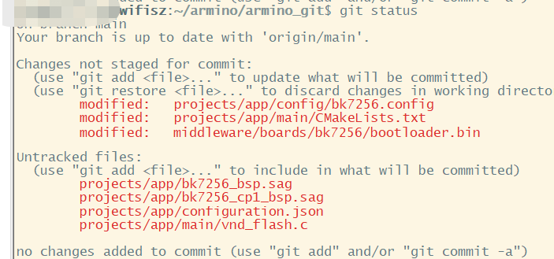

# 分区修改的组成[](#id1 "永久链接至标题")

[[English]](../../../../en/v1.5/developer-guide/partition_specification/bk_partition_files.html "../../../../en/v1.5/developer-guide/partition_specification/bk_partition_files.html")

## 一.分区修改的组成[](#id2 "永久链接至标题")

修改分区涉及到四个部分:

重要

- 分区表制作

- 打包脚本的配置文件

- 链接脚本配置文件（sag）的制作

- bootloader的分区表制作

## 二．需修改的文件及存放位置示例[](#id3 "永久链接至标题")

重要

- 因编译脚本对app工程有特殊限制，针对bootloader.bin的修改只能替换middlewareboardsbk7256bootloader.bin，放在projects/app/bootloader.bin无效；

- 除app以外的其它工程没有此限制，bootloader.bin可直接放在工程根目录下；

以bk7256为例，当在app工程下修改分区，涉及的文件如下：

图1编译报错图示[](#id4 "永久链接至图片")
