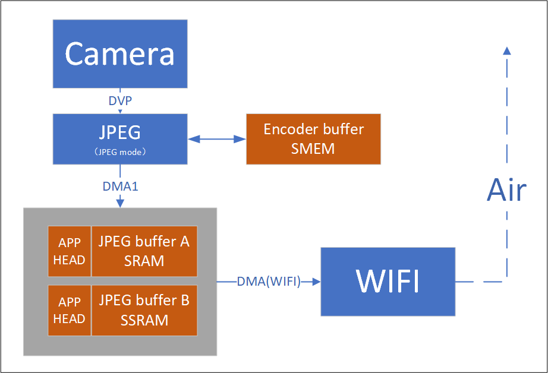
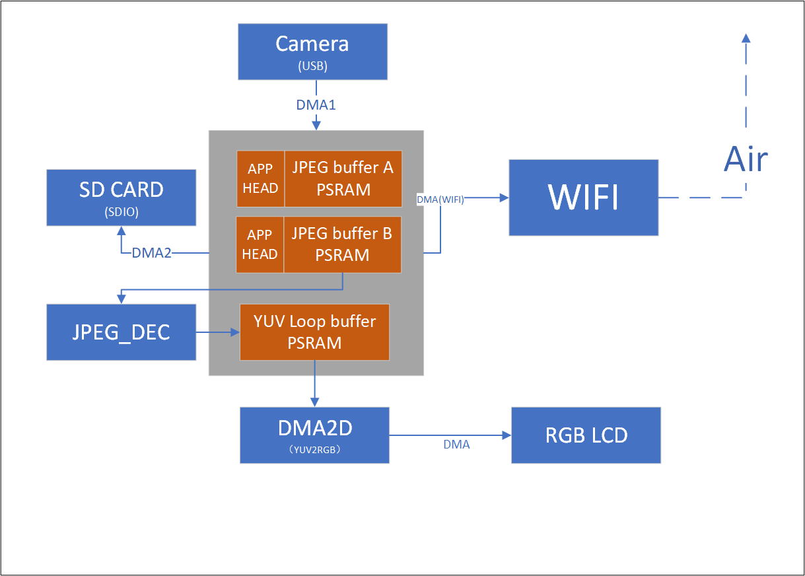

# 视频方案[](#id1 "永久链接至标题")

[[English]](../../../../en/v1.5/projects/video/index.html "../../../../en/v1.5/projects/video/index.html")

## 芯片功能[](#id2 "永久链接至标题")

|  | RGB | I8080 | DMA2D | DVP | UVC | JPEG | QSPI(LCD) |
| --- | --- | --- | --- | --- | --- | --- | --- |
| BK7256 | Y | Y | Y | Y | Y | Y | Y |

- 1x full-speed USB OTG (FS)

- 1x LCD interface (16-bit parallel RGB and I8080)

- 1x JPEG hardware encoder/decoder

- 1x 8-bit CIS DVP camera interface

## 软件推荐方案[](#id3 "永久链接至标题")

|  | 图传 | 航拍 | 门锁 | 门铃 |
| --- | --- | --- | --- | --- |
| BK7256 | Y | Y | Y | Y |

## 图传[](#id4 "永久链接至标题")

图传[](#id7 "永久链接至图片")

## 航拍[](#id5 "永久链接至标题")

航拍[](#id8 "永久链接至图片")

## 门锁/门铃[](#id6 "永久链接至标题")

门锁/门铃[](#id9 "永久链接至图片")
