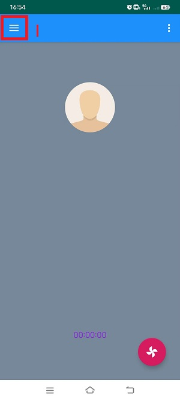
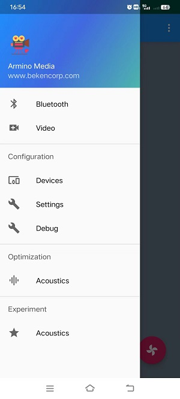
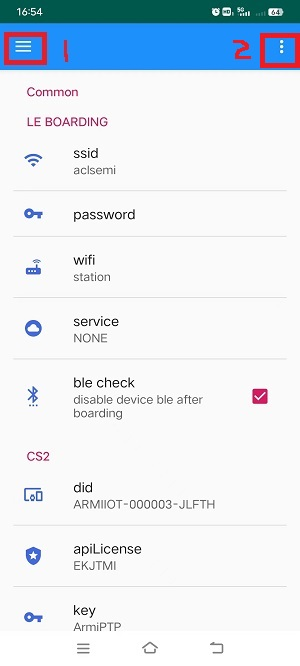
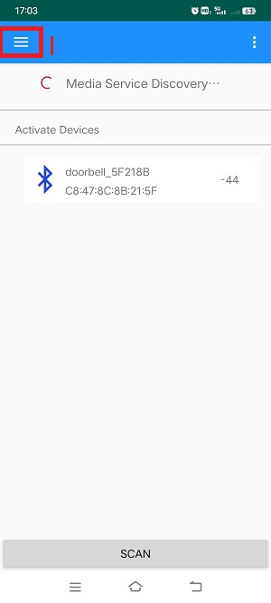
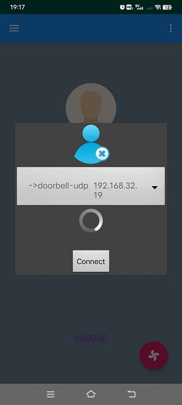
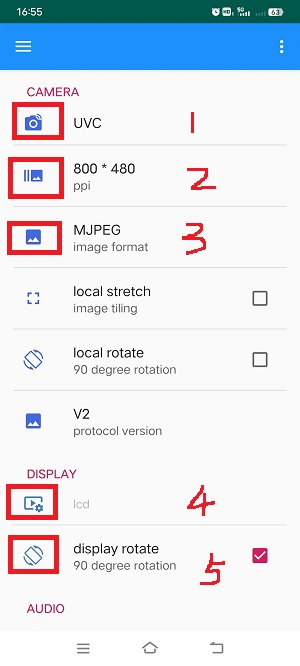
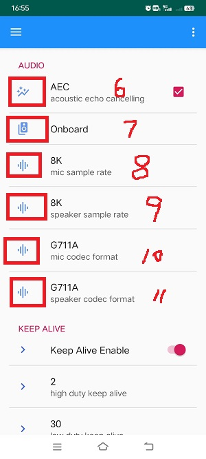
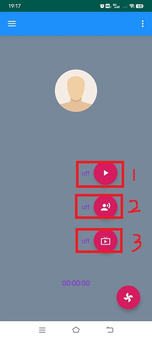

# Lan UDP/TCP[](#lan-udp-tcp "永久链接至标题")

[[English]](../../../../../en/v1.5/projects_work/media/doorbell/local_area_net.html "../../../../../en/v1.5/projects_work/media/doorbell/local_area_net.html")

## 1 功能概述[](#id1 "永久链接至标题")

> 本功能是，基于局域网的UDP/TCP门铃演示工程。

## 2 代码路径[](#id2 "永久链接至标题")

> UDP-demo路径：`./projects/media/doorbell/main/src/doorbell_udp_service.c`
>
> TCP-demo路径：`./projects/media/doorbell/main/src/doorbell_tcp_service.c`
>
> apk下载路径：[http://dl.bekencorp/apk/ArminoMedia.apk](http://dl.bekencorp/apk/ArminoMedia.apk "http://dl.bekencorp/apk/ArminoMedia.apk")

## 3 cli命令简介[](#cli "永久链接至标题")

> 本功能主要依靠APP去使用配置，暂时不需要cli命令辅助控制

## 4.编译命令[](#id3 "永久链接至标题")

> 编译工程命令：make bk7256 PROJECT=meida/doorbell

## 5 演示介绍[](#id4 "永久链接至标题")

备注

当前apk只开发了安卓系统，再用该APK进行网络传输之前需要打开蓝牙。

1、设置路由器配网信息，步骤如下图所示:

Figure 1.主界面[](#id5 "永久链接至图片")

2、选择主界面中1的位置，到达设置界面，如下图所示：

Figure 2.主设界面[](#id6 "永久链接至图片")

3、选择：`Settings`，到达网络配置界面，如下图所示：

Figure 3.网络配置界面[](#id7 "永久链接至图片")

3.1 这里可以区分很多种配置类型：

> - 如上图中选择：`wifi`，有”station/soft ap”两种选择，表示设备作为：station或者softap。
>   :   - 假设选择”station”，上图中：`ssid`，表示板子连接路由器的ssid（名字），而：`password`，表示连接路由器的密码，并且手机的wifi也需要连接到这个路由器；
>       - 假设选择”soft ap”，上图中：`ssid`，表示板子作为softap时的ssid（名字），而：`password`，表示连接板子需要的密码，手机的wifi也需要连接到softap；
> - 假设上图中选择：`wifi`，选择的是``station``，并且名字和密码已经配置了正确的值。
> - 上图中选择：`servece`，有”NONE/P2P_CS2/LAN_UDP/LANTCP”, 如果我们选择用UDP传输则，选择”LAN_UDP”；如果选择用TCP传输，则选择”LAN_TCP”，这里默认选择是无效的”NONE”，需要配置成”LAN_UDP/LANTCP”;

3.2 选择上图中1的位置，达到主设界面，并选择：`Bluetooth`，去执行蓝牙配网，到达蓝牙配网界面，如下图所示：

Figure 4.蓝牙配网界面[](#id8 "永久链接至图片")

4、选择上图中：`SCAN`，扫描到板子发出的广播，默认广播名字是：`doorbell_xxx`，如果网络中有多个，可以通过蓝牙地址找到，选择该广播，会弹出对话框，选择：`Connect`。

> - 连接成功后，仍然选择上图中1的位置，到达主设界面；
> - 然后选择：`Video`，到达主界面；
> - 然后选择主界面中2的位置，类似一个小风扇图标，会弹出对话框，选择：`Connect`，等待连接成功，如下图所示；

Figure 5.设备连接界面[](#id9 "永久链接至图片")

- 仍然选择主界面中1的位置，到达主设界面，选择：`Devices`，到达”Devices”设备配置界面，如下图所示：

Figure 6.设备配置界面[](#id10 "永久链接至图片")

5、在设备配置界面中可以配置”camera”、”DISPALY”和”AUDIO”。

> - 上图1的位置，选择打开的摄像头类型：DVP/UVC；
> - 上图2的位置，选择摄像头输出分辨率，选择打开摄像头支持的分辨率；
> - 上图3的位置，选择APK接收视频数据的格式：MJPEG/H264；
> - 上图4的位置，选择需要打开的LCD屏幕类型，需要与板子上连接的LCD屏幕相匹配；
> - 上图5的位置，选择在LCD屏幕上显示时，是否需要旋转90°，默认不选；
> - 上图6的位置，选择是否支持AEC回声消除功能，默认选择；
> - 上图7的位置，选择APK接收音频数据的来源：Onboard/UAC，表示是：板载音频/UAC音频，默认Onboard；
> - 上图8的位置，选择MIC采样率：8K/16K，默认选择8K；
> - 上图9的位置，选择Speaker采样率：8K/16K，默认选择8K；
> - 上图10的位置，选择MIC编码方式：G711A/PCM/G711U，默认选择；G711A;
> - 上图11的位置，选择Speaker编码方式：G711A/PCM/G711U，默认选择；G711A;

6、选择有上角”三”，到达主设界面，并在主设界面选择：`Video`，到达主界面，并选择右下角小风扇图标，弹出三个按钮，如下图所示：

Figure 7.开关配置主界面[](#id11 "永久链接至图片")

- 上图中1的位置，开关视频功能；

- 上图中2的位置，开关音频功能；

- 上图中3的位置，开关屏幕显示功能；
