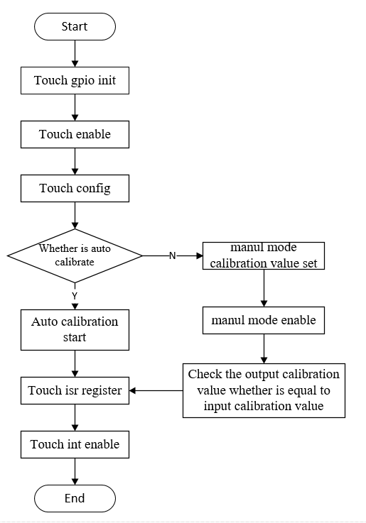

# TOUCH APIs[](#touch-apis "永久链接至标题")

[[English]](../../../../en/v2.0.1/api-reference/peripheral/bk_touch.html "../../../../en/v2.0.1/api-reference/peripheral/bk_touch.html")

重要

The TOUCH API v1.0 is the lastest and stable TOUCH APIs. All new applications should use TOUCH API v1.0.


## Touch User Guide[](#touch-user-guide "永久链接至标题")

Touch module have three different types of working modes, which are automatic calibrattion mode, manul calibration mode and scan mode. The scan mode must work based on the automatic calibration mode or manul mode.
When the touch channel has been calibrated, then set multi channels that neet to scan and enable the scan mode. The automatic calibration mode and manul calibration mode are used as follows:



Touch User Guide Flow[](#id3 "永久链接至图片")


## Touch APIs[](#id1 "永久链接至标题")

> - [`bk_touch_gpio_init()`](#_CPPv418bk_touch_gpio_init15touch_channel_t "bk_touch_gpio_init") - init the touch gpio pin
> - [`bk_touch_enable()`](#_CPPv415bk_touch_enable15touch_channel_t "bk_touch_enable") - enable the touch module funtion
> - [`bk_touch_disable()`](#_CPPv416bk_touch_disablev "bk_touch_disable") - enable the touch module funtion
> - [`bk_touch_config()`](#_CPPv415bk_touch_configPK14touch_config_t "bk_touch_config") - config the touch parameters to enable touch work
> - [`bk_touch_calibration_start()`](#_CPPv426bk_touch_calibration_startv "bk_touch_calibration_start") - start calibrating the touch channel
> - [`bk_touch_scan_mode_enable()`](#_CPPv425bk_touch_scan_mode_enable8uint32_t "bk_touch_scan_mode_enable") - enable or disable scan mode of touch module
> - [`bk_touch_manul_mode_enable()`](#_CPPv426bk_touch_manul_mode_enable8uint32_t "bk_touch_manul_mode_enable") - enable manul mode of touch module
> - [`bk_touch_manul_mode_disable()`](#_CPPv427bk_touch_manul_mode_disablev "bk_touch_manul_mode_disable") - disable manul mode of touch module
> - [`bk_touch_scan_mode_multi_channl_set()`](#_CPPv435bk_touch_scan_mode_multi_channl_set15touch_channel_t "bk_touch_scan_mode_multi_channl_set") - set multi channels that need to scan
> - [`bk_touch_int_enable()`](#_CPPv419bk_touch_int_enable15touch_channel_t8uint32_t "bk_touch_int_enable") - enable or disable touch interrupt
> - [`bk_touch_get_calib_value()`](#_CPPv424bk_touch_get_calib_valuev "bk_touch_get_calib_value") - get the calibration value of touch channel
> - [`bk_touch_get_touch_status()`](#_CPPv425bk_touch_get_touch_statusv "bk_touch_get_touch_status") - get the status of touch channel
> - [`bk_touch_register_touch_isr()`](#_CPPv427bk_touch_register_touch_isr15touch_channel_t11touch_isr_tPv "bk_touch_register_touch_isr") - register touch isr


## API Reference[](#api-reference "永久链接至标题")


### Header File[](#header-file "永久链接至标题")


- [touch.h](http://192.168.0.46/gerrit/plugins/gitiles/iot/wcn/projects/+/refs/heads/armino_main/components/touch.h "http://192.168.0.46/gerrit/plugins/gitiles/iot/wcn/projects/+/refs/heads/armino_main/components/touch.h")


### Functions[](#functions "永久链接至标题")

[bk_err_t](../system/os.html#_CPPv48bk_err_t "bk_err_t") bk_touch_gpio_init([touch_channel_t](#_CPPv415touch_channel_t "touch_channel_t") touch_id)[](#_CPPv418bk_touch_gpio_init15touch_channel_t "永久链接至目标")
:   Init the touch gpio pin.

    This API init the GPIO pin corresponding to touch channel:


    - Unmap gpio pin function

    - Change gpio pin function to touch

    - Configure gpio to be high impedance

    This API should be called before any other TOUCH APIs.

    参数
    :   **-** – touch_id: touch channel, channel 0 ~ channel 15

    返回
    :   - BK_OK: succeed

        - others: other errors.

[bk_err_t](../system/os.html#_CPPv48bk_err_t "bk_err_t") bk_touch_enable([touch_channel_t](#_CPPv415touch_channel_t "touch_channel_t") touch_id)[](#_CPPv415bk_touch_enable15touch_channel_t "永久链接至目标")
:   enable touch function

    This API enable the touch function:


    - Select the touch channel

    - Power on the touch module

    参数
    :   **-** – touch_id: touch channel, channel 0 ~ channel 15

    返回
    :   - BK_OK: succeed

        - others: other errors.

[bk_err_t](../system/os.html#_CPPv48bk_err_t "bk_err_t") bk_touch_disable(void)[](#_CPPv416bk_touch_disablev "永久链接至目标")
:   disable touch function

    This API disable the touch function:


    - Power down the touch module

    参数
    :   **-** – None

    返回
    :   - BK_OK: succeed

[bk_err_t](../system/os.html#_CPPv48bk_err_t "bk_err_t") bk_touch_config(const [touch_config_t](#_CPPv414touch_config_t "touch_config_t") *touch_config)[](#_CPPv415bk_touch_configPK14touch_config_t "永久链接至目标")
:   config touch function

    This API config the touch function:


    - Set touch sensitivity level, the smaller the value, the more sensitive. The range of level value from 0 to 3

    - Set touch detect threshold, the range of value from 0 to 7.

    - Set touch detect range, 8pF/12pF/19pF/27pF

    Usage example:

    ```
    touch_config_t touch_config;
    touch_config.sensitivity_level = TOUCH_SENSITIVITY_LEVLE_3;
    touch_config.detect_threshold = TOUCH_DETECT_THRESHOLD_6;
    touch_config.detect_range = TOUCH_DETECT_RANGE_27PF;
    bk_touch_config(&touch_config);
    ```

    参数
    :   **-** – touch_config: the config of touch work mode

    返回
    :   - BK_OK: succeed

[bk_err_t](../system/os.html#_CPPv48bk_err_t "bk_err_t") bk_touch_calibration_start(void)[](#_CPPv426bk_touch_calibration_startv "永久链接至目标")
:   start calibrating touch channel

    This API start calibrating the touch channel that selected.

    参数
    :   **-** – None

    返回
    :   - BK_OK: succeed

[bk_err_t](../system/os.html#_CPPv48bk_err_t "bk_err_t") bk_touch_scan_mode_enable(uint32_t enable)[](#_CPPv425bk_touch_scan_mode_enable8uint32_t "永久链接至目标")
:   enable/disable scan mode of touch channel

    This API enable or disable the scan mode of touch channel.

    参数
    :   **-** – enable: enable —— 1; disable —— 0;

    返回
    :   - BK_OK: succeed

[bk_err_t](../system/os.html#_CPPv48bk_err_t "bk_err_t") bk_touch_adc_mode_enable(uint32_t enable)[](#_CPPv424bk_touch_adc_mode_enable8uint32_t "永久链接至目标")
:   enable/disable adc mode of touch channel

    This API enable or disable the adc mode of touch channel.

    参数
    :   **-** – enable: enable —— 1; disable —— 0;

    返回
    :   - BK_OK: succeed

[bk_err_t](../system/os.html#_CPPv48bk_err_t "bk_err_t") bk_touch_manul_mode_enable(uint32_t calib_value)[](#_CPPv426bk_touch_manul_mode_enable8uint32_t "永久链接至目标")
:   enable manul calibration mode of touch channel

    This API enable the manul calibration mode of touch channel:


    - set the calibration value of manul mode;

    - enable the manul calibretion mode;

    参数
    :   **-** – calib_value: calibration value of manul mode, the max value is 0x1FF;

    返回
    :   - BK_OK: succeed

[bk_err_t](../system/os.html#_CPPv48bk_err_t "bk_err_t") bk_touch_manul_mode_disable(void)[](#_CPPv427bk_touch_manul_mode_disablev "永久链接至目标")
:   disable manul calibration mode of touch channel

    This API disable the manul calibration mode of touch channel

    参数
    :   **-** – None

    返回
    :   - BK_OK: succeed

[bk_err_t](../system/os.html#_CPPv48bk_err_t "bk_err_t") bk_touch_scan_mode_multi_channl_set([touch_channel_t](#_CPPv415touch_channel_t "touch_channel_t") touch_id)[](#_CPPv435bk_touch_scan_mode_multi_channl_set15touch_channel_t "永久链接至目标")
:   set multi channels that need to scan

    This API set multi channels that need to scan

    参数
    :   **-** – touch_id: the multi channels that need to scan. See the enum of touch_channel_t.

    返回
    :   - BK_OK: succeed

[bk_err_t](../system/os.html#_CPPv48bk_err_t "bk_err_t") bk_touch_int_enable([touch_channel_t](#_CPPv415touch_channel_t "touch_channel_t") touch_id, uint32_t enable)[](#_CPPv419bk_touch_int_enable15touch_channel_t8uint32_t "永久链接至目标")
:   enable/disable touch channel interrupt

    This API enable or disable the touch channel interrupt:


    - register the interrupt service handle;

    - enable or disable the touch interrupt;

    参数
    :   **-** – touch_id: touch channel, channel 0 ~ channel 15;


        - enable: enable —— 1; disable —— 0;

    返回
    :   - BK_OK: succeed

uint32_t bk_touch_get_calib_value(void)[](#_CPPv424bk_touch_get_calib_valuev "永久链接至目标")
:   get the calibration value of touch channel

    This API get the calibration value of touch channel.

    参数
    :   **-** – None

    返回
    :   - calib_value: the max value is 0x1FF.

uint32_t bk_touch_get_touch_status(void)[](#_CPPv425bk_touch_get_touch_statusv "永久链接至目标")
:   get the status of touch channel

    This API get the status of touch channel:

    参数
    :   **-** – None

    返回
    :   - touch_status: the touch status of every channel. One bit corresponding to one channel. 1 —— the channel is touched; 0 —— the channel is idle.

[bk_err_t](../system/os.html#_CPPv48bk_err_t "bk_err_t") bk_touch_digital_tube_init(void)[](#_CPPv426bk_touch_digital_tube_initv "永久链接至目标")
:   init the digital tube of touch

    This API init the digital tube:

    参数
    :   **-** – None

    返回
    :   - BK_OK: succeed

void bk_touch_digital_tube_display(uint8_t disp_value)[](#_CPPv429bk_touch_digital_tube_display7uint8_t "永久链接至目标")
:   display the value in the digital tube

    This API display the value in the digital tube

    参数
    :   **-** – disp_value: the value need to display;

    返回
    :   - None

void bk_touch_wakeup_channel_set([touch_channel_t](#_CPPv415touch_channel_t "touch_channel_t") channel)[](#_CPPv427bk_touch_wakeup_channel_set15touch_channel_t "永久链接至目标")
:   get the touch channel for low voltage and deepsleep wake up

    This API get the touch channel for low voltage and deepsleep wake up

    参数
    :   **-** – channel: touch channel, channel 0 ~ channel 15. See the enum of touch_channel_t.

    返回
    :   - None

uint32_t bk_touch_wakeup_channel_get(void)[](#_CPPv427bk_touch_wakeup_channel_getv "永久链接至目标")
:   set the touch channel for low voltage and deepsleep wake up

    This API set the touch channel for low voltage and deepsleep wake up

    参数
    :   **-** – None

    返回
    :   - s_touch_wakeup_channel: the channel number of touch

[bk_err_t](../system/os.html#_CPPv48bk_err_t "bk_err_t") bk_touch_pm_init(void)[](#_CPPv416bk_touch_pm_initv "永久链接至目标")
:   Register touch low voltage and deepsleep config.

    This API register touch low voltage and deepsleep config

    参数
    :   **-** – None

    返回
    :   - BK_OK: succeed

        - others: other errors.

[bk_err_t](../system/os.html#_CPPv48bk_err_t "bk_err_t") bk_touch_register_touch_isr([touch_channel_t](#_CPPv415touch_channel_t "touch_channel_t") touch_id, [touch_isr_t](#_CPPv411touch_isr_t "touch_isr_t") isr, void *param)[](#_CPPv427bk_touch_register_touch_isr15touch_channel_t11touch_isr_tPv "永久链接至目标")
:   Register touch isr.

    This API register touch isr

    参数
    :   **-** – touch_id: touch channel, channel 0 ~ channel 15;


        - isr: touch isr callback;

        - param: touch isr callback parameter;

    返回
    :   - BK_OK: succeed

        - others: other errors.


## API Typedefs[](#api-typedefs "永久链接至标题")


### Header File[](#id2 "永久链接至标题")


- [touch_types.h](http://192.168.0.46/gerrit/plugins/gitiles/iot/wcn/projects/+/refs/heads/armino_main/components/touch_types.h "http://192.168.0.46/gerrit/plugins/gitiles/iot/wcn/projects/+/refs/heads/armino_main/components/touch_types.h")


### Structures[](#structures "永久链接至标题")

struct touch_int_config_t[](#_CPPv418touch_int_config_t "永久链接至目标")

struct touch_config_t[](#_CPPv414touch_config_t "永久链接至目标")
:   Public Members

    [touch_sensitivity_level_t](#_CPPv425touch_sensitivity_level_t "touch_sensitivity_level_t") sensitivity_level[](#_CPPv4N14touch_config_t17sensitivity_levelE "永久链接至目标")
    :   sensitivity_level

    [touch_detect_threshold_t](#_CPPv424touch_detect_threshold_t "touch_detect_threshold_t") detect_threshold[](#_CPPv4N14touch_config_t16detect_thresholdE "永久链接至目标")
    :   detect_threshold

    [touch_detect_range_t](#_CPPv420touch_detect_range_t "touch_detect_range_t") detect_range[](#_CPPv4N14touch_config_t12detect_rangeE "永久链接至目标")
    :   detect_range


### Macros[](#macros "永久链接至标题")

BK_ERR_TOUCH_ID[](#c.BK_ERR_TOUCH_ID "永久链接至目标")


### Type Definitions[](#type-definitions "永久链接至标题")

typedef void (*touch_isr_t)(void *param)[](#_CPPv411touch_isr_t "永久链接至目标")


### Enumerations[](#enumerations "永久链接至标题")

enum touch_channel_t[](#_CPPv415touch_channel_t "永久链接至目标")
:   *Values:*

    enumerator BK_TOUCH_0[](#_CPPv4N15touch_channel_t10BK_TOUCH_0E "永久链接至目标")
    :   touch channel 0

    enumerator BK_TOUCH_1[](#_CPPv4N15touch_channel_t10BK_TOUCH_1E "永久链接至目标")
    :   touch channel 1

    enumerator BK_TOUCH_2[](#_CPPv4N15touch_channel_t10BK_TOUCH_2E "永久链接至目标")
    :   touch channel 2

    enumerator BK_TOUCH_3[](#_CPPv4N15touch_channel_t10BK_TOUCH_3E "永久链接至目标")
    :   touch channel 3

    enumerator BK_TOUCH_4[](#_CPPv4N15touch_channel_t10BK_TOUCH_4E "永久链接至目标")
    :   touch channel 4

    enumerator BK_TOUCH_5[](#_CPPv4N15touch_channel_t10BK_TOUCH_5E "永久链接至目标")
    :   touch channel 5

    enumerator BK_TOUCH_6[](#_CPPv4N15touch_channel_t10BK_TOUCH_6E "永久链接至目标")
    :   touch channel 6

    enumerator BK_TOUCH_7[](#_CPPv4N15touch_channel_t10BK_TOUCH_7E "永久链接至目标")
    :   touch channel 7

    enumerator BK_TOUCH_8[](#_CPPv4N15touch_channel_t10BK_TOUCH_8E "永久链接至目标")
    :   touch channel 8

    enumerator BK_TOUCH_9[](#_CPPv4N15touch_channel_t10BK_TOUCH_9E "永久链接至目标")
    :   touch channel 9

    enumerator BK_TOUCH_10[](#_CPPv4N15touch_channel_t11BK_TOUCH_10E "永久链接至目标")
    :   touch channel 10

    enumerator BK_TOUCH_11[](#_CPPv4N15touch_channel_t11BK_TOUCH_11E "永久链接至目标")
    :   touch channel 11

    enumerator BK_TOUCH_12[](#_CPPv4N15touch_channel_t11BK_TOUCH_12E "永久链接至目标")
    :   touch channel 12

    enumerator BK_TOUCH_13[](#_CPPv4N15touch_channel_t11BK_TOUCH_13E "永久链接至目标")
    :   touch channel 13

    enumerator BK_TOUCH_14[](#_CPPv4N15touch_channel_t11BK_TOUCH_14E "永久链接至目标")
    :   touch channel 14

    enumerator BK_TOUCH_15[](#_CPPv4N15touch_channel_t11BK_TOUCH_15E "永久链接至目标")
    :   touch channel 15

    enumerator BK_TOUCH_MAX[](#_CPPv4N15touch_channel_t12BK_TOUCH_MAXE "永久链接至目标")

enum touch_sensitivity_level_t[](#_CPPv425touch_sensitivity_level_t "永久链接至目标")
:   *Values:*

    enumerator TOUCH_SENSITIVITY_LEVLE_0[](#_CPPv4N25touch_sensitivity_level_t25TOUCH_SENSITIVITY_LEVLE_0E "永久链接至目标")

    enumerator TOUCH_SENSITIVITY_LEVLE_1[](#_CPPv4N25touch_sensitivity_level_t25TOUCH_SENSITIVITY_LEVLE_1E "永久链接至目标")

    enumerator TOUCH_SENSITIVITY_LEVLE_2[](#_CPPv4N25touch_sensitivity_level_t25TOUCH_SENSITIVITY_LEVLE_2E "永久链接至目标")

    enumerator TOUCH_SENSITIVITY_LEVLE_3[](#_CPPv4N25touch_sensitivity_level_t25TOUCH_SENSITIVITY_LEVLE_3E "永久链接至目标")

enum touch_detect_threshold_t[](#_CPPv424touch_detect_threshold_t "永久链接至目标")
:   *Values:*

    enumerator TOUCH_DETECT_THRESHOLD_0[](#_CPPv4N24touch_detect_threshold_t24TOUCH_DETECT_THRESHOLD_0E "永久链接至目标")

    enumerator TOUCH_DETECT_THRESHOLD_1[](#_CPPv4N24touch_detect_threshold_t24TOUCH_DETECT_THRESHOLD_1E "永久链接至目标")

    enumerator TOUCH_DETECT_THRESHOLD_2[](#_CPPv4N24touch_detect_threshold_t24TOUCH_DETECT_THRESHOLD_2E "永久链接至目标")

    enumerator TOUCH_DETECT_THRESHOLD_3[](#_CPPv4N24touch_detect_threshold_t24TOUCH_DETECT_THRESHOLD_3E "永久链接至目标")

    enumerator TOUCH_DETECT_THRESHOLD_4[](#_CPPv4N24touch_detect_threshold_t24TOUCH_DETECT_THRESHOLD_4E "永久链接至目标")

    enumerator TOUCH_DETECT_THRESHOLD_5[](#_CPPv4N24touch_detect_threshold_t24TOUCH_DETECT_THRESHOLD_5E "永久链接至目标")

    enumerator TOUCH_DETECT_THRESHOLD_6[](#_CPPv4N24touch_detect_threshold_t24TOUCH_DETECT_THRESHOLD_6E "永久链接至目标")

    enumerator TOUCH_DETECT_THRESHOLD_7[](#_CPPv4N24touch_detect_threshold_t24TOUCH_DETECT_THRESHOLD_7E "永久链接至目标")

enum touch_detect_range_t[](#_CPPv420touch_detect_range_t "永久链接至目标")
:   *Values:*

    enumerator TOUCH_DETECT_RANGE_8PF[](#_CPPv4N20touch_detect_range_t22TOUCH_DETECT_RANGE_8PFE "永久链接至目标")
    :   8PF

    enumerator TOUCH_DETECT_RANGE_12PF[](#_CPPv4N20touch_detect_range_t23TOUCH_DETECT_RANGE_12PFE "永久链接至目标")
    :   12PF

    enumerator TOUCH_DETECT_RANGE_19PF[](#_CPPv4N20touch_detect_range_t23TOUCH_DETECT_RANGE_19PFE "永久链接至目标")
    :   19PF

    enumerator TOUCH_DETECT_RANGE_27PF[](#_CPPv4N20touch_detect_range_t23TOUCH_DETECT_RANGE_27PFE "永久链接至目标")
    :   27PF
