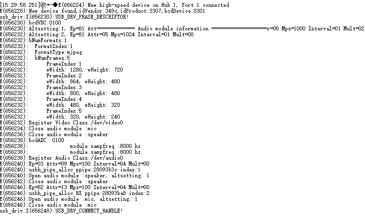
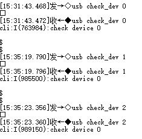
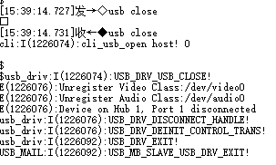

# USB[](#usb "永久链接至标题")

[[English]](../../../../en/v2.0.1/api-reference/peripheral/bk_usb.html "../../../../en/v2.0.1/api-reference/peripheral/bk_usb.html")

- [USB Host UVC+UAC](usb/bk_usbh_uvc_uac.html "usb/bk_usbh_uvc_uac.html")

## USB 简介[](#id1 "永久链接至标题")

USB（Universal Serial Bus）是一种通用的总线标准，用于连接主机和外设设备。USB 主机可以通过 USB 接口与 USB 设备连接，实现数据传输、电源供给等功能。

USB IF（USB Implementers Forum）是 USB 标准的制定者，它制定了 USB 标准，包括 USB 1.1、USB 2.0、USB 3.0 等，定义了 USB 接口的物理层、数据链路层、传输层、会话层、表示层等协议，以及 USB 设备类（Device Class）标准，常见的设备类包括 HID（Human Interface Device，人机接口设备）、MSC（Mass Storage Class，大容量存储设备）、CDC（Communication Device Class，通信设备）、Audio、Video 等。

博通BK7258芯片支持各种各样的 USB 应用，包括 USB 多媒体类应用，USB 通信类应用，USB 存储类应用，USB 人机交互类应用等。

## USB 基本使用[](#id2 "永久链接至标题")

USB open/close[](#id5 "永久链接至图片")

## USB 测试示例[](#id3 "永久链接至标题")

注：BK7258 USB 默认运行在CPU2，使用默认avdk调试需要连接UART2协助输入命令测试，依赖CLI命令打开编译后调试。 测试目标：USB模块开关正常，枚举正常，解析正常，断开/连接等状态记录正常。

作为HOST 识别枚举Video+Audio融合设备为例，输入命令和LOG信息如下图所示：

1、在默认串口输入 bootcore 2 1 启动CPU2 ，log如下

CLI Boot CPU2[](#id6 "永久链接至图片")

2、uart2 串口输入usb power 1c 1，log如下

CLI USB PowerON[](#id7 "永久链接至图片")

3、uart2 串口输入usb open_host，枚举成功log如下

CLI USB Open Host[](#id8 "永久链接至图片")

4、uart2 串口输入usb check_dev 0(是否支持video)/usb check_dev 1(是否支持mic)/usb check_dev 2(是否支持speaker)，支持需要的类设备log如下

CLI USB Check video/mic/speaker[](#id9 "永久链接至图片")

5、uart2 串口输入usb close,log如下

CLI USB Close[](#id10 "永久链接至图片")

6、uart2 串口输入usb power 1c 0,log如下

CLI USB PowerDown[](#id11 "永久链接至图片")

## USB API Status[](#usb-api-status "永久链接至标题")

| API | BK7258_cp2 |
| --- | --- |
| [`bk_usb_driver_init()`](#_CPPv418bk_usb_driver_initv "bk_usb_driver_init") | Y |
| [`bk_usb_driver_deinit()`](#_CPPv420bk_usb_driver_deinitv "bk_usb_driver_deinit") | Y |
| [`bk_usb_power_ops()`](#_CPPv416bk_usb_power_ops8uint32_tb "bk_usb_power_ops") | Y |
| [`bk_usb_open()`](#_CPPv411bk_usb_open8uint32_t "bk_usb_open") | Y |
| [`bk_usb_close()`](#_CPPv412bk_usb_closev "bk_usb_close") | Y |
| [`bk_usb_control_transfer_init()`](#_CPPv428bk_usb_control_transfer_initv "bk_usb_control_transfer_init") | Y |
| [`bk_usb_control_transfer_deinit()`](#_CPPv430bk_usb_control_transfer_deinitv "bk_usb_control_transfer_deinit") | Y |
| [`bk_usb_control_transfer()`](#_CPPv423bk_usb_control_transferP20s_usb_device_requestP26s_usb_transfer_buffer_info "bk_usb_control_transfer") | Y |
| [`bk_usb_device_set_using_status()`](#_CPPv430bk_usb_device_set_using_statusb14E_USB_DEVICE_T "bk_usb_device_set_using_status") | Y |
| [`bk_usb_get_device_connect_status()`](#_CPPv432bk_usb_get_device_connect_statusv "bk_usb_get_device_connect_status") | Y |
| [`bk_usb_check_device_supported()`](#_CPPv429bk_usb_check_device_supported14E_USB_DEVICE_T "bk_usb_check_device_supported") | Y |

## USB Port Number[](#usb-port-number "永久链接至标题")

| Capability | BK7258_cp1 | BK7258_cp2 |
| --- | --- | --- |
| Port Number | 1 | 1 |

## USB Pin and GPIO Map[](#usb-pin-and-gpio-map "永久链接至标题")

| USB Pin | BK7258_cp1 | BK7258_cp2 |
| --- | --- | --- |
| USB DP | 12 | 12 |
| USB DN | 13 | 13 |
| USB power | 28 | 28 |

## USB API Reference[](#usb-api-reference "永久链接至标题")

### Header File[](#header-file "永久链接至标题")

- [usb.h](http://192.168.0.46/gerrit/plugins/gitiles/iot/wcn/projects/+/refs/heads/armino_main/components/usb.h "http://192.168.0.46/gerrit/plugins/gitiles/iot/wcn/projects/+/refs/heads/armino_main/components/usb.h")

### Functions[](#functions "永久链接至标题")

[bk_err_t](../system/os.html#_CPPv48bk_err_t "bk_err_t") bk_usb_driver_init(void)[](#_CPPv418bk_usb_driver_initv "永久链接至目标")
:   USB Driver initialization.

    Register the adaptation layer and pass the function pointers used by the closed source library. Register the current USB Class type to be supported, and it can be uninstalled and reinitialized during execution. But be sure to do so before calling other interfaces.

    - Configure Interrupt handling function registration

    - Configure Class Driver Registration

    This API should be called before any other USB APIs.

    返回
    :   - BK_OK: succeed

        - others: other errors.

[bk_err_t](../system/os.html#_CPPv48bk_err_t "bk_err_t") bk_usb_driver_deinit(void)[](#_CPPv420bk_usb_driver_deinitv "永久链接至目标")
:   USB Driver uninstallation.

    Turn off the USB main interrupt switch Unregister Total Interrupt Handling Function Unregistered Class Driver

    This API should be called after any other USB APIs.

    返回
    :   - BK_OK: succeed

        - others: other errors.

[bk_err_t](../system/os.html#_CPPv48bk_err_t "bk_err_t") bk_usb_power_ops(uint32_t gpio_id, bool ops)[](#_CPPv416bk_usb_power_ops8uint32_tb "永久链接至目标")
:   Pin controlled USB Vbus.

    This API controls VBUS for USB:

    - Determine whether to output voltage through the high and low levels of a GPIO output parameter: gpio_id Select the corresponding pin number ops Choose to power on or off

    - Configure whether USB is power on

    When the fusion device is working, if there is a device voting for use, it cannot be directly turned off.

    返回
    :   - BK_OK: succeed

        - others: other errors.

[bk_err_t](../system/os.html#_CPPv48bk_err_t "bk_err_t") bk_usb_open(uint32_t usb_mode)[](#_CPPv411bk_usb_open8uint32_t "永久链接至目标")
:   open the USB

    This API configure the resoure common to USB:

    - Select the identity as host or slave parameter: usb_mode USB_HOST_MODE = 0 USB_DEVICE_MODE = 1

    - Configure USB common clock

    - Configure USB common registers

    This API should be called before any other USB APIs.

    返回
    :   - BK_OK: succeed

        - others: other errors.

[bk_err_t](../system/os.html#_CPPv48bk_err_t "bk_err_t") bk_usb_close(void)[](#_CPPv412bk_usb_closev "永久链接至目标")
:   close the USB

    This API release USB resources:

    - Restore register

    - Turn off the power and clock

    This API should be called after any other USB APIs.

    返回
    :   - BK_OK: succeed

        - others: other errors.

[bk_err_t](../system/os.html#_CPPv48bk_err_t "bk_err_t") bk_usb_control_transfer_init(void)[](#_CPPv428bk_usb_control_transfer_initv "永久链接至目标")
:   Initializes the control transfer request resource.

    返回
    :   - BK_OK: succeed

        - others: other errors.

[bk_err_t](../system/os.html#_CPPv48bk_err_t "bk_err_t") bk_usb_control_transfer_deinit(void)[](#_CPPv430bk_usb_control_transfer_deinitv "永久链接至目标")
:   Unmount control transfer to release resource.

    返回
    :   - BK_OK: succeed

        - others: other errors.

[bk_err_t](../system/os.html#_CPPv48bk_err_t "bk_err_t") bk_usb_control_transfer([s_usb_device_request](#_CPPv420s_usb_device_request "s_usb_device_request") *pSetup, [s_usb_transfer_buffer_info](#_CPPv426s_usb_transfer_buffer_info "s_usb_transfer_buffer_info") *buffer_info)[](#_CPPv423bk_usb_control_transferP20s_usb_device_requestP26s_usb_transfer_buffer_info "永久链接至目标")
:   Control command and data interface fucntion to be passed.

    This API is used to send commands and transfer data:

    - Two parameters pSetup/buffer_info.

    - [s_usb_device_request](#structs__usb__device__request "#structs__usb__device__request"): The command format is specified by the USB protocol

    - [s_usb_transfer_buffer_info](#structs__usb__transfer__buffer__info "#structs__usb__transfer__buffer__info"): Buffer informataion for sending and receiving data.

      example: Reference UVC_OTA demo

    返回
    :   - BK_OK: succeed

        - others: other errors.

void bk_usb_device_set_using_status(bool use_or_no, [E_USB_DEVICE_T](#_CPPv414E_USB_DEVICE_T "E_USB_DEVICE_T") dev)[](#_CPPv430bk_usb_device_set_using_statusb14E_USB_DEVICE_T "永久链接至目标")
:   A voting function is currently in use.

    This API requires two parameters to be filled in for voting to prevent it from being closed parameter: use_or_no TRUE USBING FALSE NOT used dev USB_UVC_DEVICE USB_UAC_MIC_DEVICE USB_UAC_SPEAKER_DEVICE USB_MSD_DEVICE USB_OTA_DEVICE USB_USER_CHECK_DEVICE

    返回
    :   - BK_OK: succeed

        - others: other errors.

bool bk_usb_get_device_connect_status(void)[](#_CPPv432bk_usb_get_device_connect_statusv "永久链接至目标")
:   Obtain whether there is currently a device connection.

    返回
    :   - TRUE: connect

        - FALSE: disconnect

[bk_err_t](../system/os.html#_CPPv48bk_err_t "bk_err_t") bk_usb_check_device_supported([E_USB_DEVICE_T](#_CPPv414E_USB_DEVICE_T "E_USB_DEVICE_T") usb_dev)[](#_CPPv429bk_usb_check_device_supported14E_USB_DEVICE_T "永久链接至目标")
:   Check if the corresponding device class is supported.

    返回
    :   - BK_OK: succeed

        - others: other errors.

[bk_err_t](../system/os.html#_CPPv48bk_err_t "bk_err_t") bk_usb_get_device_descriptor(struct [usb_device_descriptor_t](#_CPPv423usb_device_descriptor_t "usb_device_descriptor_t") *dev_descriptor)[](#_CPPv428bk_usb_get_device_descriptorP23usb_device_descriptor_t "永久链接至目标")
:   Obtain device descriptor.

    dev_descriptor: uint8_t bLength; Descriptor size in bytes = 18 uint8_t bDescriptorType; DEVICE descriptor type = 1 uint16_t bcdUSB; USB spec in BCD, e.g. 0x0200 uint8_t bDeviceClass; Class code, if 0 see interface uint8_t bDeviceSubClass; Sub-Class code, 0 if class = 0 uint8_t bDeviceProtocol; Protocol, if 0 see interface uint8_t bMaxPacketSize0; Endpoint 0 max. size uint16_t idVendor; Vendor ID per USB-IF uint16_t idProduct; Product ID per manufacture uint16_t bcdDevice; Device release # in BCD uint8_t iManufacturer; Index to manufacturer string uint8_t iProduct; Index to product string uint8_t iSerialNumber; Index to serial number string uint8_t bNumConfigurations; Number of possible configurations

void bk_usb_mailbox_sw_master_init(void)[](#_CPPv429bk_usb_mailbox_sw_master_initv "永久链接至目标")
:   Initialize the USB master mailbox software.

void bk_usb_mailbox_sw_slave_init(void)[](#_CPPv428bk_usb_mailbox_sw_slave_initv "永久链接至目标")
:   Initialize the USB slave mailbox software.

void bk_usb_mailbox_sw_master_deinit(void)[](#_CPPv431bk_usb_mailbox_sw_master_deinitv "永久链接至目标")
:   Uninstall the USB master mailbox software.

void bk_usb_mailbox_sw_slave_deinit(void)[](#_CPPv430bk_usb_mailbox_sw_slave_deinitv "永久链接至目标")
:   Uninstall the USB slave mailbox software.

## USB API Typedefs[](#usb-api-typedefs "永久链接至标题")

### Header File[](#id4 "永久链接至标题")

- [usb_types.h](http://192.168.0.46/gerrit/plugins/gitiles/iot/wcn/projects/+/refs/heads/armino_main/components/usb_types.h "http://192.168.0.46/gerrit/plugins/gitiles/iot/wcn/projects/+/refs/heads/armino_main/components/usb_types.h")

### Structures[](#structures "永久链接至标题")

struct usb_device_descriptor_t[](#_CPPv423usb_device_descriptor_t "永久链接至目标")

struct usb_configuration_descriptor_t[](#_CPPv430usb_configuration_descriptor_t "永久链接至目标")

struct usb_interface_association_descriptor_t[](#_CPPv438usb_interface_association_descriptor_t "永久链接至目标")

struct usb_interface_descriptor_t[](#_CPPv426usb_interface_descriptor_t "永久链接至目标")

struct usb_audio_endpoint_general_descriptor_t[](#_CPPv439usb_audio_endpoint_general_descriptor_t "永久链接至目标")

struct s_bk_usb_endpoint_descriptor[](#_CPPv428s_bk_usb_endpoint_descriptor "永久链接至目标")

struct bk_uvc_format_index[](#_CPPv419bk_uvc_format_index "永久链接至目标")

struct bk_uvc_frame[](#_CPPv412bk_uvc_frame "永久链接至目标")

struct bk_uvc_all_frame[](#_CPPv416bk_uvc_all_frame "永久链接至目标")

struct bk_uvc_device_brief_info_t[](#_CPPv426bk_uvc_device_brief_info_t "永久链接至目标")

struct bk_uvc_config_t[](#_CPPv415bk_uvc_config_t "永久链接至目标")

struct audio_packet_t[](#_CPPv414audio_packet_t "永久链接至目标")

struct audio_packet_control_t[](#_CPPv422audio_packet_control_t "永久链接至目标")

struct bk_uac_ring_buffer_t[](#_CPPv420bk_uac_ring_buffer_t "永久链接至目标")

struct bk_uac_device_brief_info_t[](#_CPPv426bk_uac_device_brief_info_t "永久链接至目标")

struct bk_uac_mic_config_t[](#_CPPv419bk_uac_mic_config_t "永久链接至目标")

struct bk_uac_spk_config_t[](#_CPPv419bk_uac_spk_config_t "永久链接至目标")

struct bk_uac_config_t[](#_CPPv415bk_uac_config_t "永久链接至目标")

struct bk_uvc_uac_app_callback[](#_CPPv423bk_uvc_uac_app_callback "永久链接至目标")

struct s_usb_device_request[](#_CPPv420s_usb_device_request "永久链接至目标")

struct s_usb_transfer_buffer_info[](#_CPPv426s_usb_transfer_buffer_info "永久链接至目标")

### Macros[](#macros "永久链接至标题")

BK_ERR_USB_NOT_POWER[](#c.BK_ERR_USB_NOT_POWER "永久链接至目标")
:   USB vbus poweron, etc

BK_ERR_USB_NOT_OPEN[](#c.BK_ERR_USB_NOT_OPEN "永久链接至目标")
:   USB dose not turn on clock and power, etc

BK_ERR_USB_NOT_CLOSE[](#c.BK_ERR_USB_NOT_CLOSE "永久链接至目标")
:   USB dose not turn off clock and power, etc

BK_ERR_USB_NOT_CONNECT[](#c.BK_ERR_USB_NOT_CONNECT "永久链接至目标")
:   USB device not connected

BK_ERR_USB_OPERATION_NULL_POINTER[](#c.BK_ERR_USB_OPERATION_NULL_POINTER "永久链接至目标")
:   USB Operated with null pointer

BK_ERR_USB_UVC_NOT_START[](#c.BK_ERR_USB_UVC_NOT_START "永久链接至目标")
:   UVC Transfer not started

BK_ERR_USB_UVC_NOT_STOP[](#c.BK_ERR_USB_UVC_NOT_STOP "永久链接至目标")
:   UVC Transfer not stopped

BK_ERR_USB_UVC_NOT_PAUSE[](#c.BK_ERR_USB_UVC_NOT_PAUSE "永久链接至目标")
:   UVC Transfer not paused

BK_ERR_USB_UVC_GET_PARAMETER_FAILED[](#c.BK_ERR_USB_UVC_GET_PARAMETER_FAILED "永久链接至目标")
:   UVC The command to obtain parameters did not respond

BK_ERR_USB_UVC_SET_PARAMETER_FAILED[](#c.BK_ERR_USB_UVC_SET_PARAMETER_FAILED "永久链接至目标")
:   UVC Configuration parameter command did not respond

BK_ERR_USB_UVC_SET_INTERFACE_FAILED[](#c.BK_ERR_USB_UVC_SET_INTERFACE_FAILED "永久链接至目标")
:   UVC The set port command did not respond

BK_ERR_USB_UVC_NOSUPPORT_ATTRIBUTE[](#c.BK_ERR_USB_UVC_NOSUPPORT_ATTRIBUTE "永久链接至目标")
:   UVC The attribute configuration is not supported

BK_ERR_USB_UAC_NOT_START[](#c.BK_ERR_USB_UAC_NOT_START "永久链接至目标")
:   UAC Transfer not started

BK_ERR_USB_UAC_NOT_STOP[](#c.BK_ERR_USB_UAC_NOT_STOP "永久链接至目标")
:   UAC Transfer not stopped

BK_ERR_USB_UAC_NOT_PAUSE[](#c.BK_ERR_USB_UAC_NOT_PAUSE "永久链接至目标")
:   UAC Transfer not paused

BK_ERR_USB_UAC_GET_PARAMETER_FAILED[](#c.BK_ERR_USB_UAC_GET_PARAMETER_FAILED "永久链接至目标")
:   UAC The command to obtain parameters did not respond

BK_ERR_USB_UAC_SET_PARAMETER_FAILED[](#c.BK_ERR_USB_UAC_SET_PARAMETER_FAILED "永久链接至目标")
:   UAC Configuration parameter command did not respond

BK_ERR_USB_UAC_SET_INTERFACE_FAILED[](#c.BK_ERR_USB_UAC_SET_INTERFACE_FAILED "永久链接至目标")
:   UAC The set port command did not respond

BK_ERR_USB_UAC_NOSUPPORT_ATTRIBUTE[](#c.BK_ERR_USB_UAC_NOSUPPORT_ATTRIBUTE "永久链接至目标")
:   UAC The attribute configuration is not supported

BK_USB_ENDPOINT_XFERTYPE_MASK[](#c.BK_USB_ENDPOINT_XFERTYPE_MASK "永久链接至目标")

### Type Definitions[](#type-definitions "永久链接至标题")

typedef void (*control_irpcomplete)(void*, void*)[](#_CPPv419control_irpcomplete "永久链接至目标")

### Enumerations[](#enumerations "永久链接至标题")

enum E_USB_MODE[](#_CPPv410E_USB_MODE "永久链接至目标")
:   *Values:*

    enumerator USB_HOST_MODE[](#_CPPv4N10E_USB_MODE13USB_HOST_MODEE "永久链接至目标")

    enumerator USB_DEVICE_MODE[](#_CPPv4N10E_USB_MODE15USB_DEVICE_MODEE "永久链接至目标")

enum E_USB_CONNECTION_STATUS[](#_CPPv423E_USB_CONNECTION_STATUS "永久链接至目标")
:   *Values:*

    enumerator USB_DEVICE_DISCONNECT[](#_CPPv4N23E_USB_CONNECTION_STATUS21USB_DEVICE_DISCONNECTE "永久链接至目标")

    enumerator USB_DEVICE_CONNECT[](#_CPPv4N23E_USB_CONNECTION_STATUS18USB_DEVICE_CONNECTE "永久链接至目标")

enum E_FRAME_RATE_ID[](#_CPPv415E_FRAME_RATE_ID "永久链接至目标")
:   *Values:*

    enumerator FPS_60[](#_CPPv4N15E_FRAME_RATE_ID6FPS_60E "永久链接至目标")

    enumerator FPS_30[](#_CPPv4N15E_FRAME_RATE_ID6FPS_30E "永久链接至目标")

    enumerator FPS_25[](#_CPPv4N15E_FRAME_RATE_ID6FPS_25E "永久链接至目标")

    enumerator FPS_20[](#_CPPv4N15E_FRAME_RATE_ID6FPS_20E "永久链接至目标")

    enumerator FPS_15[](#_CPPv4N15E_FRAME_RATE_ID6FPS_15E "永久链接至目标")

    enumerator FPS_10[](#_CPPv4N15E_FRAME_RATE_ID6FPS_10E "永久链接至目标")

    enumerator FPS_5[](#_CPPv4N15E_FRAME_RATE_ID5FPS_5E "永久链接至目标")

enum E_USB_DEVICE_T[](#_CPPv414E_USB_DEVICE_T "永久链接至目标")
:   *Values:*

    enumerator USB_UVC_DEVICE[](#_CPPv4N14E_USB_DEVICE_T14USB_UVC_DEVICEE "永久链接至目标")

    enumerator USB_UAC_MIC_DEVICE[](#_CPPv4N14E_USB_DEVICE_T18USB_UAC_MIC_DEVICEE "永久链接至目标")

    enumerator USB_UAC_SPEAKER_DEVICE[](#_CPPv4N14E_USB_DEVICE_T22USB_UAC_SPEAKER_DEVICEE "永久链接至目标")

    enumerator USB_MSD_DEVICE[](#_CPPv4N14E_USB_DEVICE_T14USB_MSD_DEVICEE "永久链接至目标")

    enumerator USB_OTA_DEVICE[](#_CPPv4N14E_USB_DEVICE_T14USB_OTA_DEVICEE "永久链接至目标")

    enumerator USB_USER_CHECK_DEVICE[](#_CPPv4N14E_USB_DEVICE_T21USB_USER_CHECK_DEVICEE "永久链接至目标")

    enumerator USB_CDC_DEVICE[](#_CPPv4N14E_USB_DEVICE_T14USB_CDC_DEVICEE "永久链接至目标")

    enumerator USB_DEVICE_MAX[](#_CPPv4N14E_USB_DEVICE_T14USB_DEVICE_MAXE "永久链接至目标")

enum E_USB_ENDPOINT_TRANSFER_MODE_T[](#_CPPv430E_USB_ENDPOINT_TRANSFER_MODE_T "永久链接至目标")
:   *Values:*

    enumerator USB_ENDPOINT_CONTROL_TRANSFER[](#_CPPv4N30E_USB_ENDPOINT_TRANSFER_MODE_T29USB_ENDPOINT_CONTROL_TRANSFERE "永久链接至目标")

    enumerator USB_ENDPOINT_ISOCH_TRANSFER[](#_CPPv4N30E_USB_ENDPOINT_TRANSFER_MODE_T27USB_ENDPOINT_ISOCH_TRANSFERE "永久链接至目标")

    enumerator USB_ENDPOINT_BULK_TRANSFER[](#_CPPv4N30E_USB_ENDPOINT_TRANSFER_MODE_T26USB_ENDPOINT_BULK_TRANSFERE "永久链接至目标")

    enumerator USB_ENDPOINT_INT_TRANSFER[](#_CPPv4N30E_USB_ENDPOINT_TRANSFER_MODE_T25USB_ENDPOINT_INT_TRANSFERE "永久链接至目标")

    enumerator USB_ENDPOINT_INVALID_TRANSFER[](#_CPPv4N30E_USB_ENDPOINT_TRANSFER_MODE_T29USB_ENDPOINT_INVALID_TRANSFERE "永久链接至目标")

enum bk_usb_drv_op_t[](#_CPPv415bk_usb_drv_op_t "永久链接至目标")
:   *Values:*

    enumerator USB_DRV_IDLE[](#_CPPv4N15bk_usb_drv_op_t12USB_DRV_IDLEE "永久链接至目标")

    enumerator USB_DRV_EXIT[](#_CPPv4N15bk_usb_drv_op_t12USB_DRV_EXITE "永久链接至目标")

    enumerator USB_POWER_OPS[](#_CPPv4N15bk_usb_drv_op_t13USB_POWER_OPSE "永久链接至目标")

    enumerator USB_DRV_USB_INIT[](#_CPPv4N15bk_usb_drv_op_t16USB_DRV_USB_INITE "永久链接至目标")

    enumerator USB_DRV_USB_DEINIT[](#_CPPv4N15bk_usb_drv_op_t18USB_DRV_USB_DEINITE "永久链接至目标")

    enumerator USB_DRV_SET_DEV_USE[](#_CPPv4N15bk_usb_drv_op_t19USB_DRV_SET_DEV_USEE "永久链接至目标")

    enumerator USB_DRV_USB_OPEN[](#_CPPv4N15bk_usb_drv_op_t16USB_DRV_USB_OPENE "永久链接至目标")

    enumerator USB_DRV_USB_CLOSE[](#_CPPv4N15bk_usb_drv_op_t17USB_DRV_USB_CLOSEE "永久链接至目标")

    enumerator USB_DRV_CONNECT_HANDLE[](#_CPPv4N15bk_usb_drv_op_t22USB_DRV_CONNECT_HANDLEE "永久链接至目标")

    enumerator USB_DRV_DISCONNECT_HANDLE[](#_CPPv4N15bk_usb_drv_op_t25USB_DRV_DISCONNECT_HANDLEE "永久链接至目标")

    enumerator USB_DRV_GET_DEV_CONNECT_STATUS[](#_CPPv4N15bk_usb_drv_op_t30USB_DRV_GET_DEV_CONNECT_STATUSE "永久链接至目标")

    enumerator USB_DRV_CHECK_DEV_SUPPORT[](#_CPPv4N15bk_usb_drv_op_t25USB_DRV_CHECK_DEV_SUPPORTE "永久链接至目标")

    enumerator USB_DRV_PRASE_DESCRIPTOR[](#_CPPv4N15bk_usb_drv_op_t24USB_DRV_PRASE_DESCRIPTORE "永久链接至目标")

    enumerator USB_DRV_INIT_CONTROL_TRANS[](#_CPPv4N15bk_usb_drv_op_t26USB_DRV_INIT_CONTROL_TRANSE "永久链接至目标")

    enumerator USB_DRV_DEINIT_CONTROL_TRANS[](#_CPPv4N15bk_usb_drv_op_t28USB_DRV_DEINIT_CONTROL_TRANSE "永久链接至目标")

    enumerator USB_DRV_CONTROL_TRANSFER[](#_CPPv4N15bk_usb_drv_op_t24USB_DRV_CONTROL_TRANSFERE "永久链接至目标")

    enumerator USB_DRV_UVC_REGISTER_CONNECT_CB[](#_CPPv4N15bk_usb_drv_op_t31USB_DRV_UVC_REGISTER_CONNECT_CBE "永久链接至目标")

    enumerator USB_DRV_UVC_REGISTER_DISCONNECT_CB[](#_CPPv4N15bk_usb_drv_op_t34USB_DRV_UVC_REGISTER_DISCONNECT_CBE "永久链接至目标")

    enumerator USB_DRV_UVC_GET_PARAM[](#_CPPv4N15bk_usb_drv_op_t21USB_DRV_UVC_GET_PARAME "永久链接至目标")

    enumerator USB_DRV_UVC_SET_PARAM[](#_CPPv4N15bk_usb_drv_op_t21USB_DRV_UVC_SET_PARAME "永久链接至目标")

    enumerator USB_DRV_UVC_REGISTER_TRANSFER_OPS[](#_CPPv4N15bk_usb_drv_op_t33USB_DRV_UVC_REGISTER_TRANSFER_OPSE "永久链接至目标")

    enumerator USB_DRV_UVC_TRANSFER_BUFFER_MALLOC[](#_CPPv4N15bk_usb_drv_op_t34USB_DRV_UVC_TRANSFER_BUFFER_MALLOCE "永久链接至目标")

    enumerator USB_DRV_UVC_TRANSFER_BUFFER_PUSH[](#_CPPv4N15bk_usb_drv_op_t32USB_DRV_UVC_TRANSFER_BUFFER_PUSHE "永久链接至目标")

    enumerator USB_DRV_UVC_TRANSFER_BUFFER_POP[](#_CPPv4N15bk_usb_drv_op_t31USB_DRV_UVC_TRANSFER_BUFFER_POPE "永久链接至目标")

    enumerator USB_DRV_UVC_TRANSFER_BUFFER_FREE[](#_CPPv4N15bk_usb_drv_op_t32USB_DRV_UVC_TRANSFER_BUFFER_FREEE "永久链接至目标")

    enumerator USB_DRV_VIDEO_OPEN_PIPE[](#_CPPv4N15bk_usb_drv_op_t23USB_DRV_VIDEO_OPEN_PIPEE "永久链接至目标")

    enumerator USB_DRV_VIDEO_CLOSE_PIPE[](#_CPPv4N15bk_usb_drv_op_t24USB_DRV_VIDEO_CLOSE_PIPEE "永久链接至目标")

    enumerator USB_DRV_VIDEO_START[](#_CPPv4N15bk_usb_drv_op_t19USB_DRV_VIDEO_STARTE "永久链接至目标")

    enumerator USB_DRV_VIDEO_STOP[](#_CPPv4N15bk_usb_drv_op_t18USB_DRV_VIDEO_STOPE "永久链接至目标")

    enumerator USB_DRV_VIDEO_RX[](#_CPPv4N15bk_usb_drv_op_t16USB_DRV_VIDEO_RXE "永久链接至目标")

    enumerator USB_DRV_VIDEO_RXED[](#_CPPv4N15bk_usb_drv_op_t18USB_DRV_VIDEO_RXEDE "永久链接至目标")

    enumerator USB_DRV_UAC_REGISTER_CONNECT_CB[](#_CPPv4N15bk_usb_drv_op_t31USB_DRV_UAC_REGISTER_CONNECT_CBE "永久链接至目标")

    enumerator USB_DRV_UAC_REGISTER_DISCONNECT_CB[](#_CPPv4N15bk_usb_drv_op_t34USB_DRV_UAC_REGISTER_DISCONNECT_CBE "永久链接至目标")

    enumerator USB_DRV_UAC_GET_PARAM[](#_CPPv4N15bk_usb_drv_op_t21USB_DRV_UAC_GET_PARAME "永久链接至目标")

    enumerator USB_DRV_UAC_SET_PARAM[](#_CPPv4N15bk_usb_drv_op_t21USB_DRV_UAC_SET_PARAME "永久链接至目标")

    enumerator USB_DRV_UAC_REGISTER_TRANSFER_OPS[](#_CPPv4N15bk_usb_drv_op_t33USB_DRV_UAC_REGISTER_TRANSFER_OPSE "永久链接至目标")

    enumerator USB_DRV_UAC_TRANSFER_BUFFER_MALLOC[](#_CPPv4N15bk_usb_drv_op_t34USB_DRV_UAC_TRANSFER_BUFFER_MALLOCE "永久链接至目标")

    enumerator USB_DRV_UAC_TRANSFER_BUFFER_PUSH[](#_CPPv4N15bk_usb_drv_op_t32USB_DRV_UAC_TRANSFER_BUFFER_PUSHE "永久链接至目标")

    enumerator USB_DRV_UAC_TRANSFER_BUFFER_POP[](#_CPPv4N15bk_usb_drv_op_t31USB_DRV_UAC_TRANSFER_BUFFER_POPE "永久链接至目标")

    enumerator USB_DRV_UAC_TRANSFER_BUFFER_FREE[](#_CPPv4N15bk_usb_drv_op_t32USB_DRV_UAC_TRANSFER_BUFFER_FREEE "永久链接至目标")

    enumerator USB_DRV_AUDIO_OPEN_PIPE[](#_CPPv4N15bk_usb_drv_op_t23USB_DRV_AUDIO_OPEN_PIPEE "永久链接至目标")

    enumerator USB_DRV_AUDIO_CLOSE_PIPE[](#_CPPv4N15bk_usb_drv_op_t24USB_DRV_AUDIO_CLOSE_PIPEE "永久链接至目标")

    enumerator USB_DRV_AUDIO_MIC_START[](#_CPPv4N15bk_usb_drv_op_t23USB_DRV_AUDIO_MIC_STARTE "永久链接至目标")

    enumerator USB_DRV_AUDIO_MIC_STOP[](#_CPPv4N15bk_usb_drv_op_t22USB_DRV_AUDIO_MIC_STOPE "永久链接至目标")

    enumerator USB_DRV_AUDIO_SPK_START[](#_CPPv4N15bk_usb_drv_op_t23USB_DRV_AUDIO_SPK_STARTE "永久链接至目标")

    enumerator USB_DRV_AUDIO_SPK_STOP[](#_CPPv4N15bk_usb_drv_op_t22USB_DRV_AUDIO_SPK_STOPE "永久链接至目标")

    enumerator USB_DRV_AUDIO_RX[](#_CPPv4N15bk_usb_drv_op_t16USB_DRV_AUDIO_RXE "永久链接至目标")

    enumerator USB_DRV_AUDIO_RXED[](#_CPPv4N15bk_usb_drv_op_t18USB_DRV_AUDIO_RXEDE "永久链接至目标")

    enumerator USB_DRV_AUDIO_TX[](#_CPPv4N15bk_usb_drv_op_t16USB_DRV_AUDIO_TXE "永久链接至目标")

    enumerator USB_DRV_AUDIO_TXED[](#_CPPv4N15bk_usb_drv_op_t18USB_DRV_AUDIO_TXEDE "永久链接至目标")

    enumerator USB_DRV_UVC_TRANSFER_DUAL_BUFFER_MALLOC[](#_CPPv4N15bk_usb_drv_op_t39USB_DRV_UVC_TRANSFER_DUAL_BUFFER_MALLOCE "永久链接至目标")

    enumerator USB_DRV_UVC_TRANSFER_DUAL_BUFFER_PUSH[](#_CPPv4N15bk_usb_drv_op_t37USB_DRV_UVC_TRANSFER_DUAL_BUFFER_PUSHE "永久链接至目标")

    enumerator USB_DRV_UVC_TRANSFER_DUAL_BUFFER_POP[](#_CPPv4N15bk_usb_drv_op_t36USB_DRV_UVC_TRANSFER_DUAL_BUFFER_POPE "永久链接至目标")

    enumerator USB_DRV_UVC_TRANSFER_DUAL_BUFFER_FREE[](#_CPPv4N15bk_usb_drv_op_t37USB_DRV_UVC_TRANSFER_DUAL_BUFFER_FREEE "永久链接至目标")

    enumerator USB_DRV_VIDEO_DUAL_START[](#_CPPv4N15bk_usb_drv_op_t24USB_DRV_VIDEO_DUAL_STARTE "永久链接至目标")

    enumerator USB_DRV_VIDEO_DUAL_STOP[](#_CPPv4N15bk_usb_drv_op_t23USB_DRV_VIDEO_DUAL_STOPE "永久链接至目标")

    enumerator USB_DRV_VIDEO_DUAL_RX[](#_CPPv4N15bk_usb_drv_op_t21USB_DRV_VIDEO_DUAL_RXE "永久链接至目标")

    enumerator USB_DRV_VIDEO_DUAL_RXED[](#_CPPv4N15bk_usb_drv_op_t23USB_DRV_VIDEO_DUAL_RXEDE "永久链接至目标")

enum E_USB_ATTRIBUTE_OP[](#_CPPv418E_USB_ATTRIBUTE_OP "永久链接至目标")
:   *Values:*

    enumerator USB_ATTRIBUTE_RC_UNDEFINED[](#_CPPv4N18E_USB_ATTRIBUTE_OP26USB_ATTRIBUTE_RC_UNDEFINEDE "永久链接至目标")

    enumerator USB_ATTRIBUTE_SET_CUR[](#_CPPv4N18E_USB_ATTRIBUTE_OP21USB_ATTRIBUTE_SET_CURE "永久链接至目标")

    enumerator USB_ATTRIBUTE_GET_CUR[](#_CPPv4N18E_USB_ATTRIBUTE_OP21USB_ATTRIBUTE_GET_CURE "永久链接至目标")

    enumerator USB_ATTRIBUTE_GET_MIN[](#_CPPv4N18E_USB_ATTRIBUTE_OP21USB_ATTRIBUTE_GET_MINE "永久链接至目标")

    enumerator USB_ATTRIBUTE_GET_MAX[](#_CPPv4N18E_USB_ATTRIBUTE_OP21USB_ATTRIBUTE_GET_MAXE "永久链接至目标")

    enumerator USB_ATTRIBUTE_GET_RES[](#_CPPv4N18E_USB_ATTRIBUTE_OP21USB_ATTRIBUTE_GET_RESE "永久链接至目标")

    enumerator USB_ATTRIBUTE_GET_LEN[](#_CPPv4N18E_USB_ATTRIBUTE_OP21USB_ATTRIBUTE_GET_LENE "永久链接至目标")

    enumerator USB_ATTRIBUTE_GET_INFO[](#_CPPv4N18E_USB_ATTRIBUTE_OP22USB_ATTRIBUTE_GET_INFOE "永久链接至目标")

    enumerator USB_ATTRIBUTE_GET_DEF[](#_CPPv4N18E_USB_ATTRIBUTE_OP21USB_ATTRIBUTE_GET_DEFE "永久链接至目标")

enum E_UVC_ATTRIBUTE_T[](#_CPPv417E_UVC_ATTRIBUTE_T "永久链接至目标")
:   *Values:*

    enumerator UVC_ATTRIBUTE_CONTROL_UNDEFINED[](#_CPPv4N17E_UVC_ATTRIBUTE_T31UVC_ATTRIBUTE_CONTROL_UNDEFINEDE "永久链接至目标")

    enumerator UVC_ATTRIBUTE_BACKLIGHT_COMPENSATION[](#_CPPv4N17E_UVC_ATTRIBUTE_T36UVC_ATTRIBUTE_BACKLIGHT_COMPENSATIONE "永久链接至目标")

    enumerator UVC_ATTRIBUTE_BRIGHTNESS[](#_CPPv4N17E_UVC_ATTRIBUTE_T24UVC_ATTRIBUTE_BRIGHTNESSE "永久链接至目标")

    enumerator UVC_ATTRIBUTE_CONTRAST[](#_CPPv4N17E_UVC_ATTRIBUTE_T22UVC_ATTRIBUTE_CONTRASTE "永久链接至目标")

    enumerator UVC_ATTRIBUTE_GAIN[](#_CPPv4N17E_UVC_ATTRIBUTE_T18UVC_ATTRIBUTE_GAINE "永久链接至目标")

    enumerator UVC_ATTRIBUTE_POWER_LINE_FREQUENCY[](#_CPPv4N17E_UVC_ATTRIBUTE_T34UVC_ATTRIBUTE_POWER_LINE_FREQUENCYE "永久链接至目标")

    enumerator UVC_ATTRIBUTE_HUE[](#_CPPv4N17E_UVC_ATTRIBUTE_T17UVC_ATTRIBUTE_HUEE "永久链接至目标")

    enumerator UVC_ATTRIBUTE_SATURATION[](#_CPPv4N17E_UVC_ATTRIBUTE_T24UVC_ATTRIBUTE_SATURATIONE "永久链接至目标")

    enumerator UVC_ATTRIBUTE_SHARPNESS[](#_CPPv4N17E_UVC_ATTRIBUTE_T23UVC_ATTRIBUTE_SHARPNESSE "永久链接至目标")

    enumerator UVC_ATTRIBUTE_GAMMA[](#_CPPv4N17E_UVC_ATTRIBUTE_T19UVC_ATTRIBUTE_GAMMAE "永久链接至目标")

    enumerator UVC_ATTRIBUTE_WHITE_BALANCE_TEMPERATURE[](#_CPPv4N17E_UVC_ATTRIBUTE_T39UVC_ATTRIBUTE_WHITE_BALANCE_TEMPERATUREE "永久链接至目标")

    enumerator UVC_ATTRIBUTE_WHITE_BALANCE_TEMPERATURE_AUTO[](#_CPPv4N17E_UVC_ATTRIBUTE_T44UVC_ATTRIBUTE_WHITE_BALANCE_TEMPERATURE_AUTOE "永久链接至目标")

    enumerator UVC_ATTRIBUTE_WHITE_BALANCE_COMPONENT[](#_CPPv4N17E_UVC_ATTRIBUTE_T37UVC_ATTRIBUTE_WHITE_BALANCE_COMPONENTE "永久链接至目标")

    enumerator UVC_ATTRIBUTE_WHITE_BALANCE_COMPONENT_AUTO[](#_CPPv4N17E_UVC_ATTRIBUTE_T42UVC_ATTRIBUTE_WHITE_BALANCE_COMPONENT_AUTOE "永久链接至目标")

    enumerator UVC_ATTRIBUTE_DIGITAL_MULTIPLIER[](#_CPPv4N17E_UVC_ATTRIBUTE_T32UVC_ATTRIBUTE_DIGITAL_MULTIPLIERE "永久链接至目标")

    enumerator UVC_ATTRIBUTE_DIGITAL_MULTIPLIER_LIMIT[](#_CPPv4N17E_UVC_ATTRIBUTE_T38UVC_ATTRIBUTE_DIGITAL_MULTIPLIER_LIMITE "永久链接至目标")

    enumerator UVC_ATTRIBUTE_HUE_AUTO[](#_CPPv4N17E_UVC_ATTRIBUTE_T22UVC_ATTRIBUTE_HUE_AUTOE "永久链接至目标")

    enumerator UVC_ATTRIBUTE_ANALOG_VIDEO_STANDARD[](#_CPPv4N17E_UVC_ATTRIBUTE_T35UVC_ATTRIBUTE_ANALOG_VIDEO_STANDARDE "永久链接至目标")

    enumerator UVC_ATTRIBUTE_ANALOG_LOCK_STATUS[](#_CPPv4N17E_UVC_ATTRIBUTE_T32UVC_ATTRIBUTE_ANALOG_LOCK_STATUSE "永久链接至目标")

    enumerator UVC_ATTRIBUTE_NUM[](#_CPPv4N17E_UVC_ATTRIBUTE_T17UVC_ATTRIBUTE_NUME "永久链接至目标")

enum E_UAC_ATTRIBUTE_T[](#_CPPv417E_UAC_ATTRIBUTE_T "永久链接至目标")
:   *Values:*

    enumerator UAC_ATTRIBUTE_UNDEF[](#_CPPv4N17E_UAC_ATTRIBUTE_T19UAC_ATTRIBUTE_UNDEFE "永久链接至目标")

    enumerator UAC_ATTRIBUTE_MUTE[](#_CPPv4N17E_UAC_ATTRIBUTE_T18UAC_ATTRIBUTE_MUTEE "永久链接至目标")

    enumerator UAC_ATTRIBUTE_VOLUME[](#_CPPv4N17E_UAC_ATTRIBUTE_T20UAC_ATTRIBUTE_VOLUMEE "永久链接至目标")

    enumerator UAC_ATTRIBUTE_BASS[](#_CPPv4N17E_UAC_ATTRIBUTE_T18UAC_ATTRIBUTE_BASSE "永久链接至目标")

    enumerator UAC_ATTRIBUTE_MID[](#_CPPv4N17E_UAC_ATTRIBUTE_T17UAC_ATTRIBUTE_MIDE "永久链接至目标")

    enumerator UAC_ATTRIBUTE_TREBLE[](#_CPPv4N17E_UAC_ATTRIBUTE_T20UAC_ATTRIBUTE_TREBLEE "永久链接至目标")

    enumerator UAC_ATTRIBUTE_GRAPHIC_EQUALIZER[](#_CPPv4N17E_UAC_ATTRIBUTE_T31UAC_ATTRIBUTE_GRAPHIC_EQUALIZERE "永久链接至目标")

    enumerator UAC_ATTRIBUTE_AUTOMATIC_GAIN[](#_CPPv4N17E_UAC_ATTRIBUTE_T28UAC_ATTRIBUTE_AUTOMATIC_GAINE "永久链接至目标")

    enumerator UAC_ATTRIBUTE_DEALY[](#_CPPv4N17E_UAC_ATTRIBUTE_T19UAC_ATTRIBUTE_DEALYE "永久链接至目标")

    enumerator UAC_ATTRIBUTE_BASS_BOOST[](#_CPPv4N17E_UAC_ATTRIBUTE_T24UAC_ATTRIBUTE_BASS_BOOSTE "永久链接至目标")

    enumerator UAC_ATTRIBUTE_LOUDNESS[](#_CPPv4N17E_UAC_ATTRIBUTE_T22UAC_ATTRIBUTE_LOUDNESSE "永久链接至目标")

    enumerator UAC_ATTRIBUTE_INP_GAIN[](#_CPPv4N17E_UAC_ATTRIBUTE_T22UAC_ATTRIBUTE_INP_GAINE "永久链接至目标")

    enumerator UAC_ATTRIBUTE_INP_GAIN_PAD[](#_CPPv4N17E_UAC_ATTRIBUTE_T26UAC_ATTRIBUTE_INP_GAIN_PADE "永久链接至目标")

    enumerator UAC_ATTRIBUTE_PHASE_INVERT[](#_CPPv4N17E_UAC_ATTRIBUTE_T26UAC_ATTRIBUTE_PHASE_INVERTE "永久链接至目标")

    enumerator UAC_ATTRIBUTE_UNDERFLOW[](#_CPPv4N17E_UAC_ATTRIBUTE_T23UAC_ATTRIBUTE_UNDERFLOWE "永久链接至目标")

    enumerator UAC_ATTRIBUTE_OVERFLOW[](#_CPPv4N17E_UAC_ATTRIBUTE_T22UAC_ATTRIBUTE_OVERFLOWE "永久链接至目标")

    enumerator UAC_ATTRIBUTE_LATENCY[](#_CPPv4N17E_UAC_ATTRIBUTE_T21UAC_ATTRIBUTE_LATENCYE "永久链接至目标")

    enumerator UAC_ATTRIBUTE_NUM[](#_CPPv4N17E_UAC_ATTRIBUTE_T17UAC_ATTRIBUTE_NUME "永久链接至目标")
