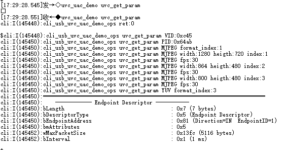
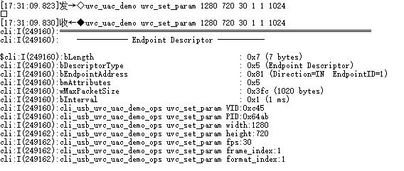
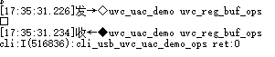
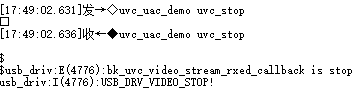
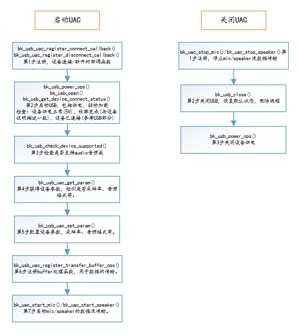
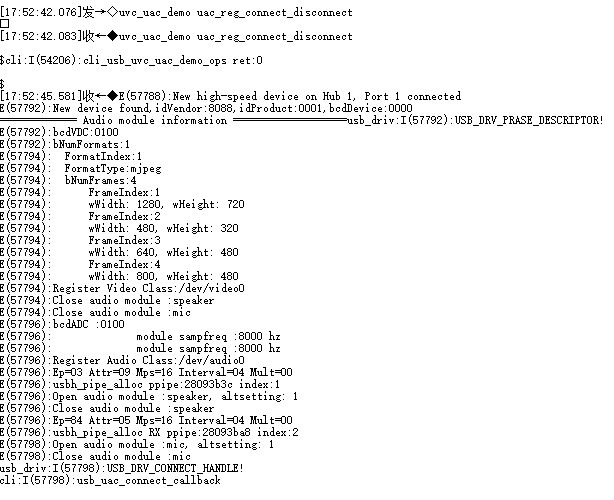
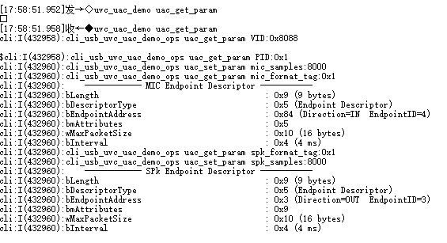
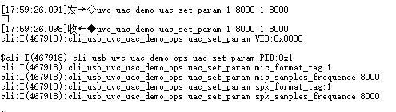
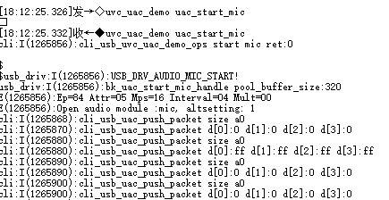

# USB Host UVC+UAC[](#usb-host-uvc-uac "永久链接至标题")

[[English]](../../../../../en/v2.0.1/api-reference/peripheral/usb/bk_usbh_uvc_uac.html "../../../../../en/v2.0.1/api-reference/peripheral/usb/bk_usbh_uvc_uac.html")

uvc_uac_api_common是BK7258的 USB UVC + UAC 主机驱动程序，支持从 USB 设备读取/写入/控制多媒体流。当前最多同时支持 1 路摄像头 + 1 路麦克风 + 1 路播放器数据流。
具体的综合使用示例，请参考avdk多媒体代码，谢谢。

## UVC 主机驱动基本使用流程[](#uvc "永久链接至标题")

UVC start/stop[](#id1 "永久链接至图片")

## UVC 主机驱动CLI测试示例[](#uvc-cli "永久链接至标题")

注：BK7258 USB 默认运行在CPU2，使用默认avdk调试需要连接UART2协助输入命令测试。 测试目标：UVC 获得参数正常，设置参数正常，Buffer管理正常，启动传输正常，关闭传输正常。

作为HOST 运行Video设备为例，输入命令和LOG信息如下图所示：

UVC Connect/Disconnect[](#id2 "永久链接至图片")

UVC Get Param[](#id3 "永久链接至图片")

UVC Set Param[](#id4 "永久链接至图片")

注：根据获得参数来设置参数，设置最大包长1024字节，分辨率1280X720 索引1，帧率30fps，视频数据格式索引1(实例中1为MJPG)。

UVC Register Buffer ops[](#id5 "永久链接至图片")

注：代码参考视频多媒体，buffer管理部分。

UVC Start[](#id6 "永久链接至图片")

UVC Stop[](#id7 "永久链接至图片")

## UAC 主机驱动基本使用流程[](#uac "永久链接至标题")

UAC start/stop[](#id8 "永久链接至图片")

## UAC 主机驱动CLI测试示例[](#uac-cli "永久链接至标题")

注：BK7258 USB 默认运行在CPU2，使用默认avdk调试需要连接UART2协助输入命令测试。 测试目标：UVC 获得参数正常，设置参数正常，Buffer管理正常，启动传输正常，关闭传输正常。

作为HOST 运行Video+Audio融合设备为例，输入命令和LOG信息如下图所示：

UAC Connect/Disconnect[](#id9 "永久链接至图片")

UAC Get Param[](#id10 "永久链接至图片")

UAC Set Param[](#id11 "永久链接至图片")

注：根据获得参数来设置参数，设置采样率，音频格式。

UAC Register Buffer ops[](#id12 "永久链接至图片")

注：代码参考音频多媒体，buffer管理部分。

UAC MIC Start[](#id13 "永久链接至图片")

UAC MIC Stop[](#id14 "永久链接至图片")

UAC SPK Start[](#id15 "永久链接至图片")

UAC SPK Stop[](#id16 "永久链接至图片")

## USB UVC UAC Reference[](#usb-uvc-uac-reference "永久链接至标题")

### Header File[](#header-file "永久链接至标题")

- [uvc_uac_api_common.h](http://192.168.0.46/gerrit/plugins/gitiles/iot/wcn/projects/+/refs/heads/armino_main/components/uvc_uac_api_common.h "http://192.168.0.46/gerrit/plugins/gitiles/iot/wcn/projects/+/refs/heads/armino_main/components/uvc_uac_api_common.h")

### Functions[](#functions "永久链接至标题")

[bk_err_t](../../system/os.html#_CPPv48bk_err_t "bk_err_t") bk_uvc_uac_register_callback([bk_uvc_uac_app_callback](../bk_usb.html#_CPPv423bk_uvc_uac_app_callback "bk_uvc_uac_app_callback") *uvc_uac_all_cb)[](#_CPPv428bk_uvc_uac_register_callbackP23bk_uvc_uac_app_callback "永久链接至目标")
:   Registering the callback function for UVC and UAC fusion devices.

    Register the corresponding callback function based on the structure, and be sure to fill in the specific type to facilitate the management of the callback function parameter: uvc_uac_all_cb E_USB_DEVICE_T dev; FUNCPTR uvc_uac_connect_cb; FUNCPTR uvc_uac_disconnect_cb;

    返回
    :   - BK_OK: succeed

        - others: other errors.

[bk_err_t](../../system/os.html#_CPPv48bk_err_t "bk_err_t") bk_usb_uvc_register_connect_callback(void *param)[](#_CPPv436bk_usb_uvc_register_connect_callbackPv "永久链接至目标")
:   UVC connect the callback function registration function registration.

    This API connect the callback:

    - parameter is the registered callback function.

    - The callback function needs to be defined.

    Notify the registered callback function when the device is connected.

    返回
    :   - BK_OK: succeed

        - others: other errors.

[bk_err_t](../../system/os.html#_CPPv48bk_err_t "bk_err_t") bk_usb_uvc_register_disconnect_callback(void *param)[](#_CPPv439bk_usb_uvc_register_disconnect_callbackPv "永久链接至目标")
:   UVC disconnect the callback function registration function registration.

    This API disconnect the callback:

    - parameter is the registered callback function.

    - The callback function needs to be defined.

    Notify the registered callback function when the device is disconnected.

    返回
    :   - BK_OK: succeed

        - others: other errors.

[bk_err_t](../../system/os.html#_CPPv48bk_err_t "bk_err_t") bk_usb_uvc_get_param([bk_uvc_device_brief_info_t](../bk_usb.html#_CPPv426bk_uvc_device_brief_info_t "bk_uvc_device_brief_info_t") *uvc_device_info)[](#_CPPv420bk_usb_uvc_get_paramP26bk_uvc_device_brief_info_t "永久链接至目标")
:   Obtain UVC relate parameters.

    Including basic parameters,VID PID FORMAT FRAME EndPoint

    parameter: uvc_device_info uint16_t vendor_id; uint16_t product_id; [bk_uvc_format_index](../bk_usb.html#structbk__uvc__format__index "../bk_usb.html#structbk__uvc__format__index") format_index; [bk_uvc_all_frame](../bk_usb.html#structbk__uvc__all__frame "../bk_usb.html#structbk__uvc__all__frame") all_frame; uint32_t endpoints_num; struct [s_bk_usb_endpoint_descriptor](../bk_usb.html#structs__bk__usb__endpoint__descriptor "../bk_usb.html#structs__bk__usb__endpoint__descriptor") *ep_desc;

    返回
    :   - BK_OK: succeed

        - others: other errors.

[bk_err_t](../../system/os.html#_CPPv48bk_err_t "bk_err_t") bk_usb_uvc_set_param([bk_uvc_config_t](../bk_usb.html#_CPPv415bk_uvc_config_t "bk_uvc_config_t") *uvc_config)[](#_CPPv420bk_usb_uvc_set_paramP15bk_uvc_config_t "永久链接至目标")
:   Configure the basic parameters for starting UVC.

    Execute the command according to the configured parameters, please fill in the parameters correctly. Prevent parameter requirements that cannot be executed

    parameter: uvc_config uint16_t vendor_id; uint16_t product_id; uint16_t width; uint16_t height; uint32_t fps; uint16_t frame_index; uint16_t format_index; struct [s_bk_usb_endpoint_descriptor](../bk_usb.html#structs__bk__usb__endpoint__descriptor "../bk_usb.html#structs__bk__usb__endpoint__descriptor") *ep_desc;

    返回
    :   - BK_OK: succeed

        - others: other errors.

[bk_err_t](../../system/os.html#_CPPv48bk_err_t "bk_err_t") bk_usb_uvc_register_transfer_buffer_ops(void *ops)[](#_CPPv439bk_usb_uvc_register_transfer_buffer_opsPv "永久链接至目标")
:   Start UVC stream transmission.

    Execute the command according to the configured parameters, please fill in the parameters correctly. Prevent parameter requirements that cannot be executed

    This API means that the data needs to transfer and needs to be copied.

    返回
    :   - BK_OK: succeed

        - others: other errors.

[bk_err_t](../../system/os.html#_CPPv48bk_err_t "bk_err_t") bk_uvc_start(void)[](#_CPPv412bk_uvc_startv "永久链接至目标")
:   Start UVC stream transmission.

    USB video camera data transfer starts:

    - configure the required configuration parameters

    - Send video stream data transfer instructions

    This API means that the data starts to transfer and needs to transfer and needs to be copied.

    返回
    :   - BK_OK: succeed

        - others: other errors.

[bk_err_t](../../system/os.html#_CPPv48bk_err_t "bk_err_t") bk_uvc_dual_start(void)[](#_CPPv417bk_uvc_dual_startv "永久链接至目标")

[bk_err_t](../../system/os.html#_CPPv48bk_err_t "bk_err_t") bk_uvc_stop(void)[](#_CPPv411bk_uvc_stopv "永久链接至目标")
:   Stop UVC stream transmission.

    USB video camera data transfer stops:

    - Send the video stream data stop transmission command

    There will be no more data flow after execution.

    返回
    :   - BK_OK: succeed

        - others: other errors.

[bk_err_t](../../system/os.html#_CPPv48bk_err_t "bk_err_t") bk_uvc_dual_stop(void)[](#_CPPv416bk_uvc_dual_stopv "永久链接至目标")

[bk_err_t](../../system/os.html#_CPPv48bk_err_t "bk_err_t") bk_usb_uvc_check_support_attribute(uint32_t attribute)[](#_CPPv434bk_usb_uvc_check_support_attribute8uint32_t "永久链接至目标")
:   Check whether the attribute configuration is supported.

    After connecting the UVC device, determine whether the attribute operation is supported by calling this API:

    - The Parameters has enumeration variable A planning, please fill in the attribute parameter correctly.

    - attribute: Processing Unit Control Selectors;

    Choose to call this API.

    返回
    :   - BK_OK: succeed

        - others: other errors.

[bk_err_t](../../system/os.html#_CPPv48bk_err_t "bk_err_t") bk_usb_uvc_attribute_op([E_USB_ATTRIBUTE_OP](../bk_usb.html#_CPPv418E_USB_ATTRIBUTE_OP "E_USB_ATTRIBUTE_OP") ops, uint32_t attribute, uint32_t *param)[](#_CPPv423bk_usb_uvc_attribute_op18E_USB_ATTRIBUTE_OP8uint32_tP8uint32_t "永久链接至目标")
:   Set camera attributes values.

    This API set/get camera attributes values:

    - Three parameters ops/attributes/values.

    - ops: E_USB_ATTRIBUTE_OP

    - attributes: Processing Unit Control Selectors

    - param: Incoming parameter pointer

      example: Reference cli_usb.c

    - Valid values needs to be viewed in camera.

    Choose to call this API.

    返回
    :   - BK_OK: succeed

        - others: other errors.

[bk_err_t](../../system/os.html#_CPPv48bk_err_t "bk_err_t") bk_usb_uac_register_connect_callback(void *param)[](#_CPPv436bk_usb_uac_register_connect_callbackPv "永久链接至目标")
:   UAC connect the callback function registration function registration.

    This API disconnect the callback:

    - parameter is the registered callback function.

    - The callback function needs to be defined.

    Notify the registered callback function when the device is connected.

    返回
    :   - BK_OK: succeed

        - others: other errors.

[bk_err_t](../../system/os.html#_CPPv48bk_err_t "bk_err_t") bk_usb_uac_register_disconnect_callback(void *param)[](#_CPPv439bk_usb_uac_register_disconnect_callbackPv "永久链接至目标")
:   UAC disconnect the callback function registration function registration.

    This API disconnect the callback:

    - parameter is the registered callback function.

    - The callback function needs to be defined.

    Notify the registered callback function when the device is disconnected.

    返回
    :   - BK_OK: succeed

        - others: other errors.

[bk_err_t](../../system/os.html#_CPPv48bk_err_t "bk_err_t") bk_usb_uac_get_param([bk_uac_device_brief_info_t](../bk_usb.html#_CPPv426bk_uac_device_brief_info_t "bk_uac_device_brief_info_t") *uac_device_info)[](#_CPPv420bk_usb_uac_get_paramP26bk_uac_device_brief_info_t "永久链接至目标")
:   Obtain UAC relate parameters.

    Including basic parameters,VID PID mic_samples_frequence spk_samples_frequence

    parameter: uac_device_info uint16_t vendor_id; uint16_t product_id; uint16_t mic_format_tag; uint8_t mic_samples_frequence_num; uint8_t *mic_samples_frequence; struct audio_ep_descriptor *mic_ep_desc; uint16_t spk_format_tag; uint8_t spk_samples_frequence_num; uint8_t *spk_samples_frequence; struct audio_ep_descriptor *spk_ep_desc;

    返回
    :   - BK_OK: succeed

        - others: other errors.

[bk_err_t](../../system/os.html#_CPPv48bk_err_t "bk_err_t") bk_usb_uac_set_param([bk_uac_config_t](../bk_usb.html#_CPPv415bk_uac_config_t "bk_uac_config_t") *uac_config)[](#_CPPv420bk_usb_uac_set_paramP15bk_uac_config_t "永久链接至目标")
:   Configure the basic parameters for starting UAC.

    Execute the command according to the configured parameters, please fill in the parameters correctly. Prevent parameter requirements that cannot be executed

    parameter: uac_config uint16_t vendor_id; uint16_t product_id; uint16_t mic_format_tag; uint32_t mic_samples_frequence; struct audio_ep_descriptor *mic_ep_desc; uint16_t spk_format_tag; uint32_t spk_samples_frequence; struct audio_ep_descriptor *spk_ep_desc;

    返回
    :   - BK_OK: succeed

        - others: other errors.

[bk_err_t](../../system/os.html#_CPPv48bk_err_t "bk_err_t") bk_usb_uac_set_mic_param([bk_uac_mic_config_t](../bk_usb.html#_CPPv419bk_uac_mic_config_t "bk_uac_mic_config_t") *uac_mic_config)[](#_CPPv424bk_usb_uac_set_mic_paramP19bk_uac_mic_config_t "永久链接至目标")
:   Configure the basic parameters for starting Mic.

    Execute the command according to the configured parameters, please fill in the parameters correctly. Prevent parameter requirements that cannot be executed

    parameter: uac_mic_config uint16_t mic_format_tag; uint32_t mic_samples_frequence; struct audio_ep_descriptor *mic_ep_desc;

    返回
    :   - BK_OK: succeed

        - others: other errors.

[bk_err_t](../../system/os.html#_CPPv48bk_err_t "bk_err_t") bk_usb_uac_set_spk_param([bk_uac_spk_config_t](../bk_usb.html#_CPPv419bk_uac_spk_config_t "bk_uac_spk_config_t") *uac_spk_config)[](#_CPPv424bk_usb_uac_set_spk_paramP19bk_uac_spk_config_t "永久链接至目标")
:   Configure the basic parameters for starting Speaker.

    Execute the command according to the configured parameters, please fill in the parameters correctly. Prevent parameter requirements that cannot be executed

    parameter: uac_spk_config uint16_t spk_format_tag; uint32_t spk_samples_frequence; struct audio_ep_descriptor *spk_ep_desc;

    返回
    :   - BK_OK: succeed

        - others: other errors.

[bk_err_t](../../system/os.html#_CPPv48bk_err_t "bk_err_t") bk_usb_uac_register_transfer_buffer_ops(void *ops)[](#_CPPv439bk_usb_uac_register_transfer_buffer_opsPv "永久链接至目标")
:   Start UVC stream transmission.

    Execute the command according to the configured parameters, please fill in the parameters correctly. Prevent parameter requirements that cannot be executed

    This API means that the data needs to transfer and needs to be copied.

    返回
    :   - BK_OK: succeed

        - others: other errors.

[bk_err_t](../../system/os.html#_CPPv48bk_err_t "bk_err_t") bk_uac_start_mic(void)[](#_CPPv416bk_uac_start_micv "永久链接至目标")
:   Start UAC mic stream transmission.

    USB audio data transfer starts:

    - configure the required configuration parameters

    - Send audio stream data transfer instructions

    This API means that the data starts to transfer and needs to transfer and needs to be copied.

    返回
    :   - BK_OK: succeed

        - others: other errors.

[bk_err_t](../../system/os.html#_CPPv48bk_err_t "bk_err_t") bk_uac_stop_mic(void)[](#_CPPv415bk_uac_stop_micv "永久链接至目标")
:   Stop UAC mic stream transmission.

    USB audio data transfer stops:

    - Send the video stream data stop transmission command

    There will be no more data flow after execution.

    返回
    :   - BK_OK: succeed

        - others: other errors.

[bk_err_t](../../system/os.html#_CPPv48bk_err_t "bk_err_t") bk_uac_start_speaker(void)[](#_CPPv420bk_uac_start_speakerv "永久链接至目标")
:   Start UAC speaker stream transmission.

    USB audio data transfer starts:

    - configure the required configuration parameters

    - Send audio stream data transfer instructions

    This API means that the data starts to transfer and needs to transfer and needs to be copied.

    返回
    :   - BK_OK: succeed

        - others: other errors.

[bk_err_t](../../system/os.html#_CPPv48bk_err_t "bk_err_t") bk_uac_stop_speaker(void)[](#_CPPv419bk_uac_stop_speakerv "永久链接至目标")
:   Stop UAC speaker stream transmission.

    USB audio data transfer stops:

    - Send the video stream data stop transmission command

    There will be no more data flow after execution.

    返回
    :   - BK_OK: succeed

        - others: other errors.

[bk_err_t](../../system/os.html#_CPPv48bk_err_t "bk_err_t") bk_usb_uac_check_support_attribute(uint32_t attribute)[](#_CPPv434bk_usb_uac_check_support_attribute8uint32_t "永久链接至目标")
:   Check whether the attribute configuration is supported.

    After connecting the UAC device, determine whether the attribute operation is supported by calling this API:

    - The Parameters has enumeration variable A planning, please fill in the attribute parameter correctly.

    - attribute: Feature Unit Control Bits;

    Choose to call this API.

    返回
    :   - BK_OK: succeed

        - others: other errors.

[bk_err_t](../../system/os.html#_CPPv48bk_err_t "bk_err_t") bk_usb_uac_attribute_op([E_USB_ATTRIBUTE_OP](../bk_usb.html#_CPPv418E_USB_ATTRIBUTE_OP "E_USB_ATTRIBUTE_OP") ops, uint32_t attribute, uint32_t *param)[](#_CPPv423bk_usb_uac_attribute_op18E_USB_ATTRIBUTE_OP8uint32_tP8uint32_t "永久链接至目标")
:   Set camera attributes values.

    This API set/get camera attributes values:

    - Three parameters ops/attributes/values.

    - ops: E_USB_ATTRIBUTE_OP

    - attributes: Feature Unit Control Bits

    - param: Incoming parameter pointer

      example: Reference cli_usb.c

    - Valid values needs to be viewed in camera.

    Choose to call this API.

    返回
    :   - BK_OK: succeed

        - others: other errors.
