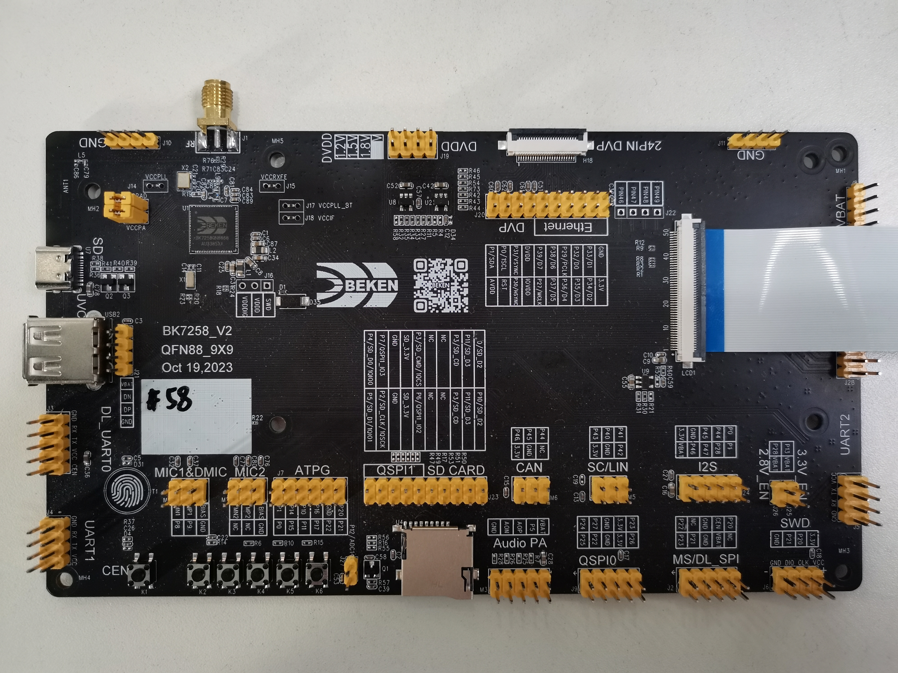

# BK7258[](#bk7258 "永久链接至标题")

[[English]](../../../en/v2.0.1/get-started/bk7258.html "../../../en/v2.0.1/get-started/bk7258.html")

## 开发板简介[](#id2 "永久链接至标题")

> - 为三核 CM33 架构
> - 支持 FreeRTOS V10

BK7258 Demo Board[](#id3 "永久链接至图片")
