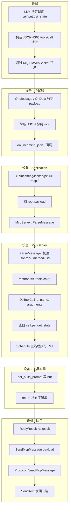
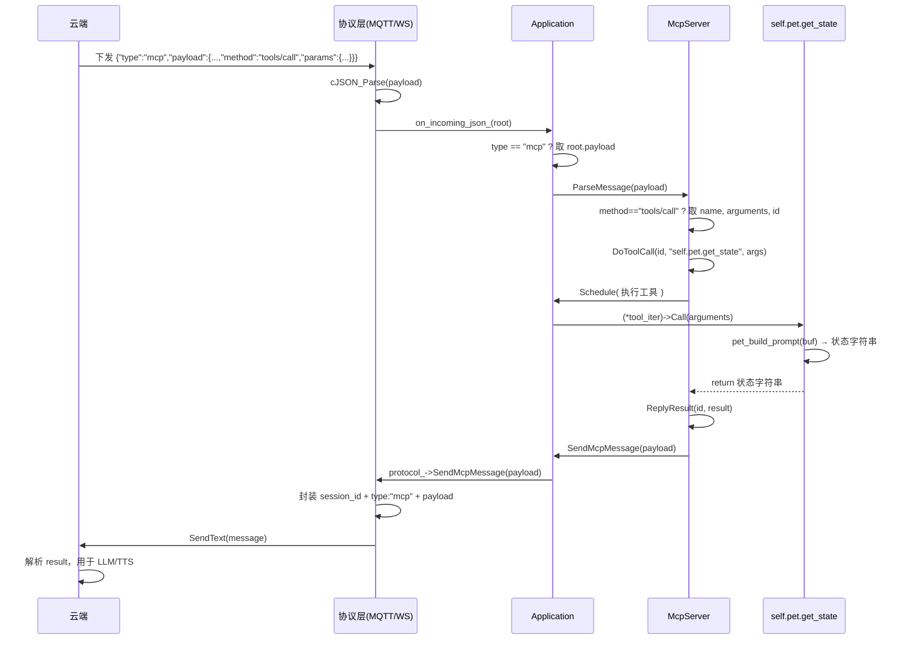

# MCP「获取设备状态」完整链路说明

本文档描述桌面宠物（desktop-pet）中 **MCP 获取设备状态**（`self.pet.get_state`）从云端请求到设备执行、再回传云端的完整数据流，每一步附带代码位置与逐行解析，并配有流程图。

- **工程根**：`xiaozhi-esp32-main-v2/xiaozhi-esp32`
- **涉及文件**：
  - 协议层：`main/protocols/mqtt_protocol.cc` 或 `  .cc`
  - 应用层：`main/application.cc`、`main/application.h`
  - MCP 服务：`main/mcp_server.cc`、`main/mcp_server.h`
  - 协议基类：`main/ /protocol.cc`
  - 桌面宠物板级：`main/boards/desktop-pet/desktop_pet.cc`
  - 养成数据：`main/boards/desktop-pet/pet_tamagotchi.cc`、`pet_tamagotchi.h`

---

## 流程图（总览）



---

## 步骤一：协议层接收云端下发的消息

云端通过当前连接（MQTT 或 WebSocket）下发一条业务 JSON，例如：

```json
{"session_id":"xxx","type":"mcp","payload":{"jsonrpc":"2.0","id":1,"method":"tools/call","params":{"name":"self.pet.get_state","arguments":{}}}}
```

以 **MQTT** 为例，在 `mqtt_protocol.cc` 中，`OnMessage` 被注册为收到 MQTT 消息时的回调；只有非 `hello`/`goodbye` 的消息才会交给 `on_incoming_json_`（即 Application 注册的 `OnIncomingJson`）。

**文件**：`main/protocols/mqtt_protocol.cc`

```c
// 105-135 行（节选）
mqtt_->OnMessage([this](const std::string& topic, const std::string& payload) {
    // 将 MQTT 消息体按 JSON 解析，得到根对象 root
    cJSON* root = cJSON_Parse(payload.c_str());
    if (root == nullptr) {
        ESP_LOGE(TAG, "Failed to parse json message %s", payload.c_str());
        return;
    }
    // 取出业务类型字段 "type"，用于区分 tts/stt/llm/mcp/system 等
    cJSON* type = cJSON_GetObjectItem(root, "type");
    if (!cJSON_IsString(type)) {
        ESP_LOGE(TAG, "Message type is invalid");
        cJSON_Delete(root);
        return;
    }
    // hello / goodbye 在协议层单独处理，其余类型交给应用层
    if (strcmp(type->valuestring, "hello") == 0) {
        ParseServerHello(root);
    } else if (strcmp(type->valuestring, "goodbye") == 0) {
        // ...
    } else if (on_incoming_json_ != nullptr) {
        // MCP、tts、stt 等：把整棵 root 交给 Application 的 OnIncomingJson
        on_incoming_json_(root);
    }
    cJSON_Delete(root);
    last_incoming_time_ = std::chrono::steady_clock::now();
});
```

| 代码行 | 说明 |
|--------|------|
| `cJSON* root = cJSON_Parse(payload.c_str())` | 把 MQTT  payload 字符串解析为 cJSON 树，root 为根节点 |
| `cJSON_GetObjectItem(root, "type")` | 从根节点取键 `"type"`，用于判断是 mcp/tts/stt/llm 等 |
| `on_incoming_json_(root)` | 调用 Application 注册的回调，把整条消息交给应用层处理 |

---

## 步骤二：Application 根据 type 派发到 MCP

在 `Application::InitializeProtocol()` 中，通过 `protocol_->OnIncomingJson(...)` 注册了回调。该回调在主任务（Schedule）上下文中执行，根据 `root["type"]` 分支；当 `type == "mcp"` 时，取出 `payload`（即 JSON-RPC 请求体）并交给 `McpServer::ParseMessage`。

**文件**：`main/application.cc`

```c
// 519-580 行（节选）
protocol_->OnIncomingJson([this, display](const cJSON* root) {
    // 从业务 JSON 根节点取 "type"
    auto type = cJSON_GetObjectItem(root, "type");
    // ...
    } else if (strcmp(type->valuestring, "mcp") == 0) {
        // MCP 消息：payload 内为 JSON-RPC 2.0 请求（如 initialize / tools/list / tools/call）
        auto payload = cJSON_GetObjectItem(root, "payload");
        if (cJSON_IsObject(payload)) {
            // 将 payload 对象交给 MCP 服务解析并处理
            McpServer::GetInstance().ParseMessage(payload);
        }
    }
    // ...
});
```

| 代码行 | 说明 |
|--------|------|
| `strcmp(type->valuestring, "mcp") == 0` | 判断本条消息是否为 MCP 类型 |
| `cJSON_GetObjectItem(root, "payload")` | 取出 MCP 载荷，即服务端下发的 JSON-RPC 对象 |
| `ParseMessage(payload)` | 注意：此处传入的是 cJSON 对象指针，调用重载 `ParseMessage(const cJSON* json)` |

---

## 步骤三：McpServer 解析 JSON-RPC 并识别 tools/call

`ParseMessage(const cJSON* json)` 校验 JSON-RPC 版本、method、params、id；若 `method == "tools/call"`，则从 `params` 中取出工具名 `name` 和 `arguments`，并调用 `DoToolCall(id, tool_name, tool_arguments)`。

**文件**：`main/mcp_server.cc`

```c
// 353-434 行（节选）
void McpServer::ParseMessage(const cJSON* json) {
    // 校验 JSON-RPC 版本必须为 "2.0"
    auto version = cJSON_GetObjectItem(json, "jsonrpc");
    if (version == nullptr || !cJSON_IsString(version) || strcmp(version->valuestring, "2.0") != 0) {
        ESP_LOGE(TAG, "Invalid JSONRPC version: %s", version ? version->valuestring : "null");
        return;
    }
    // 取 method，如 "initialize" / "tools/list" / "tools/call"
    auto method = cJSON_GetObjectItem(json, "method");
    if (method == nullptr || !cJSON_IsString(method)) {
        ESP_LOGE(TAG, "Missing method");
        return;
    }
    auto method_str = std::string(method->valuestring);
    // 通知类 method 直接忽略
    if (method_str.find("notifications") == 0) {
        return;
    }
    auto params = cJSON_GetObjectItem(json, "params");
    // 取请求 id，用于在回复时原样带回，便于云端匹配请求-响应
    auto id = cJSON_GetObjectItem(json, "id");
    if (id == nullptr || !cJSON_IsNumber(id)) {
        ESP_LOGE(TAG, "Invalid id for method: %s", method_str.c_str());
        return;
    }
    auto id_int = id->valueint;

    if (method_str == "initialize") {
        // ...
    } else if (method_str == "tools/list") {
        GetToolsList(id_int, cursor_str, list_user_only_tools);
    } else if (method_str == "tools/call") {
        if (!cJSON_IsObject(params)) {
            ReplyError(id_int, "Missing params");
            return;
        }
        // 工具名，如 "self.pet.get_state"
        auto tool_name = cJSON_GetObjectItem(params, "name");
        if (!cJSON_IsString(tool_name)) {
            ReplyError(id_int, "Missing name");
            return;
        }
        // 工具参数（get_state 无参数，此处多为 {}）
        auto tool_arguments = cJSON_GetObjectItem(params, "arguments");
        if (tool_arguments != nullptr && !cJSON_IsObject(tool_arguments)) {
            ReplyError(id_int, "Invalid arguments");
            return;
        }
        DoToolCall(id_int, std::string(tool_name->valuestring), tool_arguments);
    } else {
        ReplyError(id_int, "Method not implemented: " + method_str);
    }
}
```

| 代码行 | 说明 |
|--------|------|
| `jsonrpc == "2.0"` | 遵循 JSON-RPC 2.0 规范 |
| `id->valueint` | 请求 id，回复时通过 ReplyResult(id, result) 带回 |
| `params.name` | 本次调用的工具名，此处为 `"self.pet.get_state"` |
| `params.arguments` | 工具参数对象，get_state 无参数故通常为 `{}` |
| `DoToolCall(id_int, ...)` | 根据工具名查找注册表并执行对应 callback，最后回包 |

---

## 步骤四：DoToolCall 查找工具并在主线程执行

`DoToolCall` 在 `tools_` 列表中按 `tool_name` 查找已注册的 `McpTool`；找到后解析 `arguments` 填入 `PropertyList`，再通过 `Application::Schedule` 在主线程中执行 `(*tool_iter)->Call(arguments)`，将返回值交给 `ReplyResult(id, result)`。

**文件**：`main/mcp_server.cc`

```c
// 511-562 行
void McpServer::DoToolCall(int id, const std::string& tool_name, const cJSON* tool_arguments) {
    // 在已注册工具列表中按名称查找
    auto tool_iter = std::find_if(tools_.begin(), tools_.end(),
                                 [&tool_name](const McpTool* tool) {
                                     return tool->name() == tool_name;
                                 });
    if (tool_iter == tools_.end()) {
        ESP_LOGE(TAG, "tools/call: Unknown tool: %s", tool_name.c_str());
        ReplyError(id, "Unknown tool: " + tool_name);
        return;
    }
    // 获取该工具声明的参数列表，并从 tool_arguments 中解析出实际值
    PropertyList arguments = (*tool_iter)->properties();
    try {
        for (auto& argument : arguments) {
            // 若 params.arguments 中有对应键，则填入 argument（类型需匹配）
            // get_state 无参数，此循环不执行实质赋值
        }
    } catch (const std::exception& e) {
        ReplyError(id, e.what());
        return;
    }
    // 必须在主线程执行：工具内部可能访问 UI、NVS、Application 等
    auto& app = Application::GetInstance();
    app.Schedule([this, id, tool_iter, arguments = std::move(arguments)]() {
        try {
            // 执行工具回调，返回值即状态字符串，再作为 JSON-RPC result 回传
            ReplyResult(id, (*tool_iter)->Call(arguments));
        } catch (const std::exception& e) {
            ESP_LOGE(TAG, "tools/call: %s", e.what());
            ReplyError(id, e.what());
        }
    });
}
```

| 代码行 | 说明 |
|--------|------|
| `std::find_if(..., tool->name() == tool_name)` | 查找名为 `"self.pet.get_state"` 的 McpTool |
| `(*tool_iter)->properties()` | 获取该工具定义的参数列表（get_state 为 PropertyList() 空） |
| `app.Schedule(...)` | 将工具执行与 ReplyResult 放到主任务队列，保证线程安全 |
| `(*tool_iter)->Call(arguments)` | 调用 desktop_pet 注册的 lambda，内部执行 pet_build_prompt 并返回字符串 |

---

## 步骤五：工具实现 self.pet.get_state（生成状态字符串）

在 desktop-pet 板级初始化时，通过 `AddTool("self.pet.get_state", ...)` 注册了该工具；回调内调用 `pet_build_prompt(buf, size)` 将当前养成数据写入 `buf`，并返回该字符串（若未初始化则返回 `"宠物状态未初始化"`）。

**文件**：`main/boards/desktop-pet/desktop_pet.cc`

```c
// 303-311 行
mcp_server.AddTool("self.pet.get_state",
    "获取宠物当前养成状态，包括亲密度、心情、相识天数和关系阶段。"
    "当用户摸头、戳脸、询问认识多少天、问关系好不好、问心情如何等任何涉及宠物状态的问题时必须调用此工具，根据返回数据回应。",
    PropertyList(),   // 无入参
    [](const PropertyList&) -> ReturnValue {
        char buf[256] = {};
        pet_build_prompt(buf, sizeof(buf));   // 将状态文案写入 buf
        return std::string(buf[0] ? buf : "宠物状态未初始化");
    });
```

**文件**：`main/boards/desktop-pet/pet_tamagotchi.cc`

```c
// 315-339 行
void pet_build_prompt(char* buf, int buf_size) {
    if (!s_loaded || !buf || buf_size <= 0) return;
    // 关系阶段：陌生/熟悉/亲密
    static const char* stage_names[] = { "陌生", "熟悉", "亲密" };
    const char* stage_str = stage_names[s_data.stage];
    // 心情档位：开心 / 平静 / 低落
    const char* mood_str;
    if      (s_data.mood >= 70) mood_str = "开心";
    else if (s_data.mood >= 40) mood_str = "平静";
    else                         mood_str = "低落";
    // 亲密度 CD 剩余秒数（10 分钟内仅可增长一次）
    int cd_remain = 0;
    time_t now;
    time(&now);
    if (now > 1000000 && s_last_gain_time > 0) {
        int elapsed = (int)(now - s_last_gain_time);
        if (elapsed < INTIMACY_CD_SEC) cd_remain = INTIMACY_CD_SEC - elapsed;
    }
    // 拼成一句给 LLM 看的上下文，包含关系、亲密度、今日已获得、心情、相识天数、CD
    snprintf(buf, buf_size,
             "[宠物状态：关系%s，亲密度%d/100(今日%d/%d)，心情%s(%d)，相识第%d天，亲密CD%d秒]",
             stage_str,
             (int)s_data.intimacy, (int)s_data.daily_intimacy, DAILY_INTIMACY_CAP,
             mood_str, (int)s_data.mood,
             (int)s_data.age_days, cd_remain);
}
```

| 代码行 | 说明 |
|--------|------|
| `AddTool("self.pet.get_state", ...)` | 注册名、描述、参数列表、回调；云端 tools/call 的 name 即为此字符串 |
| `pet_build_prompt(buf, sizeof(buf))` | 用当前 NVS 加载的养成数据（s_data）拼出一段状态描述 |
| `s_data.stage / intimacy / mood / age_days` | 来自 pet_tamagotchi 的全局状态，在摸头/戳脸/投喂/对话完成等时机更新 |
| `return std::string(buf...)` | 工具返回值即该状态字符串，作为 JSON-RPC 的 result 内容 |

---

## 步骤六：ReplyResult 打包 JSON-RPC 结果并交给 Application

工具返回的字符串作为 JSON-RPC 的 `result` 字段值；`ReplyResult` 将其与 `id`、`jsonrpc` 拼成完整响应 JSON，再通过 `Application::SendMcpMessage(payload)` 发回云端。

**文件**：`main/mcp_server.cc`

```c
// 436-443 行
void McpServer::ReplyResult(int id, const std::string& result) {
    // 组装 JSON-RPC 2.0 成功响应：{"jsonrpc":"2.0","id":<id>,"result":<result>}
    std::string payload = "{\"jsonrpc\":\"2.0\",\"id\":";
    payload += std::to_string(id) + ",\"result\":";
    payload += result;   // result 为状态字符串，若含引号需在调用方转义；当前 pet_build_prompt 无引号
    payload += "}";
    Application::GetInstance().SendMcpMessage(payload);
}
```

| 代码行 | 说明 |
|--------|------|
| `id` | 与请求中的 id 一致，云端据此匹配是哪次 tools/call 的回复 |
| `result` | 此处为 get_state 返回的纯文本状态字符串 |
| `SendMcpMessage(payload)` | 将整条 JSON-RPC 响应交给 Application，再经协议层发出 |

---

## 步骤七：Application 与协议层将 MCP 回复发回云端

`SendMcpMessage` 将回复放入主任务队列，在协议可用时调用 `protocol_->SendMcpMessage(payload)`；协议基类再把 `payload` 包成业务格式（带 `session_id`、`type: "mcp"`），通过 `SendText` 经 MQTT/WebSocket 发回。

**文件**：`main/application.cc`

```c
// 1045-1051 行
void Application::SendMcpMessage(const std::string& payload) {
    // 在主任务中发送，避免与协议层竞态
    Schedule([this, payload = std::move(payload)]() {
        if (protocol_) {
            protocol_->SendMcpMessage(payload);
        }
    });
}
```

**文件**：`main/protocols/protocol.cc`

```c
// 76-79 行
void Protocol::SendMcpMessage(const std::string& payload) {
    // 业务层封装：session_id + type:"mcp" + payload（即 JSON-RPC 响应体）
    std::string message = "{\"session_id\":\"" + session_id_ + "\",\"type\":\"mcp\",\"payload\":" + payload + "}";
    SendText(message);   // MQTT 为 Publish，WebSocket 为 Send 文本帧
}
```

| 代码行 | 说明 |
|--------|------|
| `Schedule([...](){ protocol_->SendMcpMessage(payload); })` | 确保在应用主循环任务中调用协议，与 OnIncomingJson 同线程 |
| `session_id_` | 当前会话 ID，与连接建立时服务器下发的 session 一致 |
| `type: "mcp"` | 云端据此识别为 MCP 回复，并解析 payload 为 JSON-RPC 响应 |
| `SendText(message)` | 将整条 JSON 通过当前传输（MQTT/WebSocket）发回服务端 |

---

## 流程小结表

| 步骤 | 位置 | 作用 |
|------|------|------|
| 1 | 协议层 OnMessage/OnData | 收到云端 JSON，解析后根据 type 调用 on_incoming_json_(root) |
| 2 | Application OnIncomingJson | type=="mcp" 时取 root.payload，调用 McpServer::ParseMessage(payload) |
| 3 | McpServer::ParseMessage | 校验 jsonrpc/id/method，method=="tools/call" 时取 name/arguments，调 DoToolCall |
| 4 | McpServer::DoToolCall | 按 name 查工具，主线程 Schedule 执行 Call，得到 result |
| 5 | desktop_pet AddTool callback | pet_build_prompt 写状态字符串并 return，即 get_state 的“获取设备状态”实现 |
| 6 | McpServer::ReplyResult | 将 id + result 拼成 JSON-RPC 响应，调 Application::SendMcpMessage |
| 7 | Application + Protocol | SendMcpMessage 包成 session_id+type+mcp payload，SendText 发回云端 |

云端收到带同一 `id` 的 MCP 回复后，从 `result` 中取出设备侧返回的状态文案，用于后续 LLM 生成回复或 TTS。

---

## 时序图（请求-响应）


