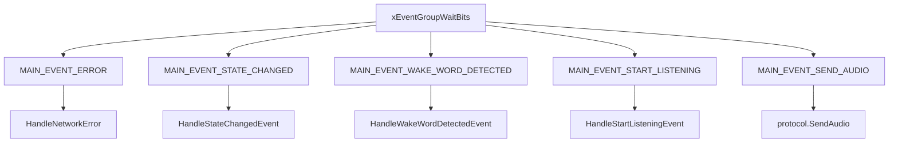
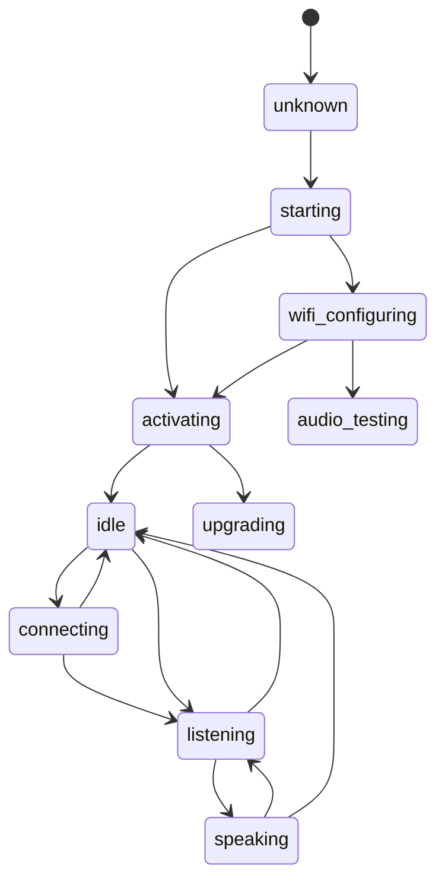
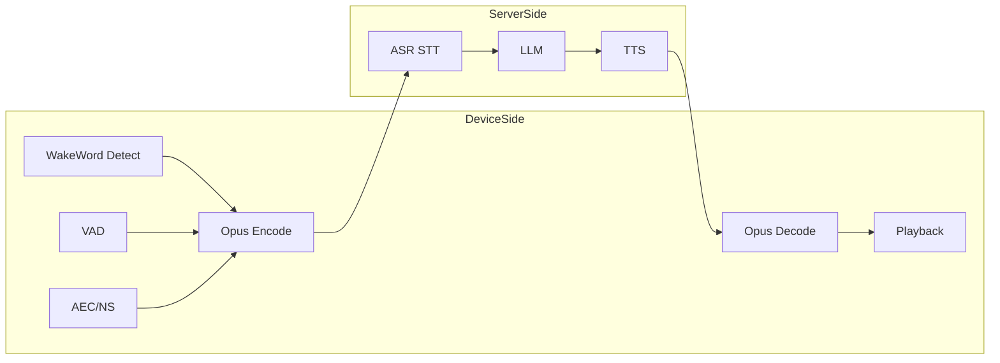
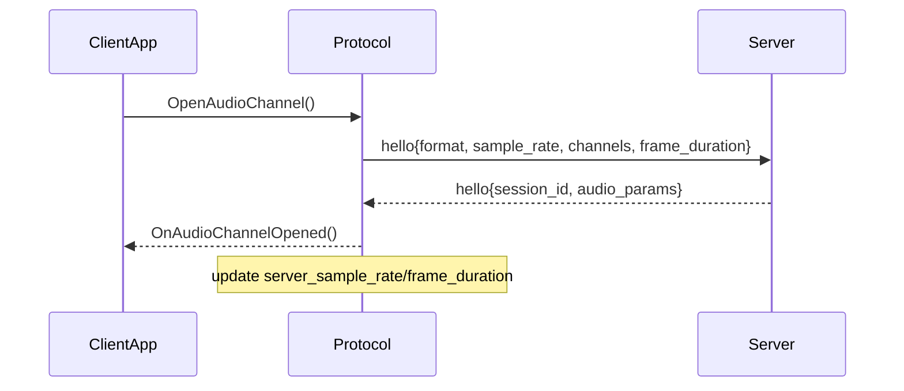
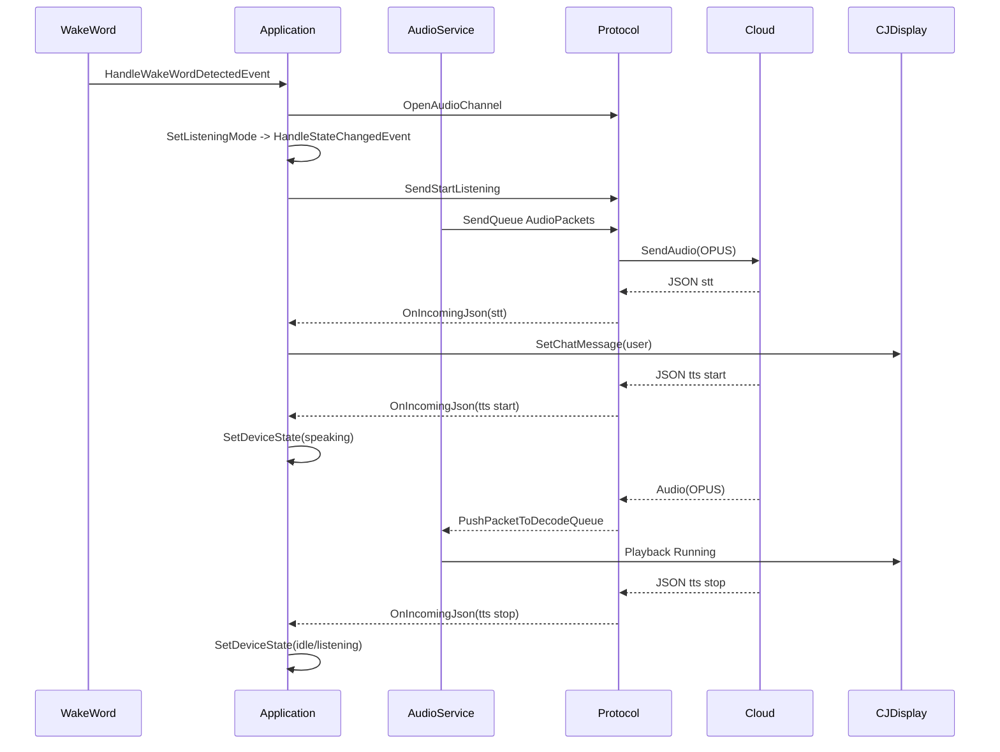

 # 语音代码学习路线-执行笔记

## 1. 全局事件与状态心智图

### 1.1 MAIN_EVENT 速查

来源：`main/application.h`

- `MAIN_EVENT_SEND_AUDIO`：发送编码后的上行音频包。
- `MAIN_EVENT_WAKE_WORD_DETECTED`：唤醒词触发事件。
- `MAIN_EVENT_VAD_CHANGE`：VAD 语音状态变化事件。
- `MAIN_EVENT_START_LISTENING` / `MAIN_EVENT_STOP_LISTENING`：手动开始/停止聆听。
- `MAIN_EVENT_STATE_CHANGED`：状态机切换后触发 UI/音频策略。
- `MAIN_EVENT_NETWORK_CONNECTED` / `MAIN_EVENT_NETWORK_DISCONNECTED`：网络状态变化。
- `MAIN_EVENT_ERROR`：协议层网络错误上报。

### 1.2 关键入口函数职责

来源：`main/application.cc`

- `InitializeProtocol()`：选择 `MqttProtocol` 或 `WebsocketProtocol`，绑定音频与 JSON 回调。
- `HandleStartListeningEvent()`：根据当前状态切到 `listening` 或中断 `speaking` 后转听。
- `HandleWakeWordDetectedEvent()`：空闲态触发唤醒后开音频通道并进入聆听。
- `HandleStateChangedEvent()`：统一做 UI、音频处理器、唤醒检测开关控制。
- `AbortSpeaking()`：向云端发 `abort_speaking`，用于插话/打断。

### 1.3 状态迁移边界（状态机约束）

来源：`main/device_state_machine.cc`

- `unknown -> starting`
- `starting -> wifi_configuring | activating`
- `wifi_configuring -> activating | audio_testing`
- `activating -> upgrading | idle | wifi_configuring`
- `idle -> connecting | listening | speaking | activating | upgrading | wifi_configuring`
- `connecting -> idle | listening`
- `listening -> speaking | idle`
- `speaking -> listening | idle`

无效迁移会被 `IsValidTransition()` 拒绝并打警告日志。

### 1.4 事件驱动主循环图

### 1.5 状态迁移图

## 2. 音频流水线（核心）

来源：`main/audio/audio_service.h`、`main/audio/audio_service.cc`

### 2.1 三任务模型

- `AudioInputTask`：采麦、喂唤醒/音频处理器、产生待编码 PCM。
- `OpusCodecTask`：编码上行与解码下行（同一任务双向处理）。
- `AudioOutputTask`：从播放队列取 PCM 并 `codec_->OutputData()` 播放。

### 2.2 队列模型（四类核心 + 时间戳）

- `audio_encode_queue_`：PCM 待编码任务。
- `audio_send_queue_`：编码后 OPUS 包，等待协议层发送。
- `audio_decode_queue_`：协议层下发 OPUS 包，等待解码。
- `audio_playback_queue_`：解码后 PCM，等待扬声器播放。
- `timestamp_queue_`：服务端 AEC 对齐用时间戳。

### 2.3 上行链路（麦克风 -> 云端）

`ReadAudioData` -> `audio_processor_->Feed`/`OnOutput` -> `PushTaskToEncodeQueue(kAudioTaskTypeEncodeToSendQueue)` -> `esp_opus_enc_process` -> `audio_send_queue_` -> `Application` 主循环触发 `protocol_->SendAudio()`

### 2.4 下行链路（云端 -> 扬声器）

`Protocol::OnIncomingAudio` -> `audio_service_.PushPacketToDecodeQueue()` -> `esp_opus_dec_decode` -> `audio_playback_queue_` -> `AudioOutputTask` -> `codec_->OutputData()`

### 2.5 音频任务与队列流图

## 3. 唤醒/VAD 与云端 ASR 边界

### 3.1 本地负责（设备侧）

来源：`main/audio/processors/afe_audio_processor.cc`、`main/audio/wake_words/afe_wake_word.cc`、`main/audio/wake_words/custom_wake_word.cc`

- 唤醒检测：`AfeWakeWord` 或 `CustomWakeWord` 本地检测。
- VAD：`AfeAudioProcessor::AudioProcessorTask()` 内由 `res->vad_state` 触发 `OnVadStateChange`。
- 降噪/AEC：`AfeAudioProcessor` 根据配置启用 `ns/aec/vad`。
- 唤醒前缓存音频：`wake_word_pcm_` 保留约 2 秒，用于可选上送唤醒音频。

### 3.2 云端负责（服务侧）

- ASR（`stt`）识别文本在 `Application::InitializeProtocol()` 的 `OnIncomingJson` 中接收并显示。
- TTS（`tts`）控制播放起停与句子文本显示（`sentence_start`）。

### 3.3 关键配置位

来源：`main/Kconfig.projbuild`

- `WAKE_WORD_TYPE`：`USE_AFE_WAKE_WORD` / `USE_CUSTOM_WAKE_WORD` / 关闭。
- `CUSTOM_WAKE_WORD_THRESHOLD`：自定义唤醒阈值。
- `SEND_WAKE_WORD_DATA`：是否将唤醒词音频片段上送。
- `USE_AUDIO_PROCESSOR`：启用语音处理链路。
- `USE_DEVICE_AEC` / `USE_SERVER_AEC`：设备侧/服务侧 AEC 路线选择。

### 3.4 本地与云端职责边界图

## 4. 协议层 STT/TTS 与帧格式

来源：`main/protocols/protocol.h`、`main/protocols/websocket_protocol.cc`、`main/protocols/mqtt_protocol.cc`

### 4.1 hello 协商字段（双方都包含）

- `type: hello`
- `transport: websocket` 或 `udp`
- `audio_params.format: opus`
- `audio_params.sample_rate: 16000`
- `audio_params.channels: 1`
- `audio_params.frame_duration: OPUS_FRAME_DURATION_MS`

服务器回包后更新：

- `server_sample_rate_`
- `server_frame_duration_`
- `session_id_`

### 4.2 `OnIncomingJson` 核心分支（在 Application）

- `type=tts`
  - `state=start`：切 `speaking`
  - `state=stop`：根据模式切 `idle` 或 `listening`
  - `state=sentence_start`：显示 assistant 文本
- `type=stt`：显示 user 文本
- 其他：`llm`（情绪）、`mcp`（扩展消息）、`system`（如 reboot）

### 4.3 `OnIncomingAudio` 入队条件

- 仅在 `GetDeviceState() == kDeviceStateSpeaking` 时推入 `PushPacketToDecodeQueue()`，避免非播报态误播。

### 4.4 hello 协商与会话建立图

## 5. 桌宠 UI 端到端走读

来源：`main/boards/desktop-pet/ui/ui_pet.cc`、`main/boards/desktop-pet/CJ_display.cc`

### 5.1 状态指示

- `ui_pet.cc` 中状态灯按状态变色：
  - `listening` 绿色
  - `speaking` 蓝色
  - `connecting` 橙色闪烁
  - `idle` 暗灰

### 5.2 文本显示路径

- 云端 `stt` -> `display->SetChatMessage("user", text)`
- 云端 `tts sentence_start` -> `display->SetChatMessage("assistant", text)`
- `CJ_display.cc` 中对 `user/assistant/system` 使用不同气泡样式和布局。

### 5.3 函数级时序（唤醒到播放结束）

1. `AfeWakeWord/CustomWakeWord::Feed()` 检测到唤醒 -> 回调到 `Application`。
2. `Application::HandleWakeWordDetectedEvent()`：必要时开音频通道并 `SetListeningMode()`。
3. `HandleStateChangedEvent()` 进入 `listening`：`protocol_->SendStartListening()`，启音频处理。
4. `AudioInputTask` 持续采集 -> `OpusCodecTask` 编码 -> `audio_send_queue_`。
5. 主循环处理 `MAIN_EVENT_SEND_AUDIO` -> `protocol_->SendAudio()` 上送。
6. 云端回 `stt`，`OnIncomingJson` 更新 user 气泡。
7. 云端回 `tts start`，状态切 `speaking`；随后音频帧经 `OnIncomingAudio` 入解码队列。
8. `OpusCodecTask` 解码 -> `AudioOutputTask` 播放；`tts sentence_start` 刷 assistant 文本。
9. 云端 `tts stop`，状态回 `idle`（手动）或 `listening`（自动/实时）。

### 5.4 端到端时序图（事件级 + 函数级）

## 6. 三类故障定位演练（定位入口 + 验证方法）

### 6.1 听不到声音

- 定位入口：
  - `AudioService::PushPacketToDecodeQueue` 是否持续入队
  - `OpusCodecTask` 中 `esp_opus_dec_decode` 返回值
  - `AudioOutputTask` 是否调用 `codec_->OutputData`
  - 板级 `AudioCodec` 初始化与输出采样率匹配
- 验证方法：
  - 加日志计数：decode 次数、playback 次数、队列深度
  - 比较 `protocol_->server_sample_rate()` 与 `codec->output_sample_rate()`

### 6.2 识别不上报

- 定位入口：
  - `AudioInputTask` 是否采到麦克风数据
  - `audio_send_queue_` 是否增长
  - 主循环是否触发 `MAIN_EVENT_SEND_AUDIO`
  - `protocol_->SendAudio()` 返回是否成功
- 验证方法：
  - 记录每秒采样帧数与发送包数
  - 观察网络通道是否已打开（`IsAudioChannelOpened`）

### 6.3 状态异常切换

- 定位入口：
  - `Application::SetDeviceState` 调用链
  - `DeviceStateMachine::IsValidTransition` 拒绝日志
  - `HandleStateChangedEvent` 是否被触发
- 验证方法：
  - 打印完整迁移日志 `old->new`
  - 对照本笔记“1.3 状态迁移边界”查是否越界

## 7. 参数改动实验（已给出可落地方案）

### 7.1 改动目标

将 `CUSTOM_WAKE_WORD_THRESHOLD` 从默认值上调（例如 +5），降低误唤醒概率。

### 7.2 改动点

- 配置项：`main/Kconfig.projbuild` 的 `config CUSTOM_WAKE_WORD_THRESHOLD`
- 生效路径：`CustomWakeWord::Initialize()` 中
  - `threshold_ = CONFIG_CUSTOM_WAKE_WORD_THRESHOLD / 100.0f;`
  - `multinet_->set_det_threshold(multinet_model_data_, threshold_);`

### 7.3 预期收益

- 环境噪音或近似音触发概率下降，减少误唤醒。

### 7.4 潜在副作用

- 唤醒灵敏度下降，弱音量/远场更难唤醒。
- 需要更清晰发音，首次唤醒成功率可能下降。

### 7.5 回滚方式

- 将阈值恢复到原值并重新构建烧录。
- 使用固定测试语料复测误唤醒率与漏唤醒率。

## 8. 最终自测 checklist

- [x] 能口述：唤醒检测 -> 开通道 -> 上行编码发送 -> `stt` 显示 -> `tts` 下发解码播放 -> 播放结束状态回切。
- [x] 能指出三类问题定位层：
  - 听不到声音：`audio_service` + 板级 `AudioCodec`
  - 识别不上报：`AudioInputTask` + `protocol->SendAudio`
  - 状态异常：`application` + `device_state_machine`
- [x] 能说明 1 个语音参数改动点、收益、副作用和回滚方案。

