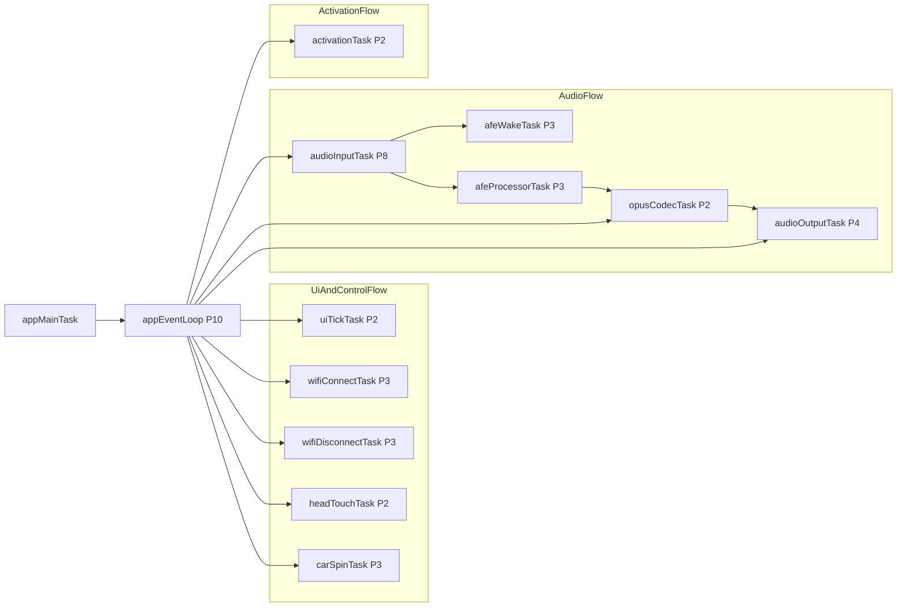
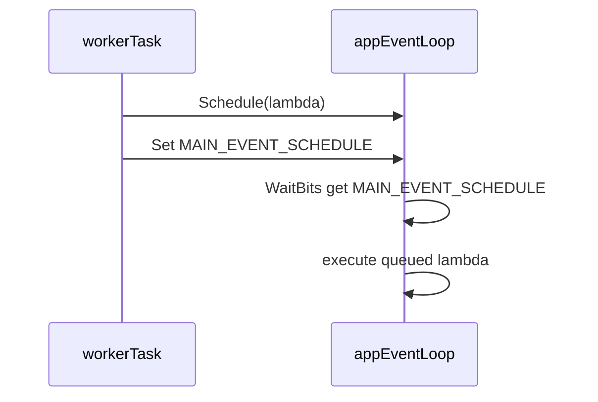
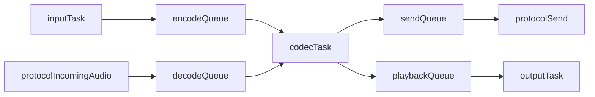

# desktop-pet 任务拓扑与通信说明

本文聚焦 `desktop-pet` 板型，回答 4 个问题：

- 运行时通常有哪些任务
- 任务在哪里创建
- 优先级如何分层
- 任务之间如何通信

## 0. 前置术语速查（先看这段再看任务表）

### 0.1 I2S 是什么

- `I2S`（Inter-IC Sound）是数字音频总线，用于在 MCU 与音频 Codec 之间传输实时音频流。
- 常见信号：`MCLK`、`BCLK`、`WS(LRCK)`、`DIN`、`DOUT`。
- 在本工程中：用于麦克风采集与喇叭播放的数据通道。

### 0.2 I2C 和 I2S 的区别

- `I2C`：控制总线（寄存器配置、状态读取），两线 `SCL/SDA`。
- `I2S`：音频数据总线（连续音频流），多线时钟+数据。
- 在本工程中：`I2C` 用来配置 ES8311，`I2S` 用来传输音频数据。

### 0.3 Codec 是什么

- `Codec` = `Coder/Decoder`，音频编解码器芯片/驱动。
- 作用：完成模拟/数字音频转换（ADC/DAC）与音频接口对接。
- 本工程 desktop-pet 使用 `ES8311`（驱动类为 `Es8311AudioCodec`）。

### 0.4 PCM 是什么（是不是数字信号）

- `PCM`（Pulse Code Modulation）是**未压缩数字音频采样**，是数字信号。
- 典型格式：`16kHz / 16bit / mono`（本工程语音链路常用）。
- 可以理解为“原始音频样本数组”。

### 0.5 Opus 是什么

- `Opus` 是实时语音常用的音频压缩编码格式（编解码器）。
- 上行：`PCM -> Opus`（减小带宽）；下行：`Opus -> PCM`（还原播放）。
- 优点：低延迟、低码率语音质量好、适合网络抖动场景。

### 0.6 AFE 处理器是什么

- `AFE`（Audio Front-End）是语音前端处理模块。
- 在本工程中对应 `AfeAudioProcessor`，运行于独立任务 `audio_communication`。
- 主要职责：
  - `VAD`：判断是否有人声（说话/静音）
  - `AEC`：回声消除
  - `NS`：噪声抑制
- 位置：`main/audio/processors/afe_audio_processor.cc`
- 在链路中的位置：`AudioInputTask` 读到 PCM 后先喂 AFE，再进入后续编码/发送流程。

### 0.7 一句话链路

`MIC(模拟) -> Codec ADC -> PCM(数字原始) -> Opus编码 -> 网络 -> Opus解码 -> PCM -> Codec DAC -> Speaker`

## 1. 主干任务清单（desktop-pet）

> 说明：部分任务按条件或按需创建（例如 WiFi 配网、MCP 控车、激活流程）。

| 任务名 | 优先级 | 创建位置 | 作用 | 具体在做什么 |
|---|---:|---|---|---|
| `main`（App 主循环） | `10`（运行时提升） | `main/main.cc` + `main/application.cc` | 事件总线分发、状态机驱动、主线程调度 | 等待 `MAIN_EVENT_*`，按位调用 `HandleXXX`，并执行 `Schedule` 投递回调 |
| `audio_input` | `8` | `main/audio/audio_service.cc` | 采麦、喂唤醒/处理器、产出待编码 PCM | 从 Codec 读 PCM，喂 `wake_word`/`audio_processor`，将编码任务推入 `audio_encode_queue_` |
| `audio_output` | `4` | `main/audio/audio_service.cc` | 消费播放队列，驱动 Codec 输出 | 从 `audio_playback_queue_` 取 PCM，调用 `codec->OutputData()` 播放 |
| `opus_codec` | `2` | `main/audio/audio_service.cc` | 上行编码 + 下行解码 | 编码：PCM -> OPUS 放 `audio_send_queue_`；解码：OPUS -> PCM 放 `audio_playback_queue_` |
| `activation` | `2` | `main/application.cc` | 网络连上后的激活流程 | 执行设备激活/注册逻辑，完成后通知主循环进入后续状态 |
| `audio_communication`（AFE 处理） | `3` | `main/audio/processors/afe_audio_processor.cc` | VAD/降噪/AEC 处理任务 | `fetch` AFE 帧，检测 `vad_state` 变化并输出处理后音频帧 |
| `audio_detection`（AFE 唤醒） | `3` | `main/audio/wake_words/afe_wake_word.cc` | 唤醒检测任务 | 持续跑唤醒模型，命中后回调上报唤醒词，并维护唤醒前缓存 |
| `head_touch` | `2` | `main/boards/desktop-pet/touch.cc` | 摸头传感器轮询与上报 | 轮询 GPIO 电平并做触发判断，驱动上层互动事件 |
| `wifi_connect_task` | `3` | `main/boards/desktop-pet/ui/ui_wifi.cc` | UI 发起的 WiFi 连接 | 执行连接流程，回写连接状态，避免阻塞 UI 线程 |
| `wifi_disc` | `3` | `main/boards/desktop-pet/ui/ui_wifi.cc` | UI 发起的 WiFi 断开 | 执行断网流程，更新 UI 状态 |
| `ui_tick_task` | `2` | `main/boards/desktop-pet/ui/action.cc` | UI 周期刷新 | 周期执行 UI 侧 tick/轮询逻辑，与 LVGL 主流程配合 |
| `LedEvent` | `tskIDLE_PRIORITY+2`（未启用） | `main/led/gpio_led.cc` | LED 事件处理 | `desktop-pet` 当前为 `BUILTIN_LED_GPIO=GPIO_NUM_NC`，实际走 `NoLed`，通常不会创建该任务 |
| `car_spin`（按需） | `3` | `main/boards/desktop-pet/desktop_pet.cc` | MCP 触发的低速转圈控制 | 循环下发左/右转和停止命令，按 `on/off` 时序实现慢速转圈 |

## 2. 任务拓扑图（谁和谁交互）

说明：子图仅用于分组阅读，不表示父子任务关系；是否存在关系只以连线为准。

## 3. 优先级分层（为什么这样配）

- **P10 主循环**：统一处理状态切换、事件分发，保证系统行为一致。
- **P8 音频输入**：采集链路最怕丢帧，优先级最高（除主循环）。
- **P4/P2 音频输出与编解码**：保证播放连续，同时给主循环留余量。
- **P3 功能任务**：WiFi UI、AFE 处理、控制类任务，次高但不抢主音频。
- **P2/Idle+2 辅助任务**：激活、UI tick、LED 等后台逻辑。

## 4. 任务通信机制（最关键）

### 4.1 EventGroup：系统主事件总线

`Application` 通过 `xEventGroupSetBits()` 发事件，在 `Run()` 中 `xEventGroupWaitBits()` 统一消费。

- 典型事件：`MAIN_EVENT_SEND_AUDIO`、`MAIN_EVENT_WAKE_WORD_DETECTED`、`MAIN_EVENT_STATE_CHANGED`、`MAIN_EVENT_NETWORK_CONNECTED` 等。
- 好处：跨线程解耦，所有关键状态变更回到主循环裁决。

### 4.2 Schedule 主线程投递

外部线程不直接改 UI/主状态，而是调用 `Application::Schedule(...)` 投递回调；主循环在 `MAIN_EVENT_SCHEDULE` 分支中串行执行。

### 4.3 音频内部队列 + 条件变量

音频 3 任务之间用 `std::deque + std::condition_variable` 做生产者-消费者：

- `audio_encode_queue_`
- `audio_send_queue_`
- `audio_decode_queue_`
- `audio_playback_queue_`

## 5. 关键创建点速查

- 主循环：`main/main.cc` -> `app.Initialize()` -> `app.Run()`
- 音频任务：`main/audio/audio_service.cc` `AudioService::Start()`
- 激活任务：`main/application.cc` `HandleNetworkConnectedEvent()`
- AFE 处理任务：`main/audio/processors/afe_audio_processor.cc`
- AFE 唤醒任务：`main/audio/wake_words/afe_wake_word.cc`
- 桌宠触摸任务：`main/boards/desktop-pet/touch.cc`
- 桌宠 WiFi UI 任务：`main/boards/desktop-pet/ui/ui_wifi.cc`
- 桌宠 UI Tick 任务：`main/boards/desktop-pet/ui/action.cc`
- 桌宠控车任务：`main/boards/desktop-pet/desktop_pet.cc`

## 6. 学习建议（按阅读顺序）

1. 先读 `main/application.cc` 的 `Run()`，建立事件分发主线。
2. 再读 `main/audio/audio_service.cc`，吃透 3 任务 + 4 队列。
3. 再读 `afe_audio_processor.cc` 和 `afe_wake_word.cc`，理解前端音频处理。
4. 最后回看 `desktop-pet` 板级任务（触摸、WiFi UI、控车）如何挂接主循环。

## 7. 每个任务具体做什么（desktop-pet）

### 7.1 `main` / `app.Run()`（P10）

- 持续 `xEventGroupWaitBits()` 等待系统事件位。
- 按事件分发到 `HandleNetworkConnectedEvent/HandleStateChangedEvent/HandleWakeWordDetectedEvent/...`。
- 在 `MAIN_EVENT_SEND_AUDIO` 分支里从 `audio_send_queue_` 取包并调用 `protocol->SendAudio()`。
- 在 `MAIN_EVENT_SCHEDULE` 分支执行其他线程投递的主线程回调（UI/状态安全更新）。

### 7.2 `audio_input`（P8）

- 持续从 `AudioCodec::Read()` 采集麦克风 PCM。
- 在开启唤醒时喂 `wake_word_->Feed(...)`，触发唤醒检测。
- 在开启音频处理时喂 `audio_processor_->Feed(...)`，拿处理后 PCM。
- 将待编码 PCM 压入 `audio_encode_queue_`，交给 `opus_codec` 编码。

### 7.3 `opus_codec`（P2）

- 从 `audio_encode_queue_` 取 PCM，调用 `esp_opus_enc_process` 编码，上行放入 `audio_send_queue_`。
- 从 `audio_decode_queue_` 取 OPUS，调用 `esp_opus_dec_decode` 解码，下行放入 `audio_playback_queue_`。
- 负责“上行编码 + 下行解码”双向转换，是音频中枢任务。

### 7.4 `audio_output`（P4）

- 从 `audio_playback_queue_` 取解码后的 PCM。
- 调用 `codec_->OutputData(...)` 推给喇叭/功放输出。
- 维护播放时的时间戳队列辅助信息（用于 AEC 对齐场景）。

### 7.5 `activation`（P2，按需）

- 网络首次连通后启动激活流程。
- 执行设备注册/激活检查并在完成后置位 `MAIN_EVENT_ACTIVATION_DONE`。
- 激活成功后主循环继续协议初始化和待机态流程。

### 7.6 `audio_communication`（P3，AFE 处理）

- 周期 `fetch` AFE 输出帧，执行本地 VAD/AEC/NS 后处理。
- 检测 `VAD_SPEECH/VAD_SILENCE` 变化，通过回调上报语音状态变化。
- 将处理后的有效 PCM 送回音频服务后续编码链路。

### 7.7 `audio_detection`（P3，AFE 唤醒）

- 持续运行唤醒词检测模型（Wakenet）。
- 检测到唤醒词后保存命中词并回调 `on_wake_word_detected`。
- 维护唤醒前音频缓存（供可选“唤醒片段上送”使用）。

### 7.8 `head_touch`（P2）

- 轮询触摸 GPIO 电平，做简单消抖/状态判断。
- 触发桌宠互动入口（如摸头事件）并驱动上层行为变化。

### 7.9 `wifi_connect_task` / `wifi_disc`（P3，按需）

- 由 UI 点击触发创建。
- 分别执行 WiFi 连接和断开流程，更新连接状态文案。
- 避免在 UI 线程中执行阻塞网络操作。

### 7.10 `ui_tick_task`（P2）

- 周期执行 UI 侧逻辑刷新（如动画/状态轮询扩展）。
- 与 LVGL 主流程配合，承载非中断式 UI 周期任务。

### 7.11 `LedEvent`（Idle+2）

- 处理 LED 亮灭/闪烁事件。
- 配合 `esp_timer` 与 PWM（LEDC）实现呼吸灯、状态灯效果。

### 7.12 `car_spin`（P3，按需）

- 由 MCP 工具触发后创建，循环发送“左转/右转 + 停止”串口控制命令。
- 根据 `on_ms/off_ms` 参数形成低速转圈动作。
- 收到 `stop` 或运行标志清零后退出并自删任务。

